# 原理图与PCB快速预览

预览提取自本次原生工程内的缓存图，供辨认页面和元件位置；高倍率查线以EDA工程和网表为准。

## 前面板PCB

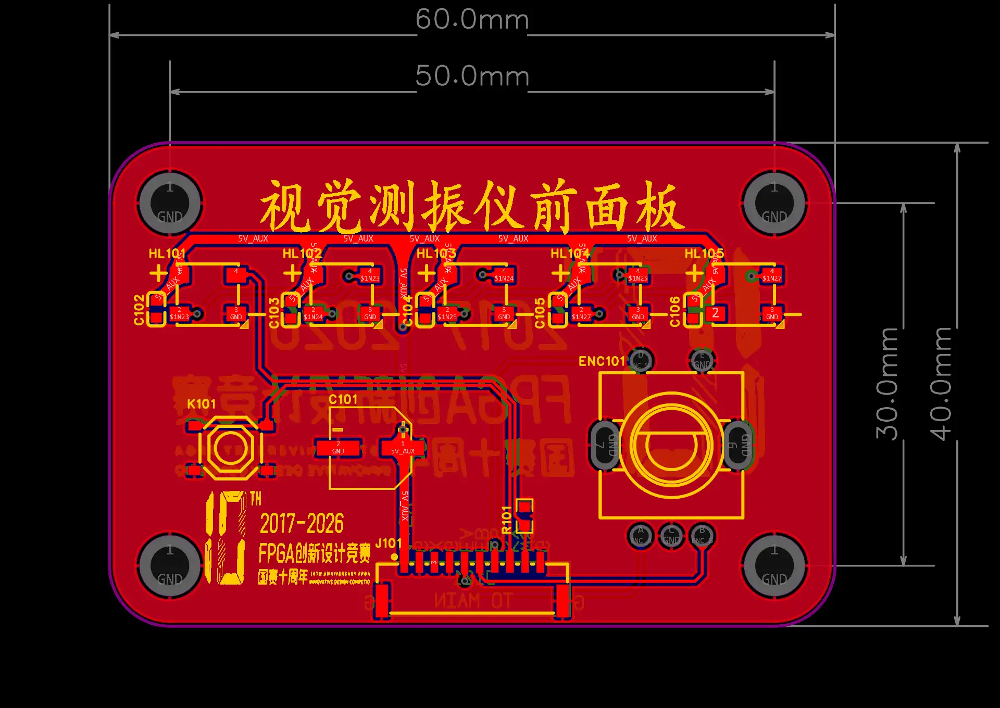

## 主载板PCB

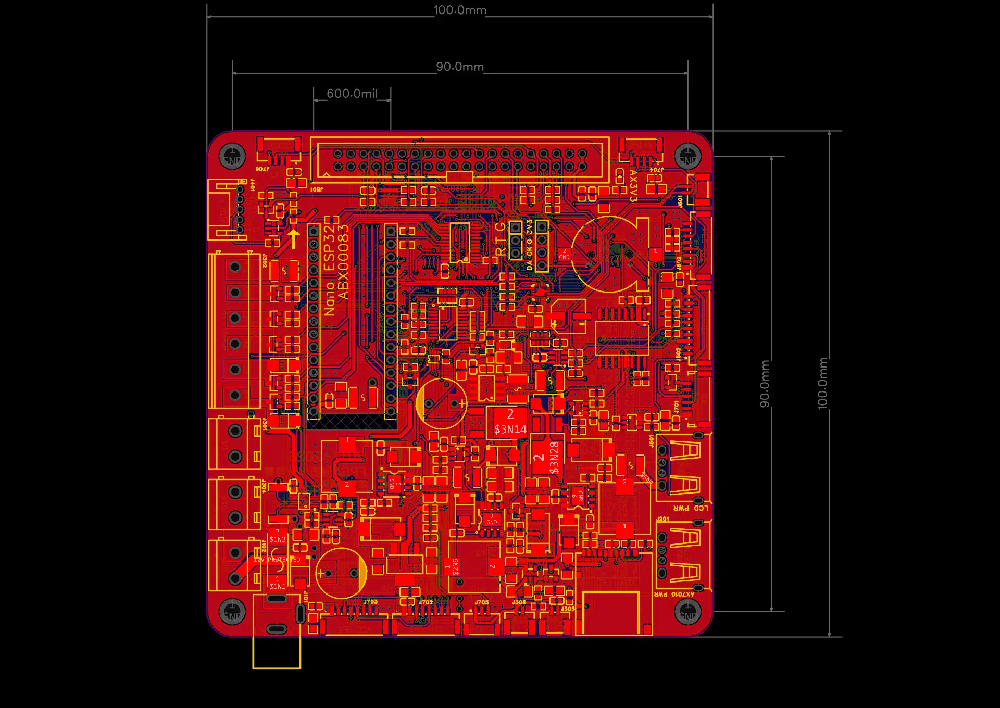

## 前面板_前面板操作与状态显示

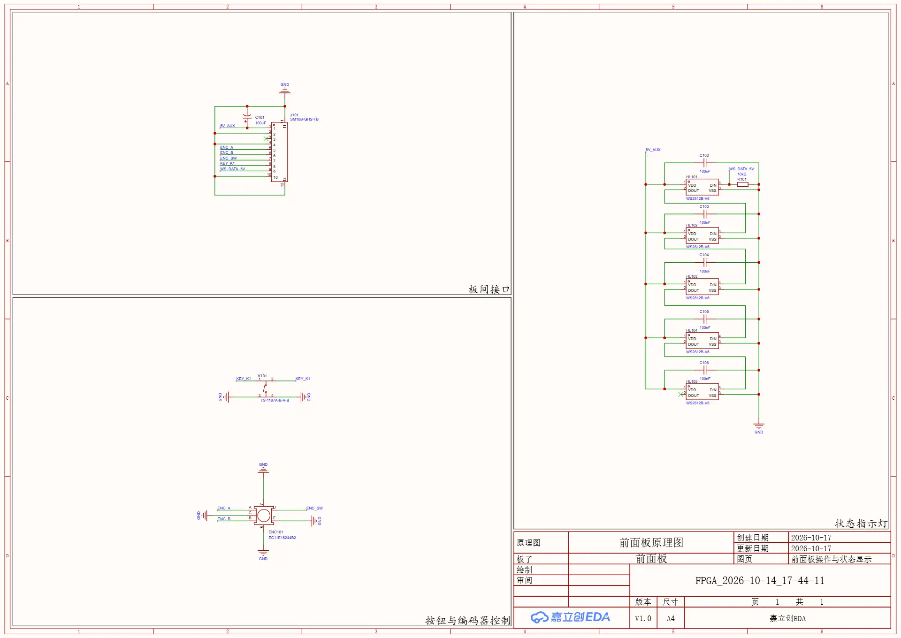

## 主载板_电源输入与监测

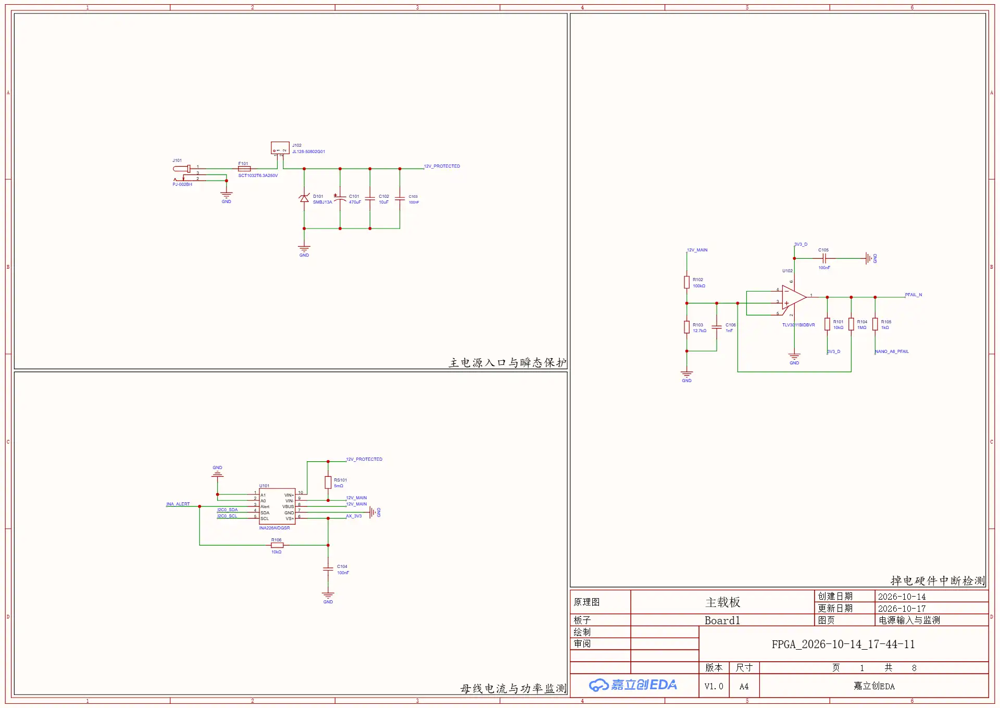

## 主载板_电源转换与分配

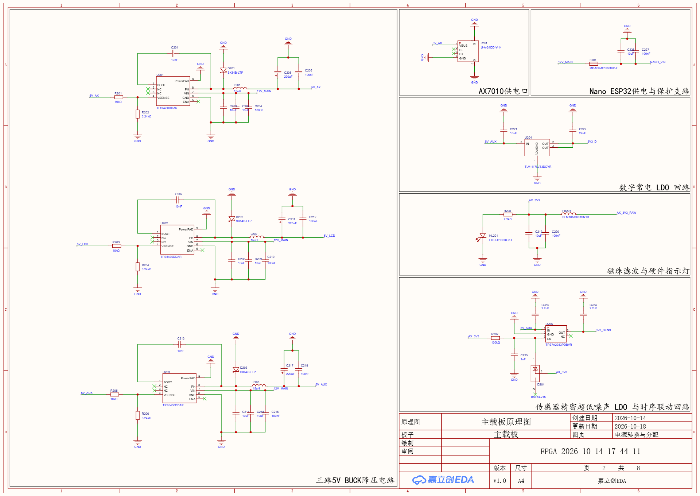

## 主载板_补光与负载驱动

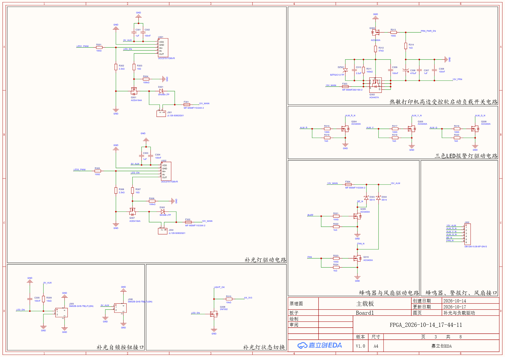

## 主载板_跨域接口与打印通信

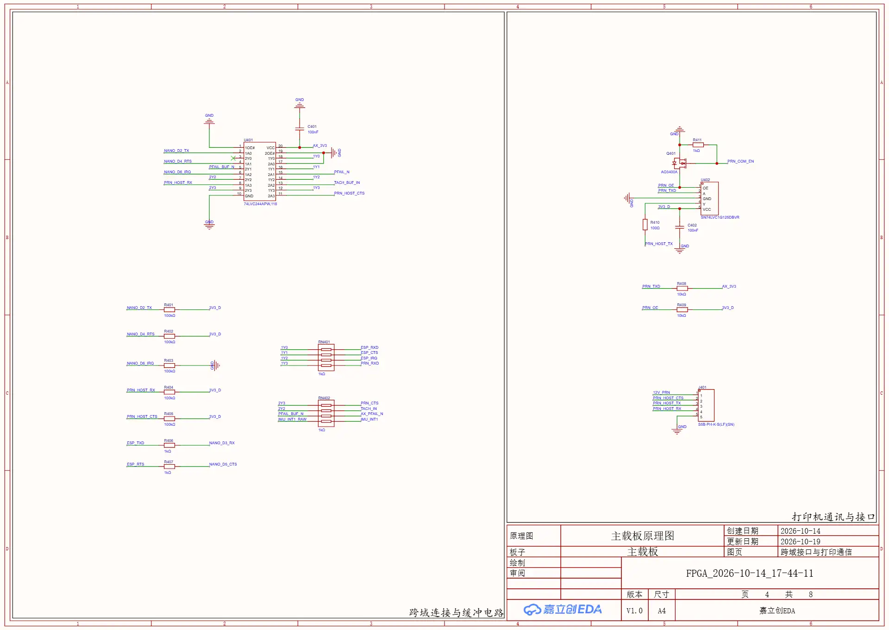

## 主载板_屏幕与前面板接口

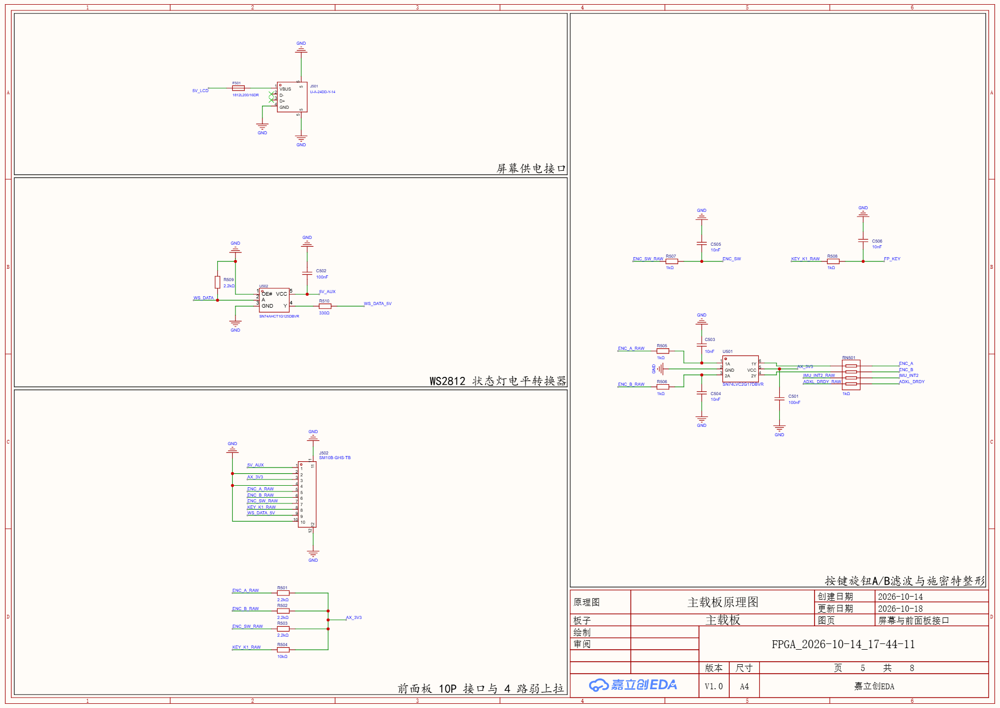

## 主载板_Nano 与辅助外设

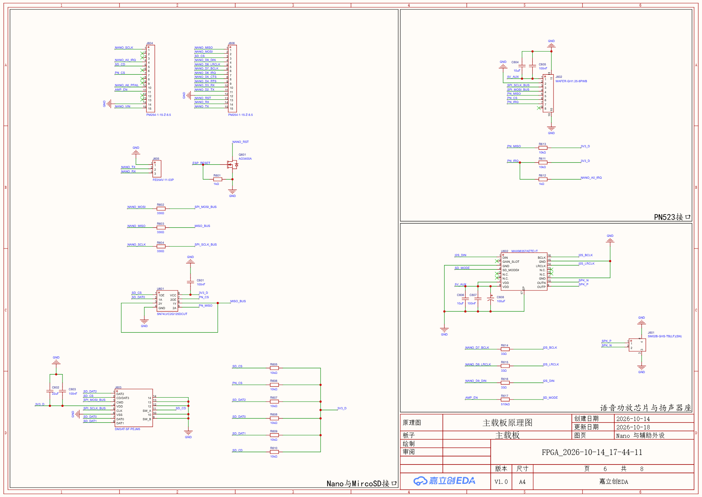

## 主载板_传感器与扩展接口

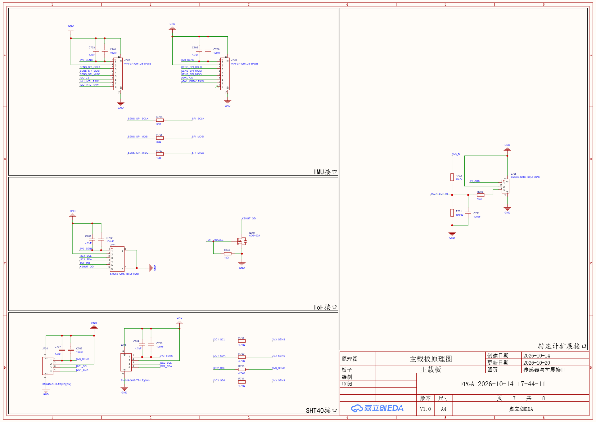

## 主载板_板内管理与主控连接

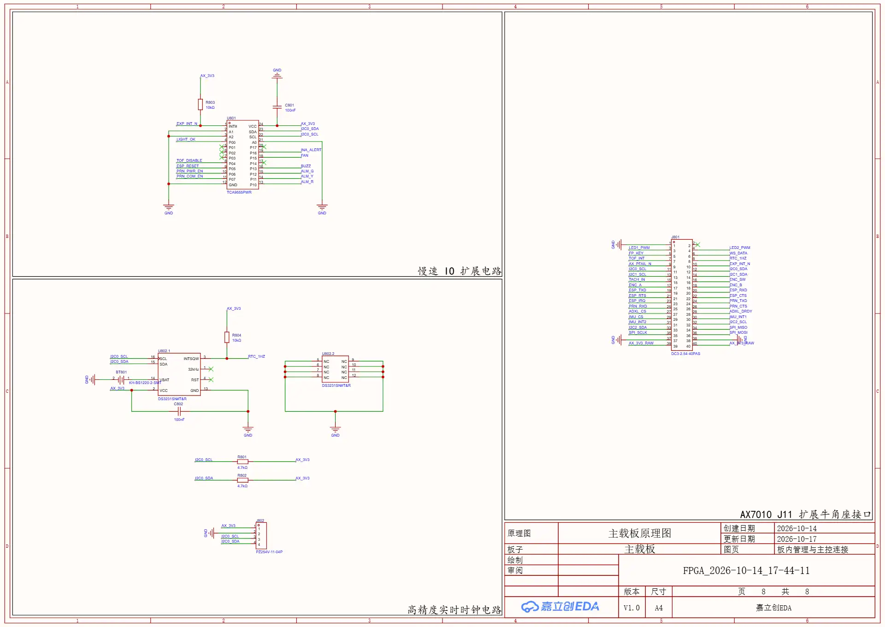

