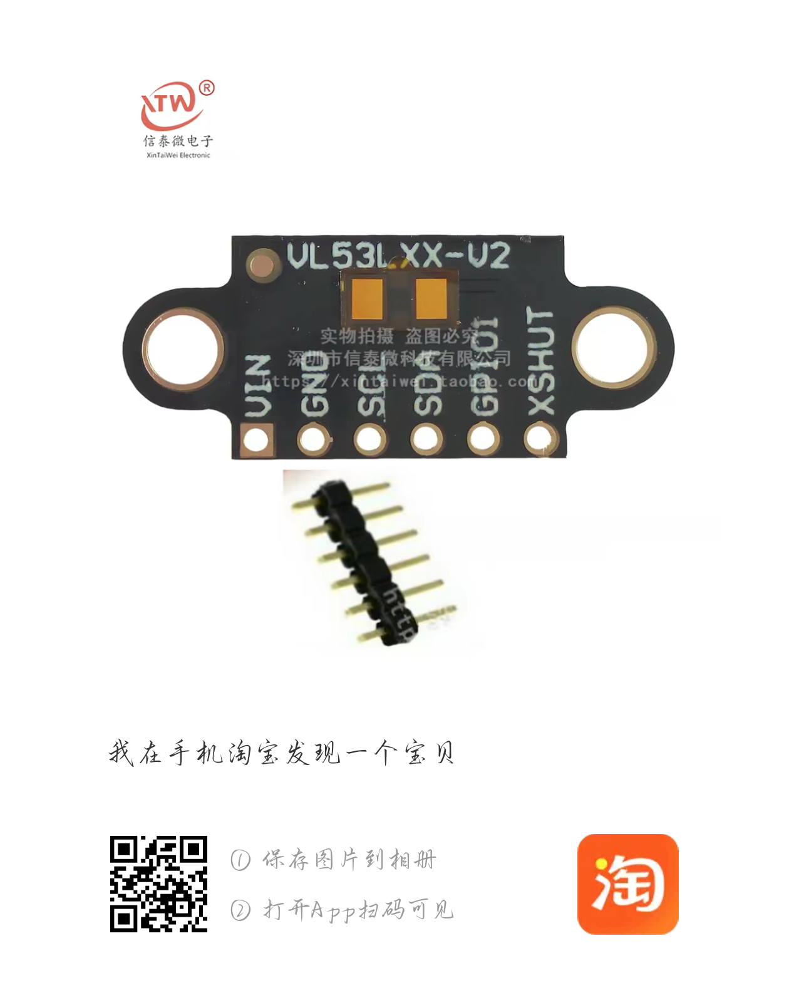
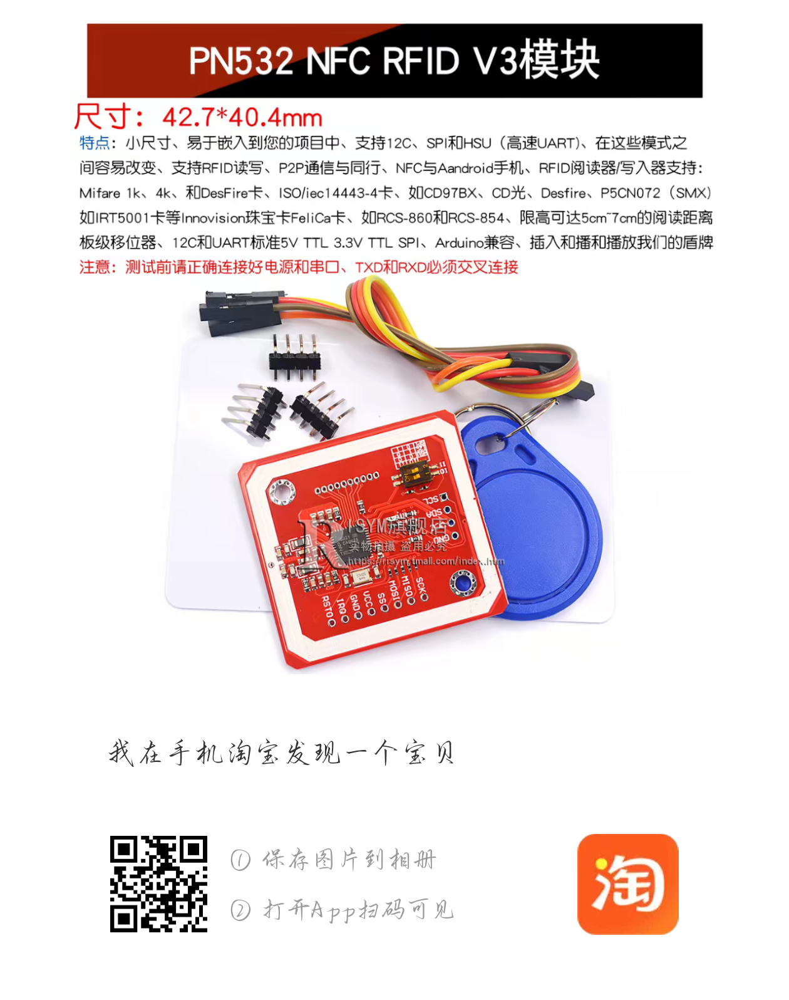
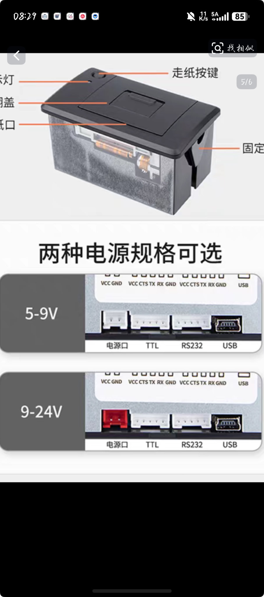
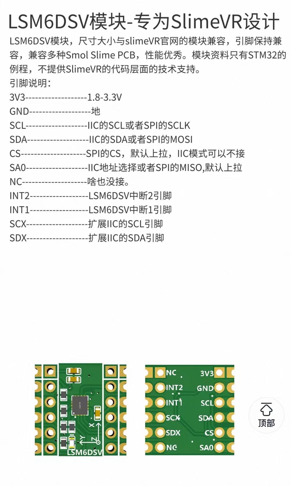
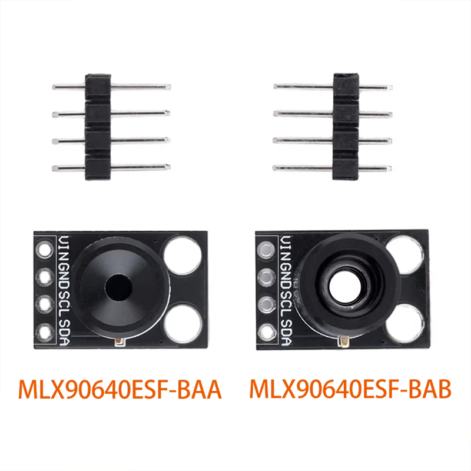
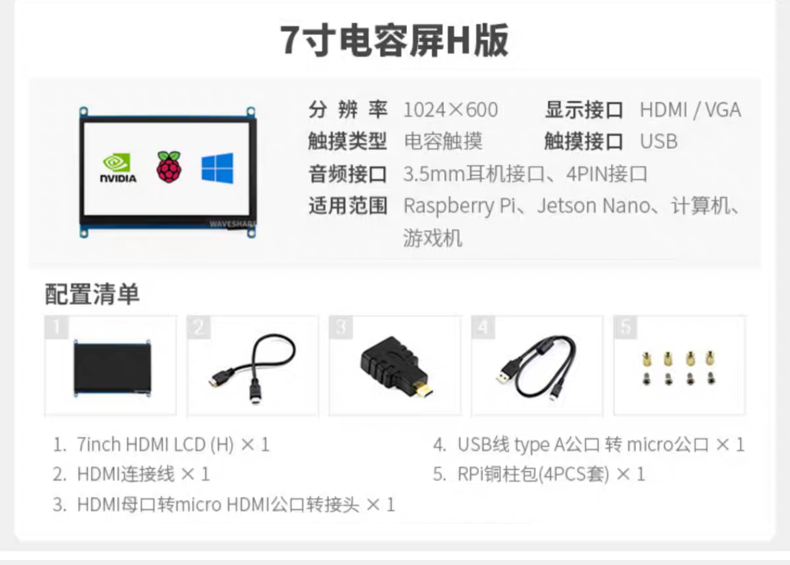
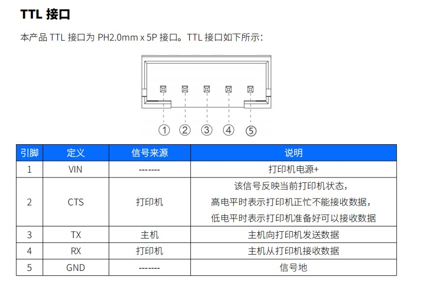
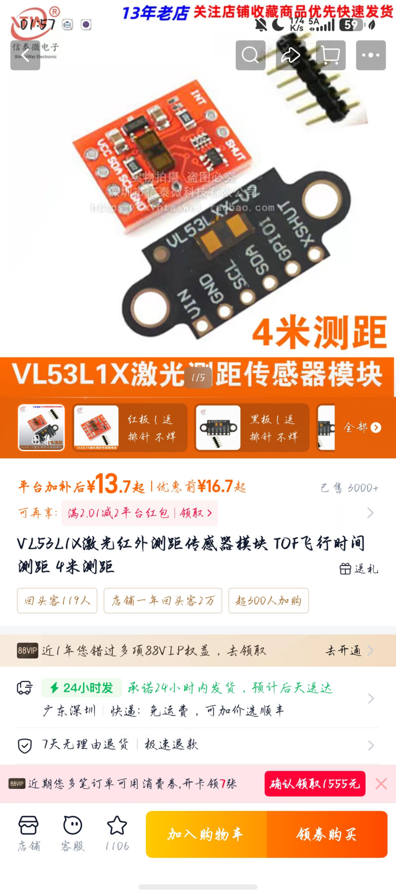
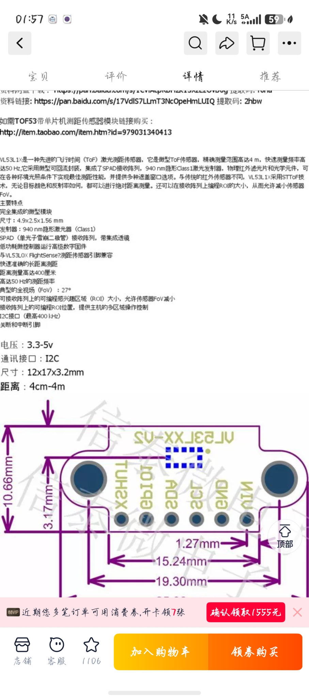
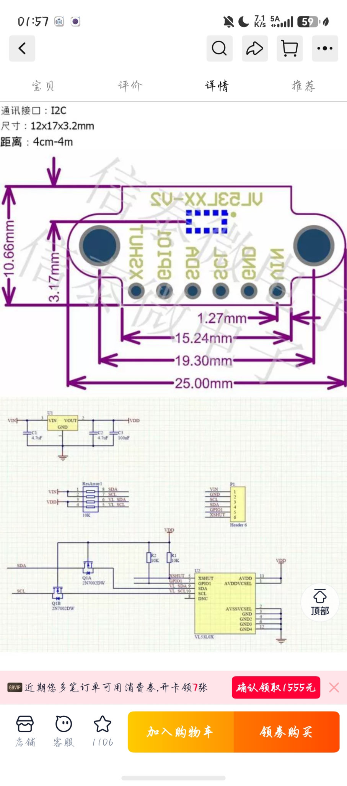

# 模块与接口图片

从本次对话附件缓存恢复，未裁剪或重新编码。微信原临时目录已不存在。保留原始文件名作为来源标识；缓存副本的分辨率以文件实际尺寸为准。

## 01_TOF模块早期图片

原文件名：`4bfc723bdf8549882703e2b211d3ac97.png`

## 02_PN532模块

原文件名：`1a535ca724089ea59e4ae6d44715c91d.png`

## 03_打印机外观及供电版本

原文件名：`435fbe4091f7843d07f0ff69ecb3f70e.jpg`

## 04_LSM6DSV模块及引脚

原文件名：`aeecbbad4e9c8849b75b28344e6e5fe5.jpg`

## 05_热成像模块参考_首版不装

原文件名：`a4034315c6f46f4279a950c386b1ea76.png`

## 06_HDMI屏规格

原文件名：`d8867248205ddc06c9cd69bf70868289.png`

## 07_打印机TTL五针定义

原文件名：`aa1f68b325e5f7b64e40d743049ef1d4.jpg`

## 08_TOF商品页

原文件名：`bdaf0a1262bb6442cf6c3b8f75b41e97.jpg`

## 09_TOF规格及尺寸

原文件名：`d1b04c29de79b42bbe0c54baf69c23e7.jpg`

## 10_TOF模块参考电路

原文件名：`80bb49c32f8b586a080745d9c0a48508.jpg`

## 11_TOF最终选定模块

原文件名：`aebb84c46a9b4f33759d4381ee087f67.jpg`

