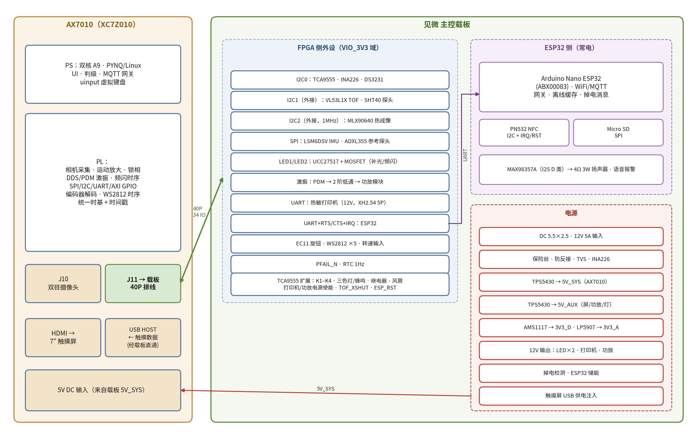
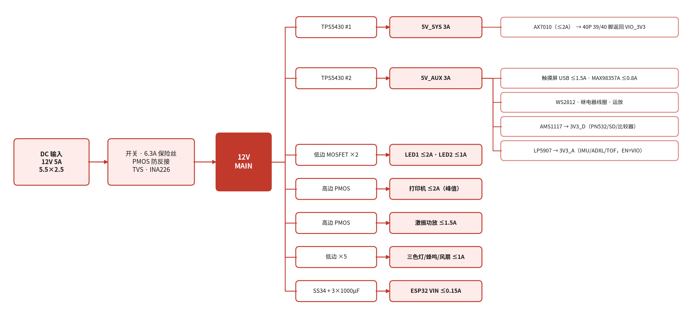
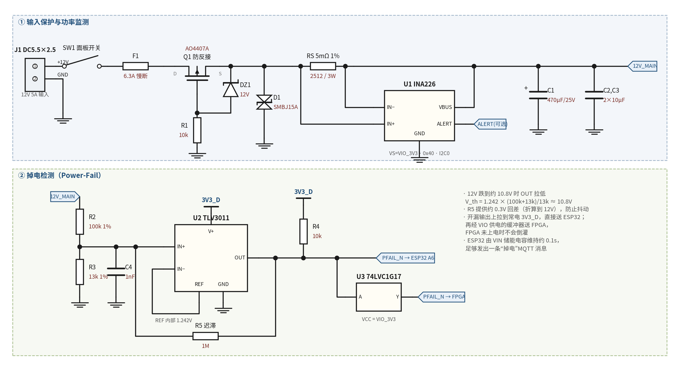
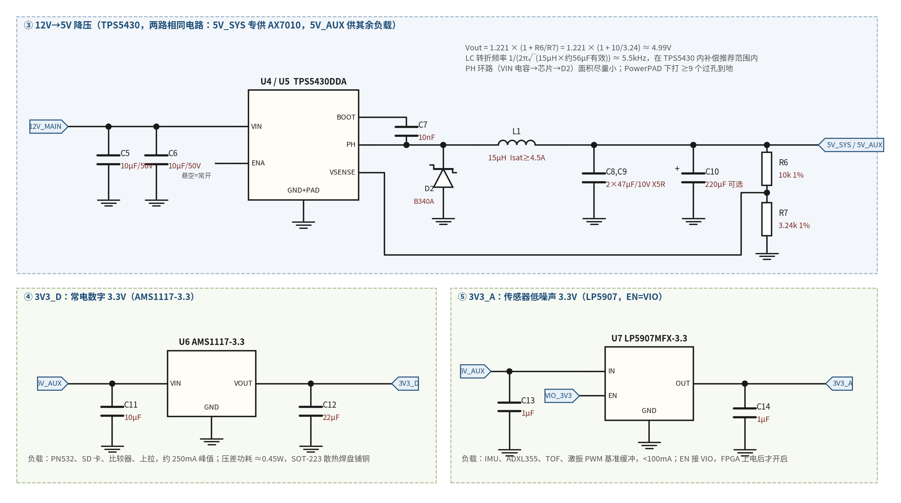
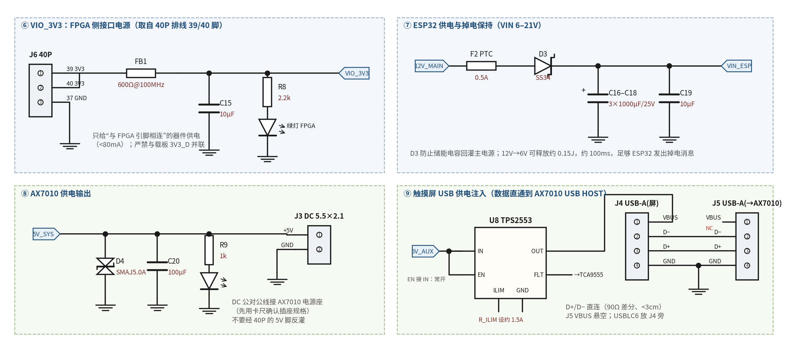
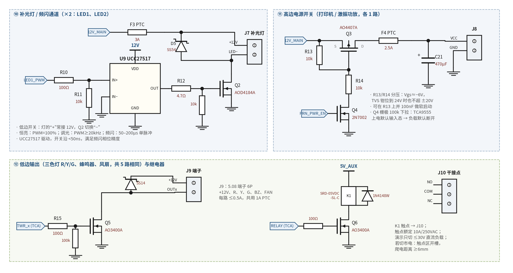
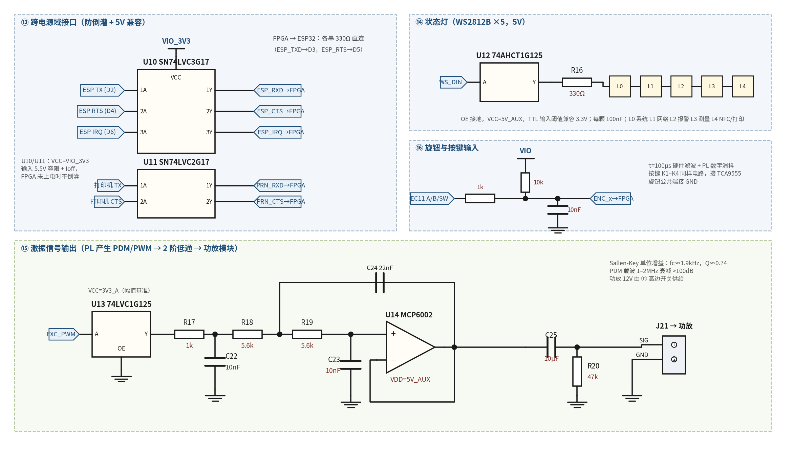
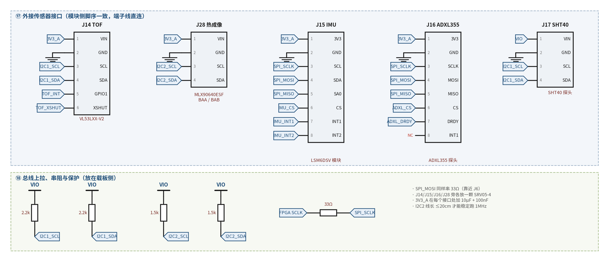
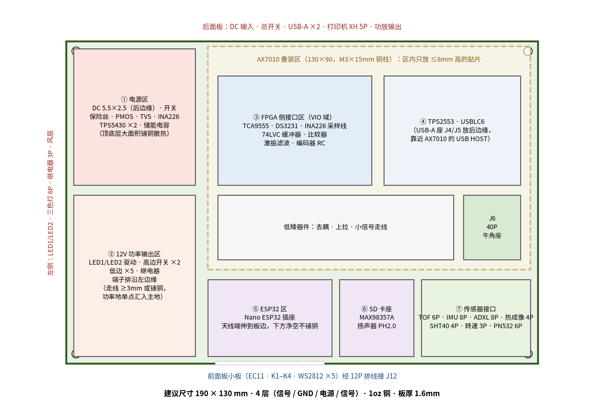

# 见微：实时运动放大视觉测振仪 — 主控载板原理图设计方案（V1.1）

> 全国大学生嵌入式芯片与系统设计竞赛'2026 · FPGA 创新设计赛道（AMD）
> 主控：ALINX AX7010（XC7Z010-1CLG400）· 协处理器：Arduino Nano ESP32（ABX00083）· 编制日期：2026 年 10 月

**目录**：1 设计概述 · 2 系统架构 · 3 电源设计 · 4 12V 负载驱动 · 5 主控接口分配 · 6 外设电路 · 7 连接器总表 · 8 BOM · 9 PCB 设计要点 · 10 上电调试顺序 · 11 待确认事项

## 1  设计概述

### 1.1 载板的定位

载板是 AX7010 的“底座”：AX7010 用铜柱叠装在载板上方，两者之间只有 **一根 40P 排线** 和 **一根 5V 电源线**。双目摄像头仍插在 AX7010 的另一个 40P 扩展口上，HDMI 触摸屏直接接 AX7010 的 HDMI 口。载板负责以下几件事：

- **电源**：从一个 12V 5A 输入，产生 AX7010、屏幕、ESP32、传感器和各路 12V 负载需要的全部电源，带保护、功率监测和掉电检测。
- **FPGA 侧外设**：需要精确时序或高速的外设直接接 FPGA 引脚，包括 IMU、参考加速度计、热成像、补光/频闪灯、激振信号、旋钮、状态灯和转速输入。
- **ESP32 侧外设**：联网、NFC、SD 卡和语音报警交给 ESP32，减少 FPGA 的 IO 和软件负担，并且在 FPGA 掉电时 ESP32 仍能工作。
- **执行与报警**：三色报警灯、蜂鸣器、继电器干接点、风扇、热敏打印机。

### 1.2 需求对照

| 需求 | 本方案的实现 | 章节 |
|---|---|---|
| 12V 5A，DC 5.5×2.5 输入 | J1 + 面板开关 + 6.3A 慢断保险丝 + PMOS 防反接 + TVS + INA226 功率监测 | 3.3 |
| LED 补光灯 12V 供电 | 2 路低边 MOSFET 通道（UCC27517 驱动），支持恒亮、20kHz 调光和 50µs 级频闪 | 4.1 |
| AX7010 供电 | 独立一路 TPS5430 → 5V_SYS，经 DC 线接 AX7010 电源座 | 3.4 |
| TOF 接口 | XH2.54 6P，脚序与 VL53LXX-V2 模块一致（VIN GND SCL SDA GPIO1 XSHUT） | 6.1 |
| PN532 NFC 接口 | 接 ESP32 的 I2C，4P（与模块 I2C 排针同序）+ 2P（IRQ、RSTO） | 6.7 |
| 热敏打印机（12V，XH2.54 TTL 5P） | VCC 由高边开关供 12V；TX/RX 交叉并留 0Ω 互换位；输入经 5V 容限缓冲器 | 4.3 |
| ESP32 开发板 ABX00083 | 标准 Nano 插座；VIN 由 12V 经二极管和储能电容供电，掉电后还能发出消息 | 5 |
| 按钮、旋钮控制 HDMI 屏幕 | 面板小板（EC11 + 4 键 + WS2812），PL 解码后由 PS 用 uinput 模拟键盘 | 6.10 |
| 扬声器语音报警 | ESP32 I2S → MAX98357A → 4Ω 3W 扬声器，语音文件放在 SD 卡里 | 6.9 |
| LED 状态以及报警 | 5 颗 WS2812 状态灯 + 三色报警灯/蜂鸣器 12V 输出 + 各电源轨指示灯 | 4.4、6.10 |
| 温湿度传感 | SHT40 外接探头（I2C1），可贴近被测结构做频率温度补偿 | 6.4 |
| 相机 IMU | LSM6DSV 模块，SPI 接 FPGA；载板留模块焊位，也可用 8P 线装到相机支架上 | 6.2 |
| 热成像摄像头接口 | MLX90640（BAA/BAB）模块，独立 I2C2 跑 1MHz；XH2.54 4P 脚序与模块一致（VIN GND SCL SDA） | 6.13 |
| SD 卡 | Micro SD 自弹座，接 ESP32 SPI，用于离线缓存和语音文件 | 6.8 |
| RTC | DS3231SN（±2ppm 温补晶振）+ CR1220；1Hz 方波送 FPGA 校准统一时基 | 6.5 |
| 其他有意义的部分 | 掉电检测、功率监测、继电器联动、激振信号输出、转速输入、触摸屏 USB 供电注入、风扇 | 3–6 |

### 1.3 关键设计决策

| 决策 | 原因 |
|---|---|
| AX7010 和其他负载用两路独立 5V | 屏幕、功放、继电器的电流突变不会影响 FPGA；AX7010 单独限流，最容易排查问题 |
| FPGA 侧外设由 40P 排线上的 3.3V（VIO）供电 | 保证与 FPGA 的 IO 同时上电、同时断电，避免 FPGA 未上电时被外部信号倒灌 |
| ESP32 常电，并有约 100ms 储能 | FPGA 掉电、重启时网络不中断；断电瞬间还能发出“设备掉电”消息 |
| 慢速 IO 交给 TCA9555 扩展 | 按键、报警灯、继电器、电源使能不需要高速，挪到 I2C 扩展后，40P 的 34 个 IO 正好够用（含热成像专用 I2C） |
| I2C 分为板内（I2C0）、外接（I2C1）、热成像专用（I2C2）三条 | 外接线缆出问题不影响板上的按键扩展和 RTC；热成像每帧数据量大，单独一条总线才能跑 1MHz |
| 高边开关控制打印机和功放电源 | 可以按功耗预算主动关断大负载（见 3.2 负载管理） |
| 所有负载默认关断 | TCA9555 上电默认是输入态；所有 MOSFET 栅极都有下拉，FPGA 程序没跑起来时不会误动作 |

## 2  系统架构



*图 2-1  系统框图：AX7010 + 见微主控载板*

### 2.1 分工

| 部分 | 负责内容 | 为什么放在这里 |
|---|---|---|
| PL（FPGA） | 相机采集、运动放大、锁相；激振 PDM、频闪时序；SPI/I2C/UART 控制器；编码器解码、WS2812 时序；统一时基与时间戳 | 要求纳秒到微秒级确定时序，或者数据量大 |
| PS（ARM + Linux） | 界面、振动判级、事件录像、MQTT 网关；把旋钮和按键转成 Linux 键盘事件 | 逻辑复杂、要跑 Python 或 Linux 驱动 |
| ESP32 | WiFi/MQTT、PN532 读卡、SD 卡离线缓存、I2S 语音播放、掉电消息 | 联网和慢速外设，独立供电，故障隔离 |
| 载板 | 电源、保护、电平和电源域隔离、功率驱动、全部外部接口 | — |

### 2.2 信号通路一览

| 总线 | 主机 | 从设备 | 速率 |
|---|---|---|---|
| I2C0（板内） | PL · AXI IIC | TCA9555（0x20）、INA226（0x40）、DS3231（0x68） | 400kHz |
| I2C1（外接） | PL · AXI IIC | VL53L1X TOF（0x29）、SHT40（0x44） | 100–400kHz |
| I2C2（外接） | PL · AXI IIC | MLX90640 热成像（0x33） | 1MHz（FM+） |
| SPI | PL · AXI Quad SPI 或自定义（带时间戳） | LSM6DSV IMU、ADXL355 参考探头（各自 CS） | ≤8MHz |
| UART1 | PL · AXI UART16550（带 RTS/CTS） | ESP32（D2/D3/D4/D5） | 921600–2M |
| UART2 | PL · AXI UART16550 | 热敏打印机（TX、RX、CTS） | 按打印机，常见 9600/115200 |
| ESP32 I2C | ESP32 | PN532（0x24） | 100kHz |
| ESP32 SPI | ESP32 | Micro SD | ≤20MHz |
| ESP32 I2S | ESP32 | MAX98357A | 16kHz/16bit 语音 |

## 3  电源设计



*图 3-1  电源树*

### 3.1 电源轨定义

| 电源轨 | 来源 | 额定 | 供电对象 | 何时有电 |
|---|---|---|---|---|
| 12V_MAIN | J1 经保护电路 | 5A（适配器） | 全部负载的总线 | 插上电源、打开开关 |
| 5V_SYS | TPS5430 #1 | 3A | 仅 AX7010（经 DC 线） | 同上 |
| 5V_AUX | TPS5430 #2 | 3A | 触摸屏 USB、MAX98357A、WS2812、继电器线圈、运放、两颗 LDO | 同上 |
| 3V3_D | AMS1117-3.3（取自 5V_AUX） | ≈250mA | PN532、SD 卡、掉电比较器、PFAIL 上拉 | 常电 |
| VIO_3V3 | AX7010 40P 的 39/40 脚 | <80mA | 所有与 FPGA 引脚相连的器件：TCA9555、DS3231、INA226、I2C 上拉、74LVC 缓冲器、编码器上拉 | AX7010 上电后 |
| 3V3_A | LP5907-3.3（取自 5V_AUX，EN=VIO） | 250mA | LSM6DSV、ADXL355、TOF 模块、MLX90640 热成像、激振 PWM 缓冲器 | AX7010 上电后 |
| VIN_ESP | 12V_MAIN → PTC → SS34 → 3×1000µF | 0.5A | Nano ESP32 的 VIN | 常电，掉电后可保持约 100ms |

> **注意**　VIO_3V3 只“取用”AX7010 的 3.3V，绝对不能和载板自己的 3V3_D 连在一起。两个稳压器输出并联会互相倒灌。

### 3.2 功耗预算与负载管理

| 负载 | 典型（A，12V 侧） | 峰值（A，12V 侧） | 说明 |
|---|---|---|---|
| AX7010（5V_SYS） | 0.57 | 0.95 | 5V×1.2A 典型，2A 上限，效率按 88% 估 |
| 5V_AUX 全部 | 0.57 | 1.20 | 屏 0.8–1.5A、功放峰值 0.8A、WS2812 0.2A 等 |
| LED1 补光灯 | 1.00 | 2.00 | 由灯具功率决定 |
| LED2（第二路/红外） | 0 | 1.00 | 可选 |
| 热敏打印机 | 0.05 | 2.00 | 打印时平均约 1A，深色区有脉冲 |
| 激振功放 | 0.50 | 1.50 | 10W 激励器 |
| 三色灯/蜂鸣/风扇 | 0.10 | 0.30 |  |
| ESP32 | 0.08 | 0.15 | WiFi 发射时 |
| 合计 | ≈2.9 | ≈9.1 | 峰值超过 5A 适配器能力，必须做负载管理 |

所有负载同时满功率是不会出现的场景，但打印、激振和补光叠加时会超过 5A。因此在 PS 软件里实现一个简单的“功率管理器”，用 INA226 的读数做依据：

- **优先级**：系统（AX7010、屏幕、ESP32）> 补光灯 > 激振 > 打印。
- **规则 1**：打印期间暂停激振，补光灯 PWM 限制在 60% 以下。
- **规则 2**：INA226 总电流超过 4.5A 持续 50ms，按优先级从低到高依次降功率或关断（关断经 TCA9555 控制高边开关）。
- **规则 3**：INA226 的 ALERT 设为 5.2A 过流告警，接 TCA9555 的 P1.7，作为软件失效时的兜底中断。

> **建议**　如果演示中需要补光、激振和打印同时进行，建议把适配器换成 12V 8A（接口不变）。保险丝 6.3A 慢断可以承受短时峰值。

### 3.3 输入保护、功率监测与掉电检测



*图 3-2  输入保护（上）与掉电检测（下）*

#### 器件选择与理由

| 位号 | 器件 | 参数 | 作用与理由 |
|---|---|---|---|
| J1 | DC-005 插座，5.5×2.5mm 针 | 额定 ≥5A（选标称 5A 或 8A 的型号） | 常见 DC-005 有 3A 款，一定要选 5A 以上的 |
| SW1 | 面板船型开关 KCD1（经 J2 2P 端子接入） | 6A/250VAC | 开关装在外壳上，板上留 2P 端子；不装开关时用短接线 |
| F1 | 2410 贴片慢断保险丝 | 6.3A，≥32V | 慢断可承受打印机、电容充电的浪涌 |
| Q1 | AO4407A P-MOS | −30V，−12A，Rds≈12mΩ | 理想二极管式防反接：5A 时只损耗 0.3W，比肖特基二极管（约 2.5W）好得多 |
| DZ1、R1 | 12V 稳压管 BZT52C12 + 10k | — | 把 Q1 的 Vgs 限制在 −12V，防止 TVS 钳位时栅极击穿 |
| D1 | SMBJ15A 双向/单向 TVS | 工作 15V，钳位 24.4V | 吸收插拔浪涌；后级器件耐压都 ≥28V |
| RS | 5mΩ 1% 2512 合金电阻 | 额定 ≥2W | 5A 时压降 25mV，功耗 0.125W |
| U1 | INA226 | 16 位，0–36V 总线电压 | 实时测量总电压、电流、功率，作为负载管理和物联网遥测数据 |
| C1–C3 | 470µF/25V 电解 + 2×10µF/25V 陶瓷 | — | 母线储能和高频去耦 |

#### INA226 配置

取电流分辨率 Current_LSB = 0.2mA（满量程约 6.5A），则校准寄存器：

`CAL = 0.00512 / (Current_LSB × R_shunt) = 0.00512 / (0.0002 × 0.005) = 5120`

功率分辨率 = 25 × Current_LSB = 5mW。平均次数设 16、转换时间 1.1ms，约 35ms 刷新一次。

#### 掉电检测

- TLV3011 内带 1.242V 基准，开漏输出。12V 经 100k/13k 分压，12V 跌到约 **10.8V** 时输出拉低。
- R5（1MΩ）引入正反馈，折算到 12V 约 0.3V 回差，避免在阈值附近抖动。
- 输出上拉到常电 3V3_D，直接送 ESP32 的 A6；再经 VIO 供电的 74LVC1G17 送 FPGA，FPGA 没上电时不会被倒灌。
- 比较器不依赖软件配置，上电即工作，比用 INA226 的欠压告警更可靠。

### 3.4 12V→5V 降压与 3.3V 稳压



*图 3-3  TPS5430 降压电路（两路相同）与两路 LDO*

#### TPS5430 参数计算

TPS5430：输入 5.5–36V，3A，固定 500kHz，内部补偿，SOIC-8 PowerPAD 封装，手工焊接可行，电赛中用得很多。

`Vout = 1.221V × (1 + R6/R7) = 1.221 × (1 + 10k/3.24k) ≈ 4.99V`

`ΔI_L = Vout(Vin − Vout) / (Vin · L · f) = 5×7 / (12 × 15µH × 500kHz) ≈ 0.39A`

选 15µH 电感时纹波电流约 0.39A（2A 负载的 20%），饱和电流取 ≥4.5A。输出用 2×47µF X5R 陶瓷电容，10V 耐压的 1210 封装在 5V 偏压下有效容量约 56µF，LC 转折频率约 5.5kHz，落在 TPS5430 内部补偿推荐的范围内。具体取值请再用数据手册的设计步骤核对一遍。

| 位号 | 器件 | 说明 |
|---|---|---|
| U4、U5 | TPS5430DDAR | 两路完全相同，分别输出 5V_SYS 和 5V_AUX |
| L1 | 15µH，Isat ≥4.5A，10×10mm 屏蔽功率电感 | 例如顺络 SWPA1040S 系列，按饱和电流挑选 |
| D2 | B340A 肖特基二极管（40V 3A） | 续流二极管，紧挨 PH 脚和地 |
| C5、C6 | 10µF/50V X5R 1210 ×2 | 输入电容紧贴 VIN 和 GND |
| C7 | 10nF | 自举电容（BOOT–PH） |
| C8、C9 | 47µF/10V X5R 1210 ×2 | 输出电容 |
| R6、R7 | 10k / 3.24k，1% | 反馈分压 |

#### 3.3V 稳压

- **3V3_D：AMS1117-3.3**（SOT-223）。负载约 250mA 峰值，压差功耗约 0.45W，散热焊盘铺铜 ≥2cm²。输入 10µF，输出 22µF。
- **3V3_A：LP5907MFX-3.3**（SOT-23-5，噪声约 6.5µVrms）。给 IMU、参考加速度计和热成像供电（合计 <120mA），电源噪声直接影响测量底噪。EN 接 VIO_3V3，这样 FPGA 上电后传感器才上电，避免倒灌。

### 3.5 VIO、ESP32 供电、AX7010 供电与触摸屏供电



*图 3-4  VIO 域、ESP32 储能、AX7010 供电输出、触摸屏 USB 供电注入*

| 电路 | 要点 |
|---|---|
| VIO_3V3 | 40P 的 39、40 脚并联取电，经 600Ω 磁珠和 10µF 滤波；绿灯“FPGA”亮表示 AX7010 已上电、排线插好 |
| ESP32 储能 | D3 防回灌；3×1000µF 从 11.6V 放到 6V 可释放约 0.15J，按 1.4W 算可维持约 100ms，足够发出一条 MQTT 掉电消息 |
| AX7010 供电 | 5V_SYS 经 J3（DC 5.5×2.1 母座）和一根 DC 公对公线接到 AX7010 电源座。不要从 40P 的 2 脚（5V）反灌，那样会绕过 AX7010 自身的输入保护 |
| 触摸屏供电注入 | HDMI 屏的触摸和供电通常共用一根 USB 线。AX7010 的 USB HOST 口供电能力有限，所以载板做一个“USB 直通”：屏的 USB 线插 J4，J4 的 D+/D− 直连 J5，J5 用 USB 公对公线接 AX7010 的 USB HOST；屏的 5V 由载板 TPS2553（限流约 1.5A）提供，J5 的 VBUS 悬空 |

> **待确认**　AX7010 原装电源是 5V 2A。插头尺寸请用卡尺确认（常见 5.5×2.1mm），再决定 J3 的规格。

## 4  12V 负载驱动



*图 4-1  补光/频闪通道、高边电源开关、低边输出与继电器*

### 4.1 补光灯 / 频闪通道（2 路）

| 位号 | 器件 | 理由 |
|---|---|---|
| U9 | UCC27517DBVR 单路低边栅极驱动（4A 峰值，VDD 4.5–18V，TTL 兼容输入） | 3.3V 的 FPGA 引脚直接驱动大 MOSFET 太慢；有了驱动器，开关沿 <50ns，频闪脉冲的时序误差可以忽略 |
| Q2 | AOD4184A N-MOS（40V，DPAK，10V 驱动时 Rds≈7mΩ） | 2A 时损耗只有 28mW；DPAK 好焊、好散热 |
| R12 | 4.7Ω 栅极电阻 | 抑制振铃 |
| D5 | SS54 肖特基（漏极 → +12V） | 灯线有电感，快速关断时会产生尖峰，用它钳位 |
| F3 | PTC 3A（LED2 用 2A） | 灯具短路保护 |
| J7 | KF2EDG 5.08mm 2P 插拔端子 | 灯的“+”常接 12V，Q2 开关灯的“−” |

- **恒亮**：PWM 占空比 100%，没有任何闪烁，适合运动放大（前提是灯具本身是直流恒流驱动）。
- **调光**：PWM ≥20kHz。相机曝光 10ms 时积分 200 个周期以上，不会出现条纹。
- **频闪**：由 PL 按激振相位发 50–200µs 单脉冲，用于等效采样慢动作。
- 第二路可以接 850nm 红外灯，配合窄带滤光片抑制环境光闪烁。

### 4.2 高边电源开关（打印机、激振功放各 1 路）

Q3（AO4407A）放在电源正端，Q4（2N7002）由 TCA9555 控制。R13/R14 两个 10k 分压，使 Vgs ≈ −6V；即使 TVS 钳位到 24V，Vgs 也只有 −12V，不超过 ±20V 的额定值。R13 上可以并 100nF 做软启动，限制打印机输入电容的冲击电流。Q4 栅极有 100k 下拉，所以 TCA9555 刚上电（默认输入态）时负载是断开的。

### 4.3 热敏打印机接口

按你提供的打印机资料，选 **9–24V 供电版本**，TTL 口为 XH2.54 5P：VCC、CTS、TX、RX、GND。

| J13 脚 | 打印机信号 | 载板连接 | 说明 |
|---|---|---|---|
| 1 | VCC | 12V（经 Q3 高边开关和 2.5A PTC） | 打印时峰值约 2A，XH2.54 单针额定 3A，够用 |
| 2 | CTS | → U11 74LVC2G17 → FPGA PRN_CTS | 打印机忙时拉高，软件据此暂停发送 |
| 3 | TX | → U11 → FPGA PRN_RXD | 打印机发送，我们接收 |
| 4 | RX | ← FPGA PRN_TXD（串 1k） | 我们发送，打印机接收 |
| 5 | GND | GND | — |

- **TX/RX 交叉**：资料里的 TX/RX 一般以打印机自身为参照，所以要交叉连接。PCB 上留 4 个 0Ω 电阻位，焊成“直连”或“交叉”都可以，接错了不用飞线。
- **电平**：输入经 74LVC2G17（5.5V 容限），打印机是 5V TTL 也不会损坏 FPGA。我们输出 3.3V，满足 TTL 的 2.0V 高电平门限。如果打印机要求 5V CMOS 电平，可以在 R 位换焊一颗 74AHCT1G125（预留封装）。
- **电源口**：打印机另有一个 2P 电源口。TTL 口的 VCC 是否就是供电输入，请向卖家确认；如果是，只用 TTL 口一根线即可。如果 TTL 口的 VCC 只是参考电平，就把 J13 的 1 脚经 0Ω 电阻断开，另用 J8（2P）给电源口供电。
- **接收指令**：打印机一般兼容 ESC/POS 指令。小票内容（设备编号、时间、振动值、频谱小图、结论）由 PS 生成位图后发送。

### 4.4 三色报警灯、蜂鸣器、风扇、继电器

- 5 路相同的低边开关（AO3400A，栅极 100Ω + 100k 下拉），由 TCA9555 直接驱动。AO3400A 在 3.3V 栅压下导通电阻约 50mΩ，0.5A 时损耗可以忽略。每路漏极到 +12V 有 SS14 续流二极管（蜂鸣器、风扇是感性负载）。
- J9：5.08mm 6P 端子，依次为 +12V、R、Y、G、BZ、FAN−，共用一颗 1A PTC。12V 工业三色灯（带蜂鸣）可直接接入。
- 继电器 K1：SRD-05VDC-SL-C（5V 线圈，约 70mA），AO3400A 驱动，1N4148W 续流。触点经 J10（NO/COM/NC）引出，用于“振动超限 → 自动停机”演示。

> **安全**　继电器触点额定 10A/250VAC，但比赛演示只切换 30V 以下的直流负载（例如风扇）。如果要切市电，触点区域要开槽隔离，强电与弱电的爬电距离 ≥6mm，并加外壳防护。

## 5  主控接口分配

### 5.1 AX7010 40P 排线引脚分配

AX7010 的 J10、J11 引脚定义完全相同（1 脚 GND，2 脚 5V，3–36 脚为 IO，37–38 脚 GND，39–40 脚 3.3V），都是 2.54mm 牛角座。双目摄像头插哪个口，载板就用另一个。下表同时给出两种接法对应的 FPGA 引脚。

| 40P 脚 | 信号 | 方向 | 连接到 | 接 J10 时 | 接 J11 时 |
|---|---|---|---|---|---|
| 1 / 37 / 38 | GND | — | 载板地 | — | — |
| 2 | +5V | — | **载板不连接** | — | — |
| 39 / 40 | +3.3V | — | VIO_3V3（见 3.5） | — | — |
| 3 | LED1_PWM | 出 | U9 UCC27517 → 补光灯 1 | W19 | F17 |
| 4 | LED2_PWM | 出 | 第二路 LED 驱动 | W18 | F16 |
| 5 | EXC_PWM | 出 | U13 → 激振低通滤波 | R14 | F20 |
| 6 | WS_DIN | 出 | U12 74AHCT1G125 → WS2812 | P14 | F19 |
| 7 | TOF_INT | 入 | TOF 模块 GPIO1 | Y17 | G20 |
| 8 | RTC_1HZ | 入 | DS3231 INT/SQW（1Hz 方波） | Y16 | G19 |
| 9 | PFAIL_N | 入 | U3 → 掉电检测 | W15 | H18 |
| 10 | EXP_INT_N | 入 | TCA9555 INT | V15 | J18 |
| 11 | I2C0_SCL | 双向 | TCA9555 / INA226 / DS3231 | Y14 | L20 |
| 12 | I2C0_SDA | 双向 | 同上 | W14 | L19 |
| 13 | I2C1_SCL | 双向 | 外接：TOF、SHT40 | P18 | M20 |
| 14 | I2C1_SDA | 双向 | 同上 | N17 | M19 |
| 15 | TACH_IN | 入 | 转速传感器（经 74LVC1G17） | U15 | K18 |
| 16 | ENC_SW | 入 | 旋钮按下 | U14 | K17 |
| 17 | ENC_A | 入 | 旋钮 A 相 | P16 | J19 |
| 18 | ENC_B | 入 | 旋钮 B 相 | P15 | K19 |
| 19 | ESP_TXD | 出 | → ESP32 D3（UART1 RX），串 330Ω | U17 | H20 |
| 20 | ESP_RXD | 入 | ← ESP32 D2（经 U10） | T16 | J20 |
| 21 | ESP_RTS | 出 | → ESP32 D5（CTS），串 330Ω | V18 | L17 |
| 22 | ESP_CTS | 入 | ← ESP32 D4（RTS，经 U10） | V17 | L16 |
| 23 | ESP_IRQ | 入 | ← ESP32 D6（经 U10） | T15 | M18 |
| 24 | PRN_TXD | 出 | → 打印机 RX，串 1k | T14 | M17 |
| 25 | PRN_RXD | 入 | ← 打印机 TX（经 U11） | V13 | D20 |
| 26 | PRN_CTS | 入 | ← 打印机 CTS（经 U11） | U13 | D19 |
| 27 | ADXL_CS | 出 | ADXL355 片选 | W13 | E19 |
| 28 | ADXL_DRDY | 入 | ADXL355 数据就绪 | V12 | E18 |
| 29 | IMU_CS | 出 | LSM6DSV 片选 | U12 | G18 |
| 30 | IMU_INT1 | 入 | LSM6DSV INT1（数据就绪） | T12 | G17 |
| 31 | IMU_INT2 | 入 | LSM6DSV INT2（FIFO 阈值等） | T10 | H17 |
| 32 | I2C2_SCL | 双向 | 外接：MLX90640 热成像（1.5k 上拉） | T11 | H16 |
| 33 | I2C2_SDA | 双向 | 同上 | A20 | G15 |
| 34 | SPI_MISO | 入 | IMU / ADXL355 共用 | B19 | H15 |
| 35 | SPI_SCLK | 出 | 共用，串 33Ω（紧邻 37 脚 GND） | B20 | J14 |
| 36 | SPI_MOSI | 出 | 共用，串 33Ω（紧邻 38 脚 GND） | C20 | K14 |

引脚安排的考虑：

- 边沿最陡的 SPI_SCLK、SPI_MOSI 放在 35、36 脚，紧挨 37、38 脚的 GND；LED1_PWM 放在 3 脚，紧挨 1 脚 GND。排线只有 3 根地线，这样能让高速信号就近回流。
- 接 J10 时，33–36 脚属于 Bank 35，3–32 脚属于 Bank 34，两组都是 3.3V，没有影响。
- 34 个 IO 全部用完（32、33 脚给热成像的 I2C2）。以后还要加慢速 IO，可以在 I2C0 上再挂一颗 TCA9555（地址 0x21），不占排线引脚。

### 5.2 XDC 约束示例（接 J11）

```tcl
## 载板接 AX7010 J11 时（Bank 35，默认 3.3V）
set_property -dict {PACKAGE_PIN F17 IOSTANDARD LVCMOS33} [get_ports led1_pwm]
set_property -dict {PACKAGE_PIN F16 IOSTANDARD LVCMOS33} [get_ports led2_pwm]
set_property -dict {PACKAGE_PIN F20 IOSTANDARD LVCMOS33} [get_ports exc_pwm]
set_property -dict {PACKAGE_PIN F19 IOSTANDARD LVCMOS33} [get_ports ws_din]
set_property -dict {PACKAGE_PIN G20 IOSTANDARD LVCMOS33} [get_ports tof_int]
set_property -dict {PACKAGE_PIN G19 IOSTANDARD LVCMOS33} [get_ports rtc_1hz]
set_property -dict {PACKAGE_PIN H18 IOSTANDARD LVCMOS33} [get_ports pfail_n]
set_property -dict {PACKAGE_PIN J18 IOSTANDARD LVCMOS33} [get_ports exp_int_n]
set_property -dict {PACKAGE_PIN L20 IOSTANDARD LVCMOS33} [get_ports i2c0_scl]
set_property -dict {PACKAGE_PIN L19 IOSTANDARD LVCMOS33} [get_ports i2c0_sda]
set_property -dict {PACKAGE_PIN M20 IOSTANDARD LVCMOS33} [get_ports i2c1_scl]
set_property -dict {PACKAGE_PIN M19 IOSTANDARD LVCMOS33} [get_ports i2c1_sda]
set_property -dict {PACKAGE_PIN K18 IOSTANDARD LVCMOS33} [get_ports tach_in]
set_property -dict {PACKAGE_PIN K17 IOSTANDARD LVCMOS33} [get_ports enc_sw]
set_property -dict {PACKAGE_PIN J19 IOSTANDARD LVCMOS33} [get_ports enc_a]
set_property -dict {PACKAGE_PIN K19 IOSTANDARD LVCMOS33} [get_ports enc_b]
set_property -dict {PACKAGE_PIN H20 IOSTANDARD LVCMOS33} [get_ports esp_txd]
set_property -dict {PACKAGE_PIN J20 IOSTANDARD LVCMOS33} [get_ports esp_rxd]
set_property -dict {PACKAGE_PIN L17 IOSTANDARD LVCMOS33} [get_ports esp_rts]
set_property -dict {PACKAGE_PIN L16 IOSTANDARD LVCMOS33} [get_ports esp_cts]
set_property -dict {PACKAGE_PIN M18 IOSTANDARD LVCMOS33} [get_ports esp_irq]
set_property -dict {PACKAGE_PIN M17 IOSTANDARD LVCMOS33} [get_ports prn_txd]
set_property -dict {PACKAGE_PIN D20 IOSTANDARD LVCMOS33} [get_ports prn_rxd]
set_property -dict {PACKAGE_PIN D19 IOSTANDARD LVCMOS33} [get_ports prn_cts]
set_property -dict {PACKAGE_PIN E19 IOSTANDARD LVCMOS33} [get_ports adxl_cs]
set_property -dict {PACKAGE_PIN E18 IOSTANDARD LVCMOS33} [get_ports adxl_drdy]
set_property -dict {PACKAGE_PIN G18 IOSTANDARD LVCMOS33} [get_ports imu_cs]
set_property -dict {PACKAGE_PIN G17 IOSTANDARD LVCMOS33} [get_ports imu_int1]
set_property -dict {PACKAGE_PIN H17 IOSTANDARD LVCMOS33} [get_ports imu_int2]
set_property -dict {PACKAGE_PIN H16 IOSTANDARD LVCMOS33} [get_ports i2c2_scl]
set_property -dict {PACKAGE_PIN G15 IOSTANDARD LVCMOS33} [get_ports i2c2_sda]
set_property -dict {PACKAGE_PIN H15 IOSTANDARD LVCMOS33} [get_ports spi_miso]
set_property -dict {PACKAGE_PIN J14 IOSTANDARD LVCMOS33} [get_ports spi_sclk]
set_property -dict {PACKAGE_PIN K14 IOSTANDARD LVCMOS33} [get_ports spi_mosi]
## 输出口降低边沿速率，减少排线串扰
set_property -dict {SLEW SLOW DRIVE 8} [get_ports {led*_pwm exc_pwm ws_din}]
set_property -dict {SLEW SLOW DRIVE 8} [get_ports {esp_txd esp_rts prn_txd}]
set_property -dict {SLEW SLOW DRIVE 8} [get_ports {*_cs spi_sclk spi_mosi}]
set_property PULLUP true [get_ports {pfail_n exp_int_n}]
```

> **说明**　如果接 J10，把 PACKAGE_PIN 换成上表“接 J10 时”一列即可。

### 5.3 PL 端 IP 建议

| 功能 | IP | 说明 |
|---|---|---|
| I2C0 / I2C1 / I2C2 | AXI IIC ×3 | Linux 下用 i2c-dev 访问；DS3231 可直接用 rtc-ds1307 驱动；I2C2 设为 1MHz 给热成像 |
| SPI | AXI Quad SPI，或自写 SPI + 时间戳 | 自写的版本在 INT1 上升沿锁存统一时基，IMU 数据与相机帧精确对齐 |
| ESP32 / 打印机串口 | AXI UART16550 ×2 | UART Lite 不支持 RTS/CTS 硬件流控，所以用 16550 |
| 旋钮 | 自写正交解码 + 消抖 → AXI GPIO 中断 | PS 用 python-evdev 的 uinput 生成方向键、回车、返回键 |
| WS2812 | 自写串行时序模块（800kHz） | AXI-Lite 写 5 个 RGB 值 |
| LED / 频闪 / 激振 | 自写 PWM + 频闪调度 + PDM（Σ-Δ） | 都基于统一时基；PDM 时钟 1–2MHz |
| 统一时基 | 64 位自由计数器 + 1Hz 校准 | RTC_1HZ 用来测量并修正晶振漂移；TACH_IN、IMU_INT1、相机 VSYNC、热成像帧都打时间戳 |

### 5.4 跨电源域接口电路



*图 5-1  跨域缓冲、状态灯、旋钮输入、激振信号输出*

- **ESP32 → FPGA**（TX、RTS、IRQ）：经 SN74LVC3G17（VCC=VIO）。ESP32 常电，FPGA 可能没上电；74LVC 有 Ioff 功能，VCC=0 时输出高阻，不会倒灌。
- **FPGA → ESP32**（TXD、RTS）：直接连接，各串 330Ω 限流。ESP32 一直有电，不存在倒灌问题。
- **打印机 → FPGA**（TX、CTS）：经 SN74LVC2G17，同时解决 5V 电平和打印机断电两个问题。
- **转速输入**：XH2.54 3P（5V、GND、SIG），1k + 100pF 滤波后经 74LVC1G17 施密特缓冲送 FPGA，兼容 5V 光电传感器。

### 5.5 Arduino Nano ESP32（ABX00083）引脚分配

ABX00083 的 IO 都是 3.3V、不耐 5V；VIN 输入 6–21V；只用 VIN 供电时 VBUS 脚没有输出。B0（GPIO46）、B1（GPIO0）是启动配置脚，不使用。

| Nano 脚 | ESP32-S3 | 功能 | 连接 |
|---|---|---|---|
| D0 / D1 | GPIO44 / 43 | UART0 调试 | J22 3P 排针 |
| D2 | GPIO5 | UART1 TX | → U10 1A → FPGA ESP_RXD |
| D3 | GPIO6 | UART1 RX | ← FPGA ESP_TXD |
| D4 | GPIO7 | UART1 RTS | → U10 2A → FPGA ESP_CTS |
| D5 | GPIO8 | UART1 CTS | ← FPGA ESP_RTS |
| D6 | GPIO9 | IRQ（有消息时通知 FPGA） | → U10 3A → FPGA ESP_IRQ |
| D7 | GPIO10 | I2S BCLK | MAX98357A BCLK |
| D8 | GPIO17 | I2S LRCLK | MAX98357A LRCLK |
| D9 | GPIO18 | I2S DOUT | MAX98357A DIN |
| D10 | GPIO21 | SPI CS | SD 卡 DAT3/CS |
| D11 | GPIO38 | SPI MOSI（COPI） | SD 卡 CMD |
| D12 | GPIO47 | SPI MISO（CIPO） | SD 卡 DAT0 |
| D13 | GPIO48 | SPI SCK | SD 卡 CLK（板载 RGB 灯会随时钟微亮，正常） |
| A0 | GPIO1 | PN532_IRQ | J20 第 1 脚 |
| A1 | GPIO2 | SD_CD | SD 卡座检测开关 |
| A2 | GPIO3（启动配置脚） | AMP_SD | 经 1MΩ 接 MAX98357A SD_MODE（只作输出，不受启动影响） |
| A3 | GPIO4 | PN532_RSTO | J20 第 2 脚（可选，读 PN532 复位状态） |
| A4 / A5 | GPIO11 / 12 | I2C SDA / SCL | PN532（4.7k 上拉到 3V3_D） |
| A6 | GPIO13 | PFAIL_N | 掉电比较器输出 |
| A7 | GPIO14 | 备用 | J22 |
| VIN | — | 电源输入 | VIN_ESP（见 3.5） |
| RESET | — | 复位 | 经 2N7002 由 TCA9555 P0.5 控制，FPGA 可远程复位 ESP32 |

## 6  外设电路



*图 6-1  外接传感器接口（TOF、热成像、IMU、ADXL355、SHT40）及总线上拉*

### 6.1 TOF 测距（VL53LXX-V2 模块）

模块排针从左到右为 VIN、GND、SCL、SDA、GPIO1、XSHUT（2.54mm）。载板 J14 用 XH2.54 6P，**脚序与模块完全一致**，一根 6P 端子线直连即可。

| J14 脚 | 信号 | 载板连接 |
|---|---|---|
| 1 | VIN | 3V3_A（模块自带稳压，3.3V 供电即可） |
| 2 | GND | GND |
| 3 | SCL | I2C1_SCL（2.2k 上拉到 VIO） |
| 4 | SDA | I2C1_SDA（2.2k 上拉到 VIO） |
| 5 | GPIO1 | → FPGA TOF_INT（测距完成中断） |
| 6 | XSHUT | ← TCA9555 P0.4（拉低即关断；默认高阻，模块自带上拉保持开启） |

- TOF 要和相机朝同一方向、装在相机旁边，测出的距离才能把像素位移换算成毫米。线长建议 ≤40cm。
- I2C 地址 0x29。如果以后要接两颗 TOF，用 XSHUT 先关掉一颗，给另一颗改地址。
- J14 旁放 SRV05-4 ESD 阵列，保护 SCL、SDA、GPIO1、XSHUT。

### 6.2 相机 IMU（LSM6DSV 模块）

你选的 LSM6DSV 模块（SlimeVR 兼容款）两排各 6 个焊盘。按模块说明，SPI 模式下 SCL=SCLK、SDA=MOSI、SA0=MISO、CS 为片选（模块上默认上拉）。采用 **SPI 接 FPGA**：速度快、不占 I2C 带宽，数据就绪中断由 PL 打时间戳，与相机帧对齐。

| J15 脚（XH2.54 8P） | 模块引脚 | 载板连接 |
|---|---|---|
| 1 | 3V3 | 3V3_A（模块允许 1.8–3.3V） |
| 2 | GND | GND |
| 3 | SCL | SPI_SCLK |
| 4 | SDA | SPI_MOSI |
| 5 | SA0 | SPI_MISO |
| 6 | CS | IMU_CS |
| 7 | INT1 | → FPGA IMU_INT1（数据就绪） |
| 8 | INT2 | → FPGA IMU_INT2（FIFO 阈值或运动唤醒） |

- **两种装法**：① 模块装在相机支架上，用 8P 线接 J15（推荐，测到的就是相机本身的晃动）；② 整机做成一体外壳、相机刚性固定在外壳上时，模块可以直接焊在载板的预留焊位（2×6），用 0Ω 电阻在两个位置之间选 IMU_CS。
- SCX/SDX（扩展 I2C）不使用，悬空。
- SPI 时钟不超过 8MHz；线长 ≤30cm 时，载板侧 SCLK、MOSI 串 33Ω 即可。
- 模块焊盘间距按实物量取（常见 2.54mm）。
- 帧同步：PL 用统一时基记录每个 INT1 的时刻和相机 VSYNC 的时刻，软件按时间戳插值对齐，不依赖芯片的同步引脚。

### 6.3 ADXL355 参考加速度计探头

ADXL355 是低噪声（约 25µg/√Hz）三轴加速度计，用来给视觉测量做“标准答案”。探头用磁铁或双面胶贴在被测物上，经 8P 线接 J16，与 IMU 共用 SPI 总线，各用一根 CS。

| J16 脚（XH2.54 8P） | 信号 | 说明 |
|---|---|---|
| 1 | 3V3_A | VSUPPLY 与 VDDIO 都接 3.3V |
| 2 | GND | — |
| 3 | SCLK | SPI_SCLK |
| 4 | MOSI | SPI_MOSI |
| 5 | MISO | SPI_MISO |
| 6 | CS | ADXL_CS |
| 7 | DRDY | → FPGA ADXL_DRDY，PL 打时间戳 |
| 8 | INT1 | 预留，不连 FPGA |

> **说明**　如果用 ADI 官方 EVAL-ADXL355-PMDZ（PMOD 接口），按它的 PMOD 引脚定义做一根转接线即可，载板不用改。

### 6.4 温湿度（SHT40 外接探头）

- SHT40-AD1B，地址 0x44，精度 ±0.2°C。挂在 I2C1 上，经 J17（XH2.54 4P：VIO、GND、SCL、SDA）外接。
- **为什么外接**：载板上有降压芯片和 MOSFET，板上测温会偏高好几度。更重要的是，结构固有频率的温度补偿要测的是**被测物附近**的温度，所以探头要贴近被测结构放置。
- 如果还需要测机箱内温度来控制风扇，可再加一颗 SHT40-BD1B（地址 0x45）焊在板边，两颗不冲突。

### 6.5 RTC（DS3231SN）

- DS3231SN，SO-16W 封装，内置温补晶振，精度 ±2ppm（每年约 1 分钟）。VCC 接 VIO，VBAT 接 CR1220 电池座（与 AX7010 用同型号电池，方便备件）。
- INT/SQW 配置为 1Hz 方波（INTCN=0），10k 上拉到 VIO，送 FPGA RTC_1HZ。PL 用它测量 50MHz 晶振的实际频率并修正统一时基，多台设备的时间戳可以对齐。
- 32kHz 输出引到测试点，RST 脚悬空（内部上拉）。
- AX7010 板上也有 RTC（在 PS 的 I2C 上）。载板这颗的价值在于精度高，而且 1Hz 输出能被 PL 直接使用。Linux 里可以把它设为系统时钟源。

### 6.6 I2C 地址表与 TCA9555 端口表

| 总线 | 器件 | 地址 | 上拉 | 备注 |
|---|---|---|---|---|
| I2C0（板内） | TCA9555 | 0x20 | 4.7k → VIO | A2–A0 接地 |
| I2C0（板内） | INA226 | 0x40 | 同上 | A1、A0 接地 |
| I2C0（板内） | DS3231SN | 0x68 | 同上 | 固定地址 |
| I2C1（外接） | VL53L1X（TOF 模块） | 0x29 | 2.2k → VIO | 模块可能自带上拉，并联后仍可用 |
| I2C1（外接） | SHT40-AD1B | 0x44 | 同上 | 第二颗用 BD1B（0x45） |
| I2C2（外接） | MLX90640 热成像 | 0x33 | 1.5k → VIO | 独占总线，1MHz |
| ESP32 I2C | PN532 | 0x24 | 4.7k → 3V3_D | 模块拨码设为 I2C 模式 |

| TCA9555 端口 | 方向 | 信号 | 默认状态（上电为输入态） |
|---|---|---|---|
| P0.0–P0.3 | 入 | K1–K4 面板按键 | 10k 上拉，按下为低 |
| P0.4 | 出 | TOF_XSHUT | 高阻 → 模块上拉 → TOF 开启 |
| P0.5 | 出 | ESP_RST（经 2N7002） | 100k 下拉 → 不复位 |
| P0.6 | 出 | PRN_PWR_EN | 100k 下拉 → 打印机断电 |
| P0.7 | 出 | EXC_PWR_EN | 100k 下拉 → 功放断电 |
| P1.0–P1.2 | 出 | 三色灯 R / Y / G | 100k 下拉 → 灭 |
| P1.3 | 出 | 蜂鸣器 | 100k 下拉 → 不响 |
| P1.4 | 出 | 继电器 | 100k 下拉 → 释放 |
| P1.5 | 出 | 风扇 | 100k 下拉 → 停 |
| P1.6 | 入 | USB_FLT_N（TPS2553 过流） | 10k 上拉 |
| P1.7 | 入 | INA_ALERT（INA226 过流） | 10k 上拉 |

TCA9555 的 INT 脚（开漏，10k 上拉到 VIO）接 FPGA EXP_INT_N。任何输入变化都会触发中断，PS 收到后读一次端口寄存器即可。

### 6.7 PN532 NFC（V3 模块，接 ESP32）

- **模式**：模块上的拨码设为 I2C（常见定义为 1=ON、2=OFF，以卖家资料为准）。ESP32 上用 Adafruit_PN532 库，I2C + IRQ 方式读卡。
- **接口**：J19 为 XH2.54 4P，脚序与模块 I2C 排针一致（SCL、SDA、VCC、GND），VCC 接 3V3_D；J20 为 2P（IRQ → A0，RSTO → A3）。IRQ 和 RSTO 在模块 8P 排针上，用两根杜邦线引过来。
- **安装**：模块天线面贴在外壳顶盖内侧，距离金属和载板铺铜 ≥10mm，否则读卡距离会明显缩短。连接线 ≤20cm。
- **用途**：每台被测设备贴一张 NFC 标签。刷卡后 ESP32 把卡号通过 UART 发给 FPGA，PS 自动载入这台设备的编号、额定转速和历史基线。

### 6.8 Micro SD 卡（接 ESP32）

- 自弹式 Micro SD 卡座（带卡检测开关），SPI 模式：CS=D10、MOSI=D11、MISO=D12、SCK=D13，卡检测接 A1。
- CMD、DAT0–DAT3 各 10k 上拉到 3V3_D；SCK 串 33Ω；卡座旁放 10µF + 100nF。
- 存放：断网时的遥测缓存（恢复后补传）、语音报警 WAV 文件、ESP32 配置（WiFi、MQTT 服务器）。
- 视频录像等大文件仍存在 AX7010 自己的 SD 卡上，两者分工不同。

### 6.9 语音报警（MAX98357A + 扬声器）

- MAX98357AETE+：I2S 输入的 D 类功放，5V 供电驱动 4Ω 扬声器约 3W，不需要外部 DAC。
- VDD 接 5V_AUX，旁边放 10µF + 100nF；GAIN 脚悬空（9dB）。
- **SD_MODE**：经 1MΩ 接 ESP32 A2。芯片内部有 100k 下拉，A2 输出高电平时 SD_MODE ≈ 0.3V，为左右声道混合的单声道模式；A2 拉低即关断，静音时不耗电、没有底噪。
- J18：PH2.0 2P 接 4Ω 3W、直径 40mm 的扬声器，外壳开孔并加防尘网。
- 语音内容（“2 号风机振动超标”等）事先合成为 16kHz WAV 存进 SD 卡，FPGA 通过 UART 发“播放第 n 条”。
- TQFN 封装需要热风枪焊接；如果手工焊接有困难，可以换成 NS4168（ESOP-8，I2S 输入，约 2.5W）。

### 6.10 面板：旋钮、按键与状态灯

旋钮、按键和状态灯装在一块前面板小板上，经 J12（2×6 IDC 牛角座 + 12P 排线）接到载板。RC 滤波放在载板侧。

| J12 脚 | 信号 | J12 脚 | 信号 |
|---|---|---|---|
| 1 | 5V_AUX（WS2812 供电） | 2 | GND |
| 3 | VIO_3V3（上拉电源） | 4 | GND |
| 5 | ENC_A | 6 | ENC_B |
| 7 | ENC_SW | 8 | K1 |
| 9 | K2 | 10 | K3 |
| 11 | K4 | 12 | WS_DOUT（5V 电平） |

| 输入 | 功能（建议） |
|---|---|
| EC11 旋转 | 在菜单中移动；在测量界面调节放大倍数或频带 |
| EC11 按下 | 确认 |
| K1 | 返回 / 菜单 |
| K2 | 模式切换（被动监测 / 主动扫频 / 频闪慢动作） |
| K3 | 抓拍并打印小票 |
| K4 | 报警复位 |

- **旋钮和按键怎么控制 HDMI 屏上的界面**：PL 对旋钮做消抖和正交解码，产生中断；PS 上的守护进程用 python-evdev 的 uinput 创建一个虚拟键盘，把“旋转、按下、K1–K4”转换成方向键、回车、Esc 等按键事件。这样屏幕上的任何界面（PyQt、网页、Jupyter）都不用改代码，同时支持触摸和旋钮操作。
- **状态灯**：5 颗 WS2812B-5050，每颗旁边放 100nF。L0 系统（FPGA 心跳）、L1 网络（ESP32 / MQTT）、L2 报警等级（绿 / 黄 / 红）、L3 测量状态、L4 NFC / 打印。
- **电源指示灯**：载板上 12V、5V_SYS、5V_AUX、3V3_D、VIO 各一颗绿色 0603 LED（串 2.2k），调试时一眼就能看出哪路没电。

### 6.11 激振信号输出

PL 用 Σ-Δ 调制（PDM）输出 1–2MHz 的 1 位码流，代表 DDS 产生的正弦波。U13（74LVC1G125）由低噪声的 3V3_A 供电，作为幅值基准，然后经 1k/10nF 预滤波和 Sallen-Key 二阶低通（单位增益）还原成模拟信号：

`fc = 1 / (2π · 5.6kΩ · √(22nF × 10nF)) ≈ 1.9kHz，Q ≈ 0.74`

- 激振频率最高约 500Hz，在通带内，相移固定，可以标定掉；1MHz 处的载波衰减超过 100dB。
- MCP6002 用 5V_AUX 供电，输出经 10µF 隔直、47k 对地，从 J21（PH2.0 2P）送功放模块（TPA3116D2 或 TPA3110D2 模块，12V 供电）。
- 功放的 12V 由 4.2 节的高边开关单独供给，不用时可彻底断电。
- 振幅完全由 PL 的数字值决定，不需要电位器，可以程控扫频、扫幅。

### 6.12 转速输入

J24（XH2.54 3P：5V_AUX、GND、SIG）接反射式光电或激光对射转速传感器。信号经 1k + 100pF 滤波和 74LVC1G17 施密特缓冲送 FPGA TACH_IN。PL 测量脉冲周期并打时间戳，用于频闪锁相和阶次分析。

### 6.13 热成像摄像头（MLX90640 模块）

你选的模块是 MLX90640ESF（BAA 或 BAB），4 针排针依次为 VIN、GND、SCL、SDA。载板 J28 用 XH2.54 4P，**脚序与模块一致**。

| 项目 | 内容 |
|---|---|
| 传感器 | 32×24 像素热电堆阵列，测温范围约 −40~300°C，I2C 地址 0x33 |
| BAA / BAB | BAA 视场 110°×75°（看大场景）；BAB 视场 55°×35°（每个像素覆盖面积更小，适合定位发热的轴承、电机外壳）。见微的可见光相机视场通常在 60° 左右，**建议选 BAB**，两路图像更容易对齐 |
| 接口 J28 | 1 VIN → 3V3_A；2 GND；3 SCL → I2C2_SCL；4 SDA → I2C2_SDA |
| 供电 | 3V3_A（模块 VIN 一般允许 3.3–5V，接 3.3V 时 I/O 电平与 FPGA 一致）；接口处 10µF + 100nF；工作电流约 20–25mA |
| 总线 | **独立的 I2C2**，占用 40P 的 32、33 脚，1.5k 上拉到 VIO。如果模块上已有上拉，并联后阻值仍在合理范围；若模块上拉过强（<1k），载板的 1.5k 不焊 |
| 速率 | 每读一个子页约 1.7KB。400kHz 下约 37ms，整帧大约 4Hz；1MHz（FM+）下约 15ms，整帧可到 16Hz。AXI IIC 设为 1MHz，不稳定时退回 400kHz |
| 软件 | PL 只负责 I2C 传输并给每帧打时间戳；温度计算用 Melexis 官方 C 库，在 PS 上运行，结果交给界面叠加显示 |

- **为什么单独一条总线**：热成像每帧数据量是其他传感器的几百倍，放在 I2C1 上会挤占 TOF 和 SHT40 的读取时间，而且 I2C1 带了多根外接线，电容大，跑不到 1MHz。
- **安装**：紧贴可见光相机，两者光轴平行，镜头中心距离尽量 ≤2cm，减小视差。线长 ≤20cm。
- **热-可见光配准**：用一块带几个发热点（例如贴在板上的功率电阻）的标定板，同时拍可见光和热像，求一个单应矩阵，把 32×24 的温度图映射到相机画面上。
- **用途**：振动热力图和温度图叠加显示。“振动大 + 温度高”的位置往往就是轴承或联轴器的故障点，这正是工业点检“测振 + 测温”的组合，可以给出更可靠的诊断结论。
- **注意**：MLX90640 对自身温度变化敏感，要远离降压芯片和风扇气流；上电后预热几分钟读数更稳定。

## 7  连接器总表

| 位号 | 用途 | 型号 | 引脚定义 |
|---|---|---|---|
| J1 | 12V 输入 | DC-005，5.5×2.5，≥5A | 中心正极 |
| J2 | 面板总开关 | KF2EDG 5.08 2P | 接 KCD1 船型开关；不用时短接 |
| J3 | AX7010 供电输出 | DC-005，5.5×2.1（待确认） | 中心 5V_SYS |
| J4 | 触摸屏 USB | USB-A 母座（卧式） | VBUS 由 TPS2553 供电，D± 直通 J5 |
| J5 | 至 AX7010 USB HOST | USB-A 母座（卧式） | VBUS 悬空；USB 公对公线连接 |
| J6 | AX7010 40P | 2×20 牛角座 + FC-40P 排线 ≤15cm | 见 5.1 |
| J7 / J25 | 补光灯 LED1 / LED2 | KF2EDG 5.08 2P | +12V、LED− |
| J8 | 打印机电源口（可选） | 按打印机电源座选 2P 线 | 12V、GND |
| J9 | 三色灯 / 蜂鸣器 / 风扇 | KF2EDG 5.08 6P | +12V、R、Y、G、BZ、FAN− |
| J10 | 继电器干接点 | KF2EDG 5.08 3P | NO、COM、NC |
| J12 | 前面板 | 2×6 IDC 牛角座 | 见 6.10 |
| J13 | 热敏打印机 TTL | XH2.54 5P | VCC(12V)、CTS、TX、RX、GND |
| J14 | TOF | XH2.54 6P | VIN、GND、SCL、SDA、GPIO1、XSHUT |
| J15 | IMU（LSM6DSV） | XH2.54 8P | 3V3、GND、SCL、SDA、SA0、CS、INT1、INT2 |
| J16 | ADXL355 探头 | XH2.54 8P | 3V3、GND、SCLK、MOSI、MISO、CS、DRDY、INT1 |
| J17 | SHT40 探头 | XH2.54 4P | VIO、GND、SCL、SDA |
| J18 | 扬声器 | PH2.0 2P | OUT+、OUT−（不要接地） |
| J19 / J20 | PN532 | XH2.54 4P / 2P | SCL、SDA、VCC、GND / IRQ、RSTO |
| J21 | 激振信号 | PH2.0 2P | SIG、GND |
| J22 | ESP32 调试 | 2.54 排针 1×4 | D0、D1、A7、GND |
| J24 | 转速传感器 | XH2.54 3P | 5V、GND、SIG |
| J28 | 热成像 MLX90640 | XH2.54 4P | VIN、GND、SCL、SDA（与模块同序） |
| J26 | 功放电源 | KF2EDG 5.08 2P | 12V（高边开关后）、GND |
| J27 | I2C0 调试 | 2.54 排针 1×4 | VIO、GND、SCL、SDA（接逻辑分析仪） |
| — | ESP32 插座 | 1×15 母座 ×2，行距 15.24mm | 标准 Arduino Nano 封装 |

> **说明**　载板不使用 J11 这个位号，避免和 AX7010 的扩展口 J11 混淆。

## 8  关键器件清单（BOM）

| 类别 | 器件 | 封装 | 数量 | 参考价（元） |
|---|---|---|---|---|
| 电源 | TPS5430DDAR | SOIC-8 PowerPAD | 2 | 6–10 / 颗 |
| 电源 | 15µH 4.5A 屏蔽功率电感 | 10×10mm | 2 | 1–2 |
| 电源 | B340A / SS34 / SS54 / SS14 | SMA / SMB | 各 1–6 | 0.2–0.5 |
| 电源 | AMS1117-3.3 / LP5907MFX-3.3 | SOT-223 / SOT-23-5 | 各 1 | 0.3 / 1.5 |
| 电源 | AO4407A（防反接 + 高边 ×2） | SOIC-8 | 3 | 0.8 |
| 电源 | SMBJ15A / SMAJ5.0A TVS | SMB / SMA | 各 1 | 0.3 |
| 电源 | 2410 6.3A 慢断保险丝 + PTC 若干 | 2410 / 1812 | 1 + 6 | 1–2 |
| 监测 | INA226AIDGSR + 5mΩ 2512 合金电阻 | MSOP-10 | 1 | 6–10 |
| 监测 | TLV3011AIDBVR | SOT-23-6 | 1 | 3–5 |
| 驱动 | UCC27517DBVR | SOT-23-5 | 2 | 3–5 |
| 驱动 | AOD4184A | DPAK | 2 | 1–2 |
| 驱动 | AO3400A / 2N7002 | SOT-23 | 8 / 4 | 0.1 |
| 驱动 | TPS2553DBVR | SOT-23-6 | 1 | 3–5 |
| 驱动 | SRD-05VDC-SL-C 继电器 | 直插 | 1 | 2 |
| 接口 | TCA9555PWR | TSSOP-24 | 1 | 3–5 |
| 接口 | SN74LVC3G17 / 2G17 / 1G17（×2） | SOT-23-8 / SOT-23-6 / SOT-23-5 | 各 1–2 | 0.5–1 |
| 接口 | 74AHCT1G125 / 74LVC1G125 | SOT-23-5 | 各 1 | 0.5 |
| 接口 | MCP6002 | SOIC-8 | 1 | 2 |
| 接口 | USBLC6-2SC6 / SRV05-4 | SOT-23-6 | 1 / 4 | 0.5 |
| 时钟 | DS3231SN + CR1220 座 | SO-16W | 1 | 10–20 |
| 音频 | MAX98357AETE+ | TQFN-16 | 1 | 8–12 |
| 存储 | Micro SD 自弹卡座 | 贴片 | 1 | 1 |
| 连接器 | DC-005 ×2、USB-A ×2、牛角座 40P/12P、XH/PH/KF2EDG 若干 | — | — | 约 30 |
| 外购模块 | Arduino Nano ESP32、PN532 V3、VL53LXX-V2、LSM6DSV、MLX90640、ADXL355、SHT40、功放模块、热敏打印机、扬声器、三色灯 | — | — | 按已购 |
| PCB | 190×130mm，4 层，1oz | — | 5 片 | 按打样厂报价 |

板上元器件（不含模块和 PCB）合计约 150–250 元。价格为常见渠道的大致区间，以下单时为准。

## 9  PCB 设计要点



*图 9-1  建议布局（俯视）*

### 9.1 层叠与布局

- **4 层板**：L1 信号 + 功率铺铜，L2 完整地平面，L3 电源分区（12V / 5V_SYS / 5V_AUX / 3V3），L4 信号。2 层板也能做，但降压电路和 40P 排线的回流会变差，不建议。
- **AX7010 叠装**：AX7010 四个安装孔（直径 3.5mm）的坐标按 ALINX 提供的 dxf 结构图放置，M3×15mm 铜柱。投影区内只放高度 ≤8mm 的贴片器件；电解电容用贴片款或放到投影区外。
- **分区**：电源和 12V 功率输出放在左侧，远离 FPGA 接口区；ESP32 天线端伸出板边，天线下方所有层净空不铺铜；传感器接口集中在一条边上。

### 9.2 走线与电流

| 网络 | 电流 | 要求 |
|---|---|---|
| 12V 输入 → 12V_MAIN | 5A | 1oz 外层按 IPC-2221、温升 10°C 计算需 ≥2.8mm；建议直接铺铜，换层处 ≥6 个 0.3mm 过孔 |
| LED1、打印机 | 2A | ≥1.5mm |
| 5V_SYS → J3 | 2A | ≥1.5mm；J3 尽量靠近 AX7010 电源座方向 |
| TPS5430 PH 节点 | 3A 开关 | 铜皮够用即可，不要过大（辐射源）；VIN 电容 → 芯片 → D2 回路面积最小 |
| 信号线 | — | 0.15–0.2mm；USB D± 按 90Ω 差分走线，长度 <3cm |

### 9.3 接地与信号完整性

- LED、打印机、功放的回流电流较大，它们的地先汇到功率区，再在 J1 附近与主地单点相连，不要让大电流从 FPGA 接口区下方流过。
- 40P 排线 ≤15cm。高速信号放在地线旁（见 5.1）；FPGA 输出设 SLEW SLOW、DRIVE 8；载板侧 SPI_SCLK、MOSI 串 33Ω。
- 外接线缆的接口旁边放 ESD 阵列（SRV05-4），并尽量靠近板边。
- 每个电源轨和关键信号（PFAIL_N、RTC_1HZ、EXC 模拟输出、SPI_SCLK）放测试点，丝印标清网络名。

### 9.4 散热

- TPS5430 的 PowerPAD 下打 ≥9 个过孔连到 L2 地平面，底层对应位置铺铜。2A 输出时芯片损耗约 1W。
- AOD4184A 漏极铺铜 ≥2×2cm；AMS1117 散热焊盘铺铜 ≥2cm²。
- 外壳内加一个 12V 小风扇（J9 的 FAN 路），由 PS 根据 SHT40 或 Zynq 片内温度控制启停。

## 10  上电调试顺序

1. **只焊电源输入部分**（J1 到 12V_MAIN）。用可调电源限流 0.3A 上 12V，测 12V_MAIN；再反接一次，确认没有电流（防反接有效）。
2. **焊 TPS5430 #2（5V_AUX）**，空载测 5V；接 2.5Ω/10W 假负载（2A），测电压跌落和纹波。合格后再焊 #1（5V_SYS），同样测试。
3. **焊两颗 LDO**。3V3_A 的 EN 需要 VIO，调试时可以用跳线临时接到 3V3_D。
4. **焊 12V 驱动电路**。不接 AX7010，用跳线给栅极加 3.3V，逐路测试补光灯、高边开关、三色灯、继电器。
5. **接 AX7010**（DC 线 + 40P 排线）。确认“FPGA”绿灯亮、AX7010 正常启动，用万用表确认 40P 的 2 脚没有和载板 5V 相连。
6. **FPGA 基础测试**：I2C0 扫描应得到 0x20、0x40、0x68；I2C1 扫描应得到 0x29、0x44；I2C2 扫描应得到 0x33（先用 100kHz 测通，再提到 1MHz）；SPI 读 LSM6DSV 的 WHO_AM_I 和 ADXL355 的 DEVID（0xAD），与数据手册比对。
7. **ESP32 测试固件**：UART1 与 FPGA 互发数据（开启 RTS/CTS）、PN532 读卡、SD 读写、播放一段 WAV。
8. **掉电测试**：拔掉 DC 插头，示波器看 PFAIL_N 下降沿到 VIN_ESP 跌破 6V 的时间（应 ≥80ms），并确认手机收到“设备掉电”消息。
9. **满载测试**：补光灯全亮 + 激振 + 打印，读 INA226 的电流，验证负载管理规则生效；运行 10 分钟后摸 TPS5430、AOD4184A、AMS1117 的温度。

## 11  待确认事项与下一步

| 事项 | 需要确认的内容 | 影响 |
|---|---|---|
| AX7010 电源插头 | 用卡尺量 AX7010 电源座（常见 5.5×2.1mm） | J3 选型 |
| 双目摄像头插在哪个口 | J10 还是 J11 | 决定用 5.1 表中哪一列，以及 XDC |
| 打印机 TTL 口 VCC 的含义 | 是供电输入，还是逻辑电平参考 | J13 第 1 脚是否供 12V（0Ω 选择） |
| 打印机 TX/RX 参照方向 | 以打印机为参照还是以主机为参照 | 0Ω 直连/交叉焊法 |
| 打印机 TTL 电平 | 3.3V、5V TTL 还是 5V CMOS | 是否换焊 74AHCT1G125 |
| LSM6DSV 模块焊盘间距 | 实物测量 | 载板预留焊位的封装 |
| MLX90640 选 BAA 还是 BAB | BAA 视场 110°×75°，BAB 55°×35° | 与可见光相机视场的匹配（建议 BAB） |
| MLX90640 模块的上拉电阻 | 模块上是否已有 SDA/SCL 上拉，阻值多少 | 载板 1.5k 上拉是否焊接 |
| 补光灯的规格 | 是否为 12V 直流恒流驱动、功率多少 | PTC 大小和功耗预算 |
| 是否需要补光、激振、打印同时工作 | — | 决定是否换 12V 8A 适配器 |

下一步建议：

- 在立创 EDA 或 KiCad 中按本方案分页绘制原理图：电源（图 3-2、3-3、3-4）、负载驱动（图 4-1）、FPGA 接口（5.1 表 + 图 5-1）、ESP32 与外设（第 6 章）。
- 第一版板子可以把 MAX98357A、ESP32 储能电容这类“可选项”做成可不焊的焊位，先保证电源和 FPGA 接口一次成功。
- 原理图画完后，对照第 5 章和第 7 章逐个网络核对一遍，再进入布局。

> **说明**　本方案中的阈值、电流和计算值是按典型参数估算的设计值。下单前请对照每颗芯片最新的数据手册复核关键参数（尤其是 TPS5430 的补偿范围、TPS2553 的限流电阻、MAX98357A 的 SD_MODE 电压分档和 LSM6DSV 的 SPI 时序）。
