# 见微视觉测振仪：AX7010 外围载板原理图设计方案 V1.3

> 全国大学生嵌入式芯片与系统设计竞赛'2026 · FPGA 创新设计赛道（AMD）
> 主控 ALINX AX7010 · 相机 AN5642 · 屏幕 微雪 7inch HDMI LCD (H) · 协处理器 Arduino Nano ESP32（ABX00083）· 2026 年 10 月

**目录**：0 版本说明 · 1 设备与总体连接 · 2 系统架构 · 3 电源入口 · 4 降压与 3.3V · 5 功率预算 · 6 12V 负载驱动 · 7 电源域隔离与 FPGA_READY · 8 打印机 · 9 屏幕/旋钮/按键/状态灯/激振 · 10 ESP32 外设 · 11 传感器 · 12 I2C/GPIO/RTC · 13 J11 引脚分配 · 14 连接器 · 15 整机连接 · 16 相机约束 · 17 器件采购 · 18 PCB 布局 · 19 首板验证 · 20 待确认事项

## 0  版本说明

本方案面向首版原型板，采用现成 AX7010、Arduino Nano ESP32 及传感器模块。载板负责电源分配、接口、电平和电源域处理、补光与激振驱动、报警。

这是可用于分页绘制原理图的设计方案。阻容值中的“初始值”需要在最终原理图、实际线缆和负载条件下验证，不代表已经完成 PCB 或样机测试。

### 0.1 V1.3 相对 V1.2 的修改

| 项目 | V1.2 | V1.3 |
|---|---|---|
| 激振通道 | 被 FPGA_READY 占用 J11-5 后整体删除 | **恢复**：J11-16 输出 EXC_PWM，PDM→二阶低通→功放模块；功放 12V 走高边开关（TCA9555 P0.1） |
| 输入保险丝 | 5A 慢断 | **6.3A 慢断**：测量+打印约 4.2A，5A 保险丝长期工作在 85% 额定值，易老化误熔断 |
| 输入 TVS | SMBJ12A | SMBJ13A：适配器空载电压偏高时留出余量；钳位约 21.5V，TPS5430、AO4407A、INA226 耐压 ≥30V，Nano VIN 推荐上限 21V（仅瞬态短时出现） |
| 面板按键 | EC11 + K1–K4 | **EC11（画面缩放）+ K1（报警确认/静音，长按安全关机）**；其他操作走触摸屏 |
| J11 16–18 脚 | ENC_SW、ENC_A、ENC_B | EXC_PWM、ENC_A、ENC_B；ENC_SW 改接 TCA9555 P0.2 |
| 缓冲器使能 | 全部由 FPGA_READY 控制 | 保留，另给每个电源域的 /OE 加调试跳线，并给 FPGA_READY 加指示灯 |
| 接收方向缓冲器 | 默认禁用 | 与 FPGA 同为 VIO 域的接收缓冲器常开（不存在倒灌问题），减少一个失效点 |
| WS2812 数据线 | 缓冲器禁用时悬空 | 第一颗灯 DIN 加 10k 下拉 |
| 小电流连接器 | XH2.54 / PH2.0 | **GH1.25 卧贴**（传感器、面板、扬声器、NFC、激振信号） |
| 整机连接 | 未单独说明 | 新增第 15 章整机连接图与线缆清单 |

> **说明**　V1.2 对 V1.1 的评审结论（TPS5430 输出电容、AX7010 板载 RTC 为接在 PL 上的 DS1302、跨设备同步、掉电储能、PWM 条纹、屏幕供电注入、PN532 电平、地平面等）在本版全部保留。

## 1  已确定的设备和总体连接

| 项目 | 本版采用的配置 |
|---|---|
| 总电源 | 稳压 12V/5A，中心正极 |
| 电源入口 | 5.5×2.5mm DC 插座，额定电流至少 5A |
| 主控 | ALINX AX7010，外部输入 5V |
| 相机 | AN5642 双目摄像头模块（两颗 OV5640），接 AX7010 J10 |
| 屏幕 | 微雪 7inch HDMI LCD (H)，1024×600，电容触摸 |
| ESP32 | Arduino Nano ESP32，官方料号 ABX00083 |
| 补光灯 | 12V 灯带，15W/m，暂按 0.6m |
| 打印机 | 9–24V 版，12V 供电，TTL 支持 3.3V 和 5V |
| TOF | 图示 VL53LXX-V2 模块，具体芯片型号待核实 |
| NFC | 图示 PN532 V3 模块 |
| IMU | 图示 LSM6DSV 模块 |
| 热成像 | MLX90640 模块，BAA/BAB 待按视场确定 |
| 人机交互 | 触摸屏为主；EC11 旋钮调画面缩放；K1 报警确认 |

补光灯功率与电流（按两路灯带合计 60cm 计算；如果每路都是 60cm，总电流为 1.5A）：

`P_LED = 15W/m × 0.6m = 9W，I_LED = 9W / 12V = 0.75A`

连接结构：

```tcl
12V/5A 适配器 → 5.5×2.5mm DC 入口 → 保险丝 + 防反接 + TVS + 电流检测 → 12V_MAIN
  12V_MAIN ├─ 补光灯驱动 ×2 → 12V 灯带
           ├─ 高边开关 → 热敏打印机
           ├─ 高边开关 → 激振功放模块 → 激励器
           ├─ Nano ESP32 VIN
           ├─ 三色灯、蜂鸣器、风扇（低边开关）
           ├─ TPS5430 → 5V_AX  → AX7010 电源入口（AN5642 由 AX7010 供电）
           ├─ TPS5430 → 5V_LCD → 屏幕 Power Only
           └─ TPS5430 → 5V_AUX → NFC、音频、继电器、状态灯、3V3_D、3V3_SENS
AX7010：J10 ← AN5642 · J11 ← 载板 40P · HDMI → 屏幕 · USB HOST → 屏幕 Touch
```

- AN5642 继续直接连接 AX7010，不通过载板转接高速视频信号；沿用 ALINX 例程：**相机接 J10，载板接 J11**。
- 三路 5V 分别供 AX7010、屏幕、辅助电路，便于分别验证屏幕、音频和主控的电流突变。**每路“3A”表示降压电路的输出能力，总功率仍受 12V/5A 输入约束。**

## 2  系统架构

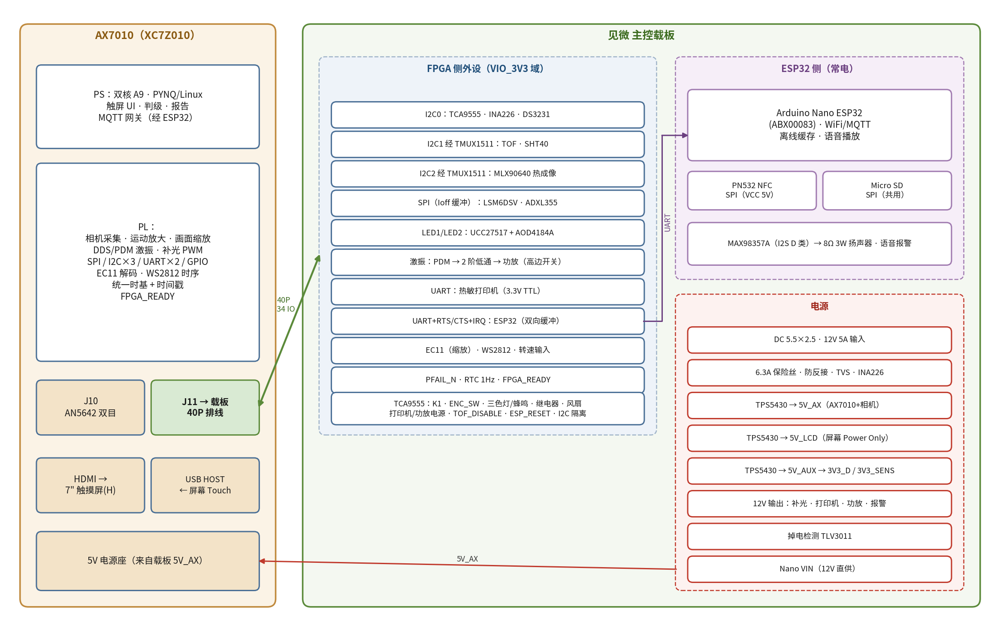

*图 2-1  系统框图*

| 部分 | 负责内容 |
|---|---|
| PL（FPGA） | 相机采集、运动放大、画面缩放；激振 PDM、补光 PWM；I2C×3、SPI、UART×2；EC11 正交解码；WS2812 时序；统一时基与时间戳；FPGA_READY |
| PS（ARM + Linux） | 触摸屏界面、振动判级、报告、打印任务、负载管理；与 ESP32 通信 |
| Nano ESP32 | WiFi/MQTT、PN532 读卡、SD 卡（语音文件、配置、少量离线缓存）、I2S 语音播放 |
| 载板 | 电源与保护、电源域隔离、功率驱动、全部外部接口 |

| 总线 | 主机 | 从设备 | 起始速率 |
|---|---|---|---|
| I2C0（板内） | PL · AXI IIC | TCA9555 0x20、INA226 0x40、DS3231 0x68 | 100kHz，验证后 400kHz |
| I2C1（外接，经 TMUX1511） | PL · AXI IIC | TOF（常见 0x29，按型号核对）、SHT40 0x44 | 100kHz |
| I2C2（外接，经 TMUX1511） | PL · AXI IIC | MLX90640 0x33 | 400kHz，验证后 1MHz |
| SPI（经缓冲） | PL | LSM6DSV、ADXL355（各自 CS） | 1MHz 起，实测后提高 |
| UART1 | PL · AXI UART16550 | Nano ESP32（含 RTS/CTS、IRQ） | 按实测 |
| UART2 | PL · AXI UART16550 | 热敏打印机（TX、RX、CTS） | 按打印机 |
| ESP32 SPI（经缓冲） | Nano | Micro SD、PN532（各自 CS） | 初始化低速 |
| ESP32 I2S | Nano | MAX98357A | PCM WAV |

## 3  12V 电源入口、保护和功率监测

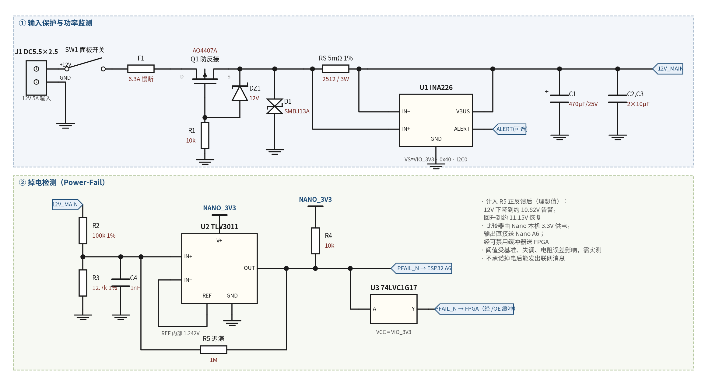

*图 3-1  输入保护、功率监测（上）与掉电检测（下）*

### 3.1 电源入口

```tcl
J1 中心正极 → SW1（经 J2）→ F1 6.3A 慢断 → Q1 AO4407A 防反接 → 12V_PROTECTED
→ RS 5mΩ 电流采样 → 12V_MAIN
```

J1 外壳负极接 GND；插座的切换触点不用时悬空，不能凭封装脚号猜测正负极。

| 元件 | 推荐选择 | 说明 |
|---|---|---|
| J1 | 明确标注 5.5×2.5mm、≥5A 的 DC 插座 | 不使用只有“DC-005”名称、没有电流规格的产品 |
| SW1 | 有直流额定值的船型开关，≥12V DC、6A | 仅标“6A/250VAC”不能确定直流开断能力 |
| F1 | 6.3A 慢断保险丝 | 最大工作电流约 4.2A，保险丝长期电流宜在额定值 75% 以下；过载由适配器自身保护 |
| Q1 | AOS AO4407A，SOIC-8 | P 沟道防反接：**Drain 接输入，Source 接后级**；多个 Source、Drain 焊盘分别并联 |
| R1 | 10kΩ | 栅极到 GND |
| DZ1 | BZT52C12 | 栅源钳位：阴极接 Source，阳极接 Gate |
| D1 | SMBJ13A，单向 | 阴极接 12V_PROTECTED，阳极接 GND；靠近入口，接地路径短而宽 |
| 母线电容 | 470µF/35V + 10µF/50V + 100nF/50V | 放在保护之后、功率分配之前 |

> **注意**　TVS 用于吸收瞬态，不能代替稳压或持续过压切断。实际尖峰还受布线电感影响。

### 3.2 INA226 功率检测

- INA226AIDGSR；RS=5mΩ、1%、2512，优先四端取样，额定 ≥1W。
- VS 接 VIO_3V3，旁路 100nF；A0、A1 接 GND，地址 0x40；SCL、SDA 接 I2C0。
- ALERT 经 10k 上拉到 VIO，接 TCA9555 P1.6。
- Kelvin 走线：采样电阻输入端 → IN+，输出端 → IN−；VBUS 接 12V_MAIN。

`5A 时：V_shunt = 5 × 0.005 = 25mV，P_shunt = 5² × 0.005 = 0.125W`

`Current_LSB = 0.25mA：CAL = 0.00512 / (0.00025 × 0.005) = 4096`

功率分辨率 6.25mW，电流寄存器量程约 8.19A（这不代表整机允许 8A 输入）。INA226 用于记录、预算和告警，它的平均测量值不能代替短路保护，也不能完整反映打印头的快速电流脉冲。

### 3.3 掉电检测

TLV3011 由 Nano 本机 3.3V 供电，输出直接送 Nano A6，同时经可禁用缓冲器送 PL。分压 100k / 12.7k，分压点 1nF 对地，1MΩ 正反馈，比较器电源旁 100nF。计入正反馈后的理想阈值：

`下降告警 ≈ 10.82V，回升恢复 ≈ 11.15V（实际值受基准、失调和电阻误差影响，需实测）`

PFAIL 触发后：停止启动新打印任务 → 关闭补光、激振等非必要负载 → 禁用跨域输出 → 停止新的存储写入。没有专门保持供电时，不保证 Linux 正常关机，也不保证最后一条 MQTT 消息发送成功。

## 4  三路降压与 3.3V 电源

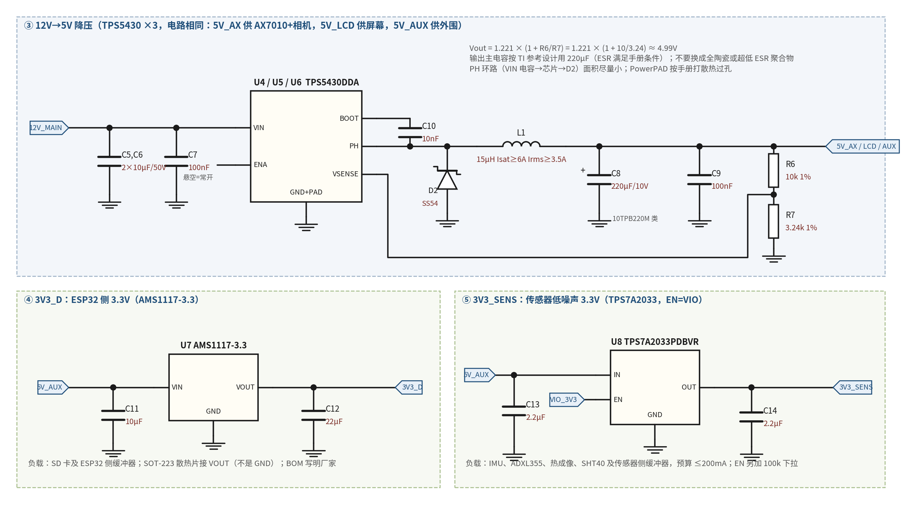

*图 4-1  TPS5430 降压（三路相同）、3V3_D 与 3V3_SENS*

### 4.1 三路 12V→5V

| 电源轨 | 输出能力 | 供电对象 |
|---|---|---|
| 5V_AX | 3A | AX7010 及由 AX7010 供电的 AN5642 |
| 5V_LCD | 3A（屏幕接口按 2A 设计） | HDMI 屏幕 Power Only |
| 5V_AUX | 3A | PN532、语音功放、UCC27517、继电器、状态灯、运放、两颗 3.3V 稳压器 |

| TPS5430 引脚 / 器件 | 连接或取值 |
|---|---|
| Pin7 VIN | 12V_MAIN |
| Pin6 GND、PowerPAD | GND，PowerPAD 必须焊接 |
| Pin8 PH | 电感输入及续流二极管阴极 |
| Pin1 BOOT | 经 10nF/25V 接 PH |
| Pin4 VSENSE | 反馈分压中点 |
| Pin5 ENA | 本版常开，按手册允许悬空 |
| Pin2、Pin3 | NC，悬空 |
| 输入电容 | 2×10µF/50V X7R + 100nF |
| 电感 | 15µH 屏蔽电感，Irms ≥3.5A，Isat 建议 ≥6A |
| 续流二极管 | SS54 或满足电流、耐压要求的同类肖特基 |
| 输出主电容 | 220µF/10V，选用符合参考设计 ESR 条件的器件（如 10TPB220M 类） |
| 输出高频旁路 | 100nF |
| 反馈电阻 | 上 10kΩ 1%，下 3.24kΩ 1% |

`Vout = 1.221 × (1 + 10/3.24) ≈ 4.99V；ΔI_L = 5×(12−5) / (12 × 15µH × 500kHz) ≈ 0.389A`

> **注意**　输出电容从 TI 的 220µF 参考方案开始，不能随意换成超低 ESR 聚合物电容，也不能用两颗 47µF 陶瓷电容直接替换；负载端额外增加的电容也要计入稳定性和启动测试。

AX7010 供电输出采用额定 ≥3A 的 2P 锁扣端子和短线，再接到 AX7010 原电源入口。**AX7010 只接 5V，不接 12V；不从 40 针扩展口反向供电。**AX7010 电源插头尺寸以实物为准。

### 4.2 3.3V 电源与电源域

| 网络 | 来源 | 用途 |
|---|---|---|
| VIO_3V3 | AX7010 J11 的 39、40 脚 | FPGA 侧接口逻辑、板内 I2C、RTC、GPIO 扩展、接收缓冲器 |
| 3V3_D | 5V_AUX → AMS1117-3.3 | ESP32 侧 SD 卡及其发送缓冲器 |
| 3V3_SENS | 5V_AUX → TPS7A2033 | IMU、ADXL355、SHT40、热成像/TOF（按模块要求）、传感器侧发送缓冲器、激振 PWM 基准 |
| NANO_3V3 | Nano ESP32 自身稳压 | 掉电比较器、Nano 侧接收缓冲器、上拉 |

四路 3.3V **不能直接并联**。

- **3V3_D（AMS1117-3.3）**：输入 10µF，输出 22µF（类型和 ESR 按所购厂家手册）；SOT-223 散热片连接输出网络，不是 GND；250mA 时损耗约 (5−3.3)×0.25 = 0.425W，留散热铜；BOM 写明厂家。
- **3V3_SENS（TPS7A2033PDBVR）**：IN 接 5V_AUX；EN 接 VIO_3V3 并加 100k 下拉；输入、输出各 2.2µF；接口旁 1µF 或 10µF+100nF 计入总输出电容；峰值预算 ≤200mA。
- **VIO_3V3**：J11 39、40 脚经 600Ω 磁珠和 10µF，绿灯指示。只供与 FPGA 引脚直接相连的器件（<80mA）。

> **说明**　EN 跟随 VIO 只解决供电控制，不能单独证明所有信号都不会倒灌；39、40 脚有电也不能证明 FPGA 已配置完成。因此另设 FPGA_READY（见第 7 章）。

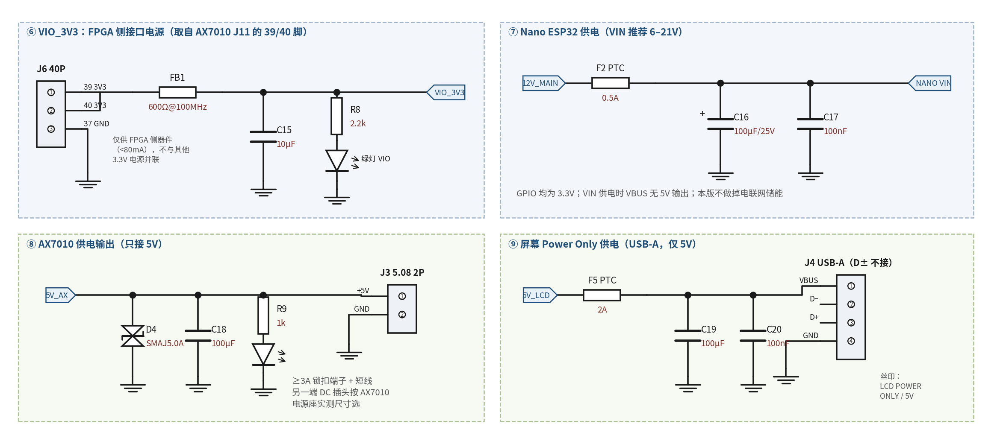

*图 4-2  VIO 域、Nano 供电、AX7010 供电输出、屏幕 Power Only*

## 5  功率预算与工作规则

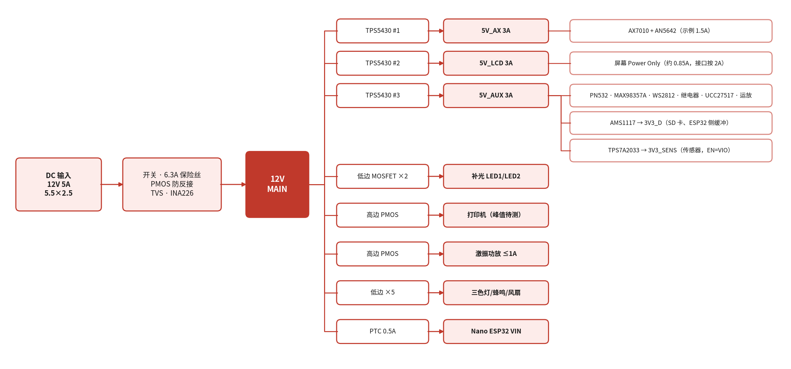

*图 5-1  电源树*

12V/5A 输入最多提供 60W。以下是**设计估算示例，不是已测得的整机功耗**，降压效率暂按 88%。

| 负载 | 示例负载 | 折算 12V 输入功率 |
|---|---|---|
| AX7010 + AN5642 | 5V、1.5A | 约 8.5W |
| H 版屏幕 | 5V、0.85A | 约 4.8W |
| 辅助外围 | 5V、0.35A | 约 2.0W |
| Nano ESP32 | 12V 侧 0.1A | 约 1.2W |
| 风扇等 | 12V 侧 0.1A | 约 1.2W |
| 60cm 补光灯 | 12V、0.75A | 9W |
| **测量状态合计** | — | **约 26.7W，2.23A** |
| 激振功放（示例 10W 输出） | 12V 侧约 1A | 约 12W |
| 打印机打印峰值（假设） | 12V、2A | 24W |
| 测量 + 激振 | — | 约 38.7W，3.2A |
| 测量 + 打印 | — | 约 50.7W，4.23A |
| 测量 + 激振 + 打印 | — | **约 62.7W，超出输入能力** |

工作规则：

1. 启动时打印机、补光、激振和报警输出全部关闭；主控初始化完成后逐步打开，打印机进入待机。
2. **激振与打印互斥**：打印优先在一段采集结束后进行。
3. 测量期间固定补光亮度；不能在连续采集过程中随意降低补光亮度，再把亮度变化当作目标运动分析。
4. 接近输入预算时限制打印黑度/速度，延后语音及其他非必要负载。
5. 总电流约 4.2A 进入预算告警；持续接近 4.5A 时停止启动新的大负载任务。阈值按最终适配器和实测修订。

> **注意**　保险丝和适配器不会自动实现精确 5A 限流。若实测打印脉冲导致适配器保护或主控复位，应调整打印任务、打印机参数或电源架构，不能只叠加电容（例如 2A、10ms 脉冲只允许跌 0.5V，需要 C = IΔt/ΔV = 40000µF）。

## 6  12V 负载驱动

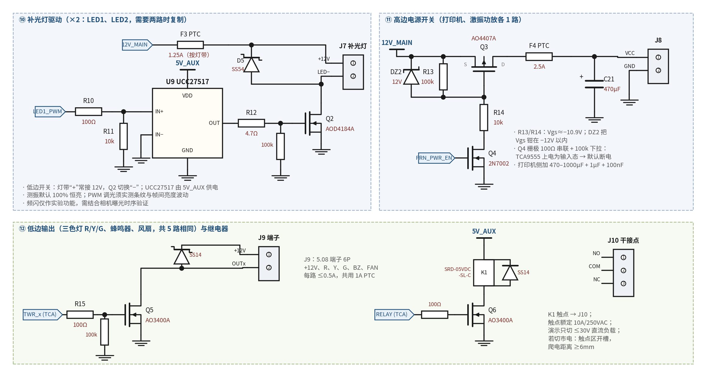

*图 6-1  补光驱动、高边电源开关、低边输出与继电器*

### 6.1 补光灯驱动（需要两路时复制）

| 器件 | 选择 | 说明 |
|---|---|---|
| 栅极驱动 | UCC27517DBVR | VDD 接 5V_AUX（避免直接承受 12V 母线瞬态），去耦 1µF+100nF；IN+ 串 100Ω、10k 下拉；IN− 接 GND |
| 功率 MOSFET | AOD4184A，DPAK | 低边开关；采购时核对同厂家手册中 4.5V 栅压下的导通电阻 |
| 栅极电阻 / 下拉 | 4.7Ω（初始值）/ 100kΩ | — |
| 钳位二极管 | SS54 | 阳极接 LED−，阴极接 LED+ |
| 分支保险丝 | 0.75A 灯带从约 1.25A 开始选 | 再核对灯带和线缆的启动电流 |
| 输出连接器 | 5.08mm 2P 插拔端子 | LED1 为 J7，LED2 为 J25 |

- **测振默认使用 100% 占空比恒亮。**只有需要调整亮度时才用 PWM，并检查实际曝光下的条纹及帧间亮度波动。
- 12V 输入只适用于已有电阻或驱动电路的 12V 灯带；裸 LED 应使用恒流驱动。
- 频闪不作为已验证功能，需结合 AN5642 的曝光、行扫描和灯带电路另行验证。

### 6.2 高边电源开关（打印机、激振功放各 1 路）

```tcl
12V_MAIN ── AO4407A Source        Drain ── 分支保险丝 ── 12V_PRN / 12V_EXC
            Gate ──100kΩ── Source；Gate ──10kΩ── 2N7002 Drain，Source ── GND
            Gate–Source 间 BZT52C12：阴极接 Source
2N7002 Gate：经 100Ω 接 PRN_PWR_EN / EXC_PWR_EN，Gate 到 GND 100kΩ
```

- GND 保持与系统连接，避免断开地线后串口成为回流路径。
- 上电时使能信号默认低（TCA9555 上电为输入态 + 外部下拉），负载断电；主控初始化后打开。
- 打印机侧放 470–1000µF/25V + 1µF + 100nF；分支 PTC 约 2.5A。功放侧 PTC 约 1.5A。
- PRN_PWR_EN 接 TCA9555 P0.6；EXC_PWR_EN 接 P0.1。

### 6.3 报警灯、蜂鸣器、风扇与继电器

- 5 路低边开关（AO3400A，Gate 100Ω + 100k 下拉），由 TCA9555 P1.0–P1.3、P1.5 驱动；蜂鸣器、风扇等感性负载加 SS14 续流（阴极接 12V，阳极接 Drain）。
- J9：5.08 6P，依次为 +12V、R、Y、G、BZ、FAN−，共用一颗约 1A 的 PTC。使用 12V 有源蜂鸣器和本身适配 12V 的报警灯。
- 继电器 SRD-05VDC-SL-C：线圈正端接 5V_AUX，负端接 AO3400A（TCA9555 P1.4），并联 SS14 或 1N4007（阴极接 5V）；J10 输出 NO、COM、NC。本版作为低压设备联动接口，不描述成安全停机系统。
- 电源指示 LED：12V 从 4.7k 开始，5V、3.3V 从 1–2.2k 开始，按实际亮度调整。

## 7  电源域隔离与 FPGA_READY

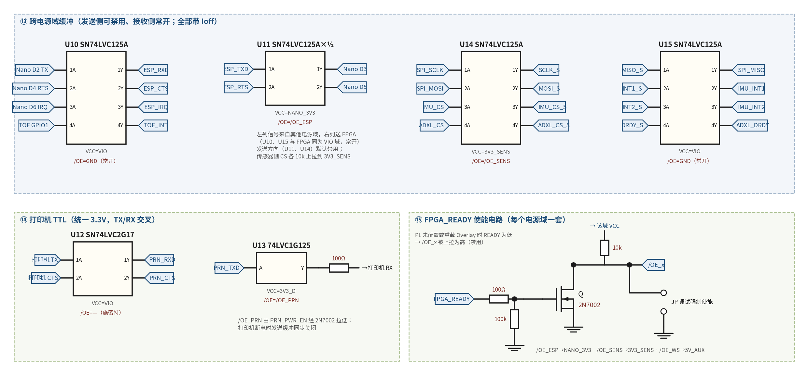

*图 7-1  跨电源域缓冲、打印机 TTL 与 FPGA_READY 使能电路*

### 7.1 原则

- **发送方向**（从 FPGA 或 Nano 发往另一个电源域）：缓冲器由**接收侧电源**供电，带 Ioff，/OE 经上拉默认禁用。
- **接收方向**（进入 FPGA）：缓冲器由 VIO 供电，与 FPGA 同域，/OE 直接接地常开。VIO 断电时缓冲器一起断电，不会倒灌；这样少一个依赖 FPGA_READY 的失效点。
- Nano 侧接收（MISO、IRQ）同理，缓冲器由 Nano 本机 3.3V 供电。

### 7.2 FPGA_READY

- J11-5 输出，载板侧 100k 下拉。PL 配置完成、外围初始化后由软件置高。
- PL 未配置或 **PYNQ 重新加载 Overlay** 时引脚变高阻，被下拉为低，所有发送缓冲器自动禁用。软件在每次加载 Overlay 后都要重新初始化打印机、ESP32 串口等外设。
- 每个电源域一套 2N7002 拉低电路：/OE_ESP（NANO_3V3）、/OE_SENS（3V3_SENS）、/OE_WS（5V_AUX）。
- **调试跳线**：每个 /OE_x 旁放一个 2P 跳线（JP1–JP3），短接即强制使能，便于在 FPGA_READY 逻辑没调通时先验证外设。正式运行时拔掉。
- FPGA_READY 旁加一颗指示灯（经 2N7002 驱动，不直接从 FPGA 引脚取电流）。
- 打印机 TX 缓冲器的 /OE_PRN 由 PRN_PWR_EN 控制：打印机断电时发送缓冲同步关闭。

### 7.3 缓冲器清单

| 位号 | 器件 | VCC | /OE | 通道 |
|---|---|---|---|---|
| U10 | SN74LVC125A | VIO | GND（常开） | Nano TX、RTS、IRQ、TOF GPIO1 → FPGA |
| U11 | SN74LVC125A | NANO_3V3 | /OE_ESP | FPGA ESP_TXD、ESP_RTS → Nano D3、D5 |
| U12 | SN74LVC2G17 | VIO | — | 打印机 TX、CTS → FPGA（施密特，5V 容限） |
| U13 | SN74LVC1G125 | 3V3_D | /OE_PRN | FPGA PRN_TXD → 100Ω → 打印机 RX |
| U14 | SN74LVC125A | 3V3_SENS | /OE_SENS | SPI_SCLK、SPI_MOSI、IMU_CS、ADXL_CS → 传感器 |
| U15 | SN74LVC125A | VIO | GND（常开） | MISO、IMU_INT1、IMU_INT2、ADXL_DRDY → FPGA |
| U16 | 74AHCT1G125 | 5V_AUX | /OE_WS | WS_DATA → 330Ω → 第一颗 WS2812 |
| U17 | SN74LVC2G17 | VIO | — | EC11 A、B → FPGA |
| U3 | SN74LVC1G17 | VIO | — | PFAIL_N → FPGA |
| — | SN74LVC1G17 | VIO | — | 转速信号 → FPGA TACH_IN |
| — | SN74LVC125A | 3V3_D | A4 控制 | Nano SCLK、MOSI、SD_CS、PN532_CS → SD / PN532 |
| — | SN74LVC2G17 | NANO_3V3 | — | SPI MISO、PN532 IRQ → Nano |

## 8  热敏打印机接口

打印机整机 12V 供电，TTL 支持 3.3V 和 5V，本版统一使用 3.3V 通信。TX 与 RX 按设备方向交叉；CTS 有效电平、上电等待时间、波特率及命令集按具体型号确定。

| J13 脚（XH2.54 5P） | 打印机信号 | 载板连接 |
|---|---|---|
| 1 | VCC | 预留接 12V_PRN 的 0Ω 焊位；实物确认前不焊 |
| 2 | CTS | 经 U12（5V 容限）到 FPGA PRN_CTS |
| 3 | TX | 经 U12 到 FPGA PRN_RXD |
| 4 | RX | FPGA PRN_TXD 经 U13 + 100Ω 接入 |
| 5 | GND | GND |

- 另设 J8 2P 电源接口：1 = 12V_PRN，2 = GND，连接器按打印机电源座选型。
- **打印机整机使用 12V，并不能证明 TTL 口的 VCC 允许输入 12V。**卖家确认 5P 口 VCC 就是整机电源输入后，才焊接 0Ω、只用 5P 线束；否则使用 J8。
- 打印机 TTL 口保留 XH2.54，与打印机配套线束一致；画封装前核对实际孔距、锁扣和脚序。

## 9  屏幕、旋钮、按键、状态灯与激振

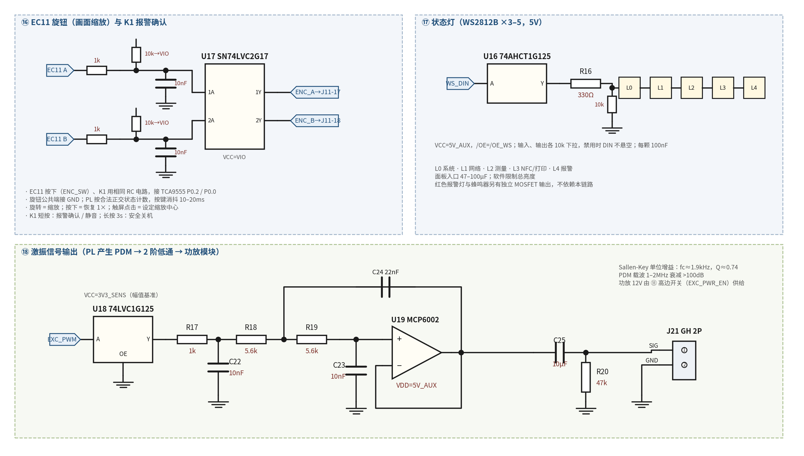

*图 9-1  EC11 与 K1 输入、WS2812 状态灯、激振信号输出*

### 9.1 屏幕连接

```tcl
AX7010 HDMI ───────── 屏幕 HDMI
AX7010 USB HOST ───── 屏幕 Touch（AX7010 的 J5、J6 跳线帽插上 = HOST 模式）
载板 J4 USB-A（5V_LCD）── 屏幕 Power Only
```

- J4 只接 VBUS（经 2A 分支保险丝）和 GND，D−、D+ 不接；丝印 `LCD POWER ONLY / 5V`。
- HDMI 时序由 AX7010 的 PL 工程配置，建议读取 EDID 后设定 1024×600，不照搬树莓派的配置文件。
- **触摸驱动**：插上 Touch 线后用 `cat /proc/bus/input/devices` 或 evtest 确认识别到触摸设备；如果没有，需要给 PYNQ 内核补编 HID 多点触摸模块（CONFIG_HID_MULTITOUCH）。这一步建议在画板之前用开发板先验证。

### 9.2 交互方式

| 输入 | 功能 |
|---|---|
| 触摸屏 | 全部菜单、模式切换、测量开始/停止、报告与打印、设定缩放中心、频带与放大倍数滑块 |
| EC11 旋转 | 画面缩放（放大 / 缩小） |
| EC11 按下 | 恢复 1× 显示 |
| K1 短按 | 报警确认 / 静音（软件卡住或戴手套时也能操作） |
| K1 长按 3s | 安全关机 |

- EC11 A、B：10k 上拉到 VIO、1k 串联、10nF 对地，经 SN74LVC2G17 施密特缓冲接 J11-17、J11-18；PL 按合法正交状态转换计数，不简单把 A、B 独立延迟。
- EC11 按下、K1：同样的 RC 电路，接 TCA9555 P0.2、P0.0；软件消抖 10–20ms。
- 缩放实现：PL 视频通路中裁剪 + 插值放大，画面跟手；也可由 PS 修改 VDMA 裁剪窗口，实现更简单但有一点延迟。

#### 面板接口 J12（GH1.25 卧贴 10P）

| 脚 | 信号 | 脚 | 信号 |
|---|---|---|---|
| 1 | 5V_AUX | 2 | GND |
| 3 | VIO_3V3 | 4 | GND |
| 5 | ENC_A | 6 | ENC_B |
| 7 | ENC_SW | 8 | K1 |
| 9 | WS_DATA（5V 电平） | 10 | GND |

### 9.3 状态灯

- 3–5 颗 WS2812B，每颗 100nF，面板入口 47–100µF；U16 输入和第一颗 DIN 各 10k 下拉，缓冲器禁用时灯不乱闪。
- 建议显示：系统、网络、测量、NFC/打印、报警。软件限制总亮度（GH 单针 1A，5 颗满亮约 0.3A）。
- 红色报警灯与蜂鸣器采用独立 MOSFET 驱动，不依赖 WS2812 链路。

### 9.4 激振信号输出

PL 用 Σ-Δ 调制输出 1–2MHz 的 PDM 码流，经 U18（VCC=3V3_SENS，作为幅值基准）、1k/10nF 预滤波和 Sallen-Key 二阶低通还原成模拟信号：

`fc = 1 / (2π · 5.6kΩ · √(22nF × 10nF)) ≈ 1.9kHz，Q ≈ 0.74`

- MCP6002 由 5V_AUX 供电，输出经 10µF 隔直、47k 对地，从 J21（GH 2P）送功放模块（如 TPA3116D2 / TPA3110D2 模块）。信号线用屏蔽线。
- 功放 12V 由 6.2 节高边开关（EXC_PWR_EN）单独供给，从 J26（5.08 2P）引出；不用时彻底断电。
- 激振频率最高约 500Hz，在通带内，相移固定可标定；振幅由 PL 数字值决定，可程控扫频、扫幅。
- 激振相位由 PL 内的 DDS 给出，可作为锁相检测和频闪实验的相位参考。

## 10  Nano ESP32 及 PN532、SD 卡、语音

### 10.1 供电与封装

- 两个 1×15 母座，按 Arduino 官方 Nano 封装放置（行距 15.24mm），USB-C 朝板边。
- VIN 由 12V_MAIN 经 0.5A PTC 直供，旁放 100µF/25V + 100nF。VIN 推荐范围 6–21V；所有 GPIO 为 3.3V；VIN 供电时 VBUS 不输出 5V。
- 本版不安装掉电联网储能电容。
- Nano 可能在载板断电时由 USB 调试供电，因此 ESP32 侧外设信号全部经缓冲器隔离（见 10.4）。

### 10.2 引脚分配（以 Nano 丝印为准）

| Nano 脚 | ESP32 GPIO | 用途 |
|---|---|---|
| D0 / D1 | 44 / 43 | 调试 UART（J22） |
| D2 | 5 | 向 AX7010 发送 UART |
| D3 | 6 | 接收 AX7010 UART |
| D4 | 7 | UART RTS |
| D5 | 8 | UART CTS |
| D6 | 9 | 通知 AX7010 的 IRQ |
| D7 / D8 / D9 | 10 / 17 / 18 | I2S BCLK / LRCLK / 数据 |
| D10 | 21 | SD 卡 CS |
| D11 / D12 / D13 | 38 / 47 / 48 | SPI MOSI / MISO / SCLK（SD 与 PN532 共用） |
| A0 | 1 | PN532 IRQ |
| A1 | 2 | SD 卡检测 |
| A2 | 3（启动绑带脚） | 不连接外部控制负载 |
| A3 | 4 | PN532 SPI CS |
| A4 | 11 | ESP32 侧发送缓冲器使能（经 2N7002） |
| A5 | 12 | 未使用，保留为输入（引到 J22） |
| A6 | 13 | PFAIL_N |
| A7 | 14 | 语音功放使能 |

### 10.3 PN532（SPI 接口）

图示 V3 模块的 I2C/UART 端为 5V 电平，SPI 为 3.3V，因此本版用 SPI，和 SD 卡共用 SCLK、MOSI、MISO，各有独立 CS。

| J19 脚（GH 8P） | 信号 |
|---|---|
| 1 | 5V_AUX（模块 VCC） |
| 2 | GND |
| 3 | SCLK |
| 4 | MOSI |
| 5 | MISO |
| 6 | PN532_CS |
| 7 | IRQ（经缓冲接 Nano A0） |
| 8 | RSTO（只留测试点，是复位状态输出，不能当复位输入） |

- 拨码设为 SPI，以模块实际说明为准；接口处 10µF + 100nF。
- PN532 为低位在前（LSB first），SD 卡为高位在前，固件必须分别配置 SPI transaction。
- 部分仿制模块在 CS 无效时不一定释放 MISO。**首板第一时间测试 PN532 与 SD 卡共存**；若冲突，备选方案是先用万用表确认模块 VCC 接 3.3V 时 I2C 上拉电平为 3.3V，再改走 I2C。
- 天线靠近外壳读卡位置，远离金属、功率电感和大面积铜，安装后实测读卡距离。

### 10.4 ESP32 侧 SPI 电源域处理

- SN74LVC125A（VCC=3V3_D）四路输出 SCLK、MOSI、SD_CS、PN532_CS；/OE 上拉到 3V3_D 默认禁用，Nano A4 经 2N7002 拉低使能；调试跳线 JP4 可强制使能。
- SD_CS、PN532_CS 在器件侧各 10k 上拉。
- 返回的 MISO、IRQ 经 SN74LVC2G17（VCC=NANO_3V3）接收。
- PFAIL 后先禁用外围输出。总电源下降期间的时序需要实测。

### 10.5 Micro SD 卡

| 卡座信号 | 连接 |
|---|---|
| VDD / VSS | 3V3_D / GND；卡座旁 22µF + 100nF |
| CLK | D13 经缓冲后串 22–33Ω |
| CMD/MOSI、DAT3/CS | D11、D10 经缓冲；预留上拉 |
| DAT0/MISO | 经接收缓冲到 D12；预留上拉 |
| DAT1、DAT2 | 各 10k 上拉到 3V3_D |
| CD 开关 | Nano A1，10k 上拉到 Nano 本机 3.3V |

初次初始化用低速，验证后再提高 SPI 速度。AX7010 自带 SD 卡存系统、原始图像和测量记录；ESP32 侧 SD 卡只存语音文件、配置和少量离线通信缓存。原始视频不经 ESP32 串口传输。

### 10.6 语音报警

- MAX98357AETE+T：D7/D8/D9 → BCLK/LRCLK/DIN；VDD 接 5V_AUX，旁 10µF + 100nF，附近可再加 100µF；底部焊盘接 GND。
- GAIN 悬空（默认增益）；A7 经 1MΩ 接 SD_MODE，利用内部下拉上电默认静音，高电平时为单声道混合模式。
- OUTP、OUTN 经 J18（GH 2P）接 8Ω/3W 扬声器，**扬声器两端都不能接 GND**。
- 语音采用 PCM WAV；AX7010 经 UART 发送播放编号。打印或激振期间如需控制电流，可限制音量或延后播报。

## 11  传感器接口

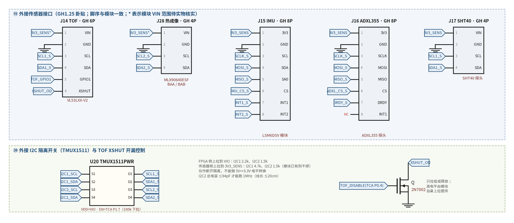

*图 11-1  外接传感器接口（GH1.25 卧贴）、外接 I2C 隔离开关与 TOF XSHUT*

### 11.1 TOF（J14，GH 6P）

| 脚 | 信号 | 载板连接 |
|---|---|---|
| 1 | VIN | 经确认后接合适的模块输入电源（默认 3V3_SENS） |
| 2 | GND | GND |
| 3 / 4 | SCL / SDA | 外接 I2C1（经 TMUX1511） |
| 5 | GPIO1 | 经 U10 缓冲到 PL TOF_INT |
| 6 | XSHUT | 2N7002 开漏：只拉低或释放，由 TCA9555 P0.4（TOF_DISABLE）控制，Gate 100k 下拉 |

“VL53LXX-V2”不能确认是 VL53L0X 还是 VL53L1X，也不能确认板载稳压和电平转换。TOF 用于工作距离提示和辅助尺度估计；像素位移换算物理位移还需要镜头标定、目标平面方向和测量几何关系。

### 11.2 热成像（J28，GH 4P，独立 I2C2）

- 1 模块 VIN、2 GND、3 SCL、4 SDA；接口旁 10µF + 100nF。
- 芯片需要稳定的 3.3V；若模块 VIN 经板载 LDO，必须核对模块规定输入电压，不默认 3.3V 输入就能得到合格的芯片电压；若模块需要 5V 输入，其 I2C 电平也要按模块电路处理。
- BAA 110°×75° 适合看较大场景；BAB 55°×35° 适合集中观察轴承、电机。默认推荐 BAB 用于局部点检。
- I2C 先用 400kHz 调通，再验证 1MHz。1.5kΩ 上拉、120ns 上升时间时，允许的总线总电容约 120ns / (0.8473 × 1.5kΩ) ≈ 94pF（含 PCB、线缆、模块、保护器件），模块已有上拉要计入。
- 完整热像由两个子页组成，不能把芯片设置的刷新率直接当作完整温度图帧率，以实测为准。

### 11.3 温湿度（J17，GH 4P）

SHT40-AD1B 探头，地址 0x44：1 3V3_SENS、2 GND、3 SCL、4 SDA；传感器旁 100nF，接口旁 1µF。探头放到目标附近，远离降压器和风扇热风；装在机箱内时读数只反映机箱环境。

### 11.4 相机 IMU（J15，GH 8P）

| 脚 | 模块信号 | 载板信号 |
|---|---|---|
| 1 | 3V3 | 3V3_SENS |
| 2 | GND | GND |
| 3 | SCL | SPI SCLK（经 U14） |
| 4 | SDA | SPI MOSI（经 U14） |
| 5 | SA0 | SPI MISO（经 U15） |
| 6 | CS | IMU_CS（经 U14），模块侧 10k 上拉 |
| 7 | INT1 | IMU_INT1（经 U15） |
| 8 | INT2 | IMU_INT2（经 U15） |

- 首版使用 LSM6DSV 模块，装在相机刚性支架上；SCX、SDX 不用。
- SPI 从 1MHz 开始验证；SCLK、MOSI 在驱动端预留 22–33Ω 串阻；接口旁 1µF + 100nF。
- 模块 SA0 若用于 MISO，不能被模块上的焊桥直接短接到电源。
- IMU 主要用于识别相机自身的转动、晃动及辅助补偿；仅凭加速度双重积分不能获得稳定、准确的相机位移。

### 11.5 参考加速度计（J16，GH 8P）

1 3V3_SENS、2 GND、3 SCLK、4 MOSI、5 MISO、6 ADXL_CS、7 ADXL_DRDY、8 预留不接。与 IMU 共用 SPI、独立 CS，DRDY 由 PL 记录时间戳。优先购买已包含正确稳压、去耦的 ADXL355 模块；对比时考虑安装、量程、带宽、滤波和相位延迟。

### 11.6 转速输入（J24，GH 3P）

1 5V_AUX、2 GND、3 TACH_SIG。信号经 1kΩ + 100pF 和 SN74LVC1G17（5V 容限，VCC=VIO）送 PL TACH_IN。仅用于逻辑或开集电极信号；12V/24V 工业传感器需另做输入电路。

## 12  I2C、GPIO 扩展与 RTC

### 12.1 总线

| 总线 | 器件 | 地址 | 上拉 |
|---|---|---|---|
| I2C0（板内） | TCA9555、INA226、DS3231 | 0x20、0x40、0x68 | 4.7kΩ → VIO |
| I2C1（外接） | TOF、SHT40 | 0x29（按型号核对）、0x44 | FPGA 侧 2.2k → VIO；传感器侧 4.7k → 3V3_SENS |
| I2C2（外接） | MLX90640 | 0x33 | FPGA 侧 1.5k → VIO；传感器侧 1.5k 预留（模块已有则不焊） |

外接 I2C1、I2C2 经一颗 TMUX1511PWR 四路开关连接：VDD 接 VIO，EN 由 TCA9555 P1.7 控制并下拉，传感器供电稳定后才接通。该器件只用于断开隔离，**不能把 5V 信号转换成 3.3V**。AXI IIC 的快速模式要按所用 IP 和驱动版本核对时序配置。

### 12.2 TCA9555

VCC=VIO，100nF 旁路，A0–A2 接 GND，INT 经 10k 上拉到 VIO 接 PL。上电端口默认为输入，输出负载另加硬件下拉；修改方向寄存器前先把输出寄存器写入期望的关闭状态。

| 端口 | 用途 | 上电状态 |
|---|---|---|
| P0.0 | K1 报警确认 | 输入 |
| P0.1 | EXC_PWR_EN（激振功放电源） | 外部下拉，断电 |
| P0.2 | ENC_SW（EC11 按下） | 输入 |
| P0.3 | 空闲 | 输入 |
| P0.4 | TOF_DISABLE | 外部下拉，释放 XSHUT |
| P0.5 | ESP_RESET 请求（经 2N7002） | 外部下拉，不复位 |
| P0.6 | PRN_PWR_EN | 外部下拉，打印机断电 |
| P0.7 | 空闲 | 输入 |
| P1.0 / P1.1 / P1.2 | 红 / 黄 / 绿报警灯 | 关闭 |
| P1.3 | 蜂鸣器 | 关闭 |
| P1.4 | 继电器 | 释放 |
| P1.5 | 风扇 | 关闭 |
| P1.6 | INA226 ALERT | 输入 |
| P1.7 | 外接 I2C 连接使能（TMUX1511 EN） | 关闭 |

### 12.3 RTC

- DS3231SN + CR1220：VCC 接 VIO（旁 100nF），VBAT 接 CR1220 正极，不增加充电电路，无需外部晶振。
- SDA、SCL 接 I2C0；INT/SQW 经 10k 上拉到 VIO 送 PL；设 INTCN=0、RS2/RS1=00 输出 1Hz 方波。
- 32kHz 留测试点；RST、NC 按该封装手册连接，不统一猜测悬空。
- 用于日期时间、报告时间戳及本机计数器频率校准。多台仪器需要同步时，应使用公共触发、PPS 或其他同步系统。

## 13  AX7010 J11 载板接口分配

固定用于：**AN5642 接 J10，载板接 J11，AX7010 使用默认 3.3V IO 配置。**方向以 FPGA 为参照。管脚与 AX7010 手册 J11 表对应；AX7010 扩展口本身已有 33Ω 串联电阻。

| J11 脚 | 载板信号 | 方向 | FPGA 管脚 |
|---|---|---|---|
| 1 | GND | — | — |
| 2 | AX7010 的 5V（载板不连接） | — | — |
| 3 | LED1_PWM | 输出 | F17 |
| 4 | LED2_PWM | 输出 | F16 |
| 5 | FPGA_READY | 输出 | F20 |
| 6 | WS_DATA | 输出 | F19 |
| 7 | TOF_INT | 输入 | G20 |
| 8 | RTC_1HZ | 输入 | G19 |
| 9 | PFAIL_N | 输入 | H18 |
| 10 | EXP_INT_N | 输入 | J18 |
| 11 | I2C0_SCL | 开漏双向 | L20 |
| 12 | I2C0_SDA | 开漏双向 | L19 |
| 13 | I2C1_SCL | 开漏双向 | M20 |
| 14 | I2C1_SDA | 开漏双向 | M19 |
| 15 | TACH_IN | 输入 | K18 |
| 16 | EXC_PWM | 输出 | K17 |
| 17 | ENC_A | 输入 | J19 |
| 18 | ENC_B | 输入 | K19 |
| 19 | ESP_TXD（至 Nano D3） | 输出 | H20 |
| 20 | ESP_RXD（来自 Nano D2） | 输入 | J20 |
| 21 | ESP_RTS（至 Nano D5） | 输出 | L17 |
| 22 | ESP_CTS（来自 Nano D4） | 输入 | L16 |
| 23 | ESP_IRQ | 输入 | M18 |
| 24 | PRN_TXD | 输出 | M17 |
| 25 | PRN_RXD | 输入 | D20 |
| 26 | PRN_CTS | 输入 | D19 |
| 27 | ADXL_CS | 输出 | E19 |
| 28 | ADXL_DRDY | 输入 | E18 |
| 29 | IMU_CS | 输出 | G18 |
| 30 | IMU_INT1 | 输入 | G17 |
| 31 | IMU_INT2 | 输入 | H17 |
| 32 | I2C2_SCL | 开漏双向 | H16 |
| 33 | I2C2_SDA | 开漏双向 | G15 |
| 34 | SPI_MISO | 输入 | H15 |
| 35 | SPI_SCLK | 输出 | J14 |
| 36 | SPI_MOSI | 输出 | K14 |
| 37、38 | GND | — | — |
| 39、40 | AX7010 3.3V 输出 → VIO_3V3 | — | — |

- 34 个 IO 全部使用。以后还要加慢速 IO，可在 I2C0 上再挂一颗 TCA9555（地址 0x21）。
- 边沿较陡的 SPI_SCLK、SPI_MOSI 在 35、36 脚，紧挨 37、38 脚 GND；LED1_PWM 在 3 脚，紧挨 1 脚 GND。
- FPGA_READY 外加 100k 下拉；外围发送缓冲器 /OE 默认禁用，初始化后才打开。

### 13.1 XDC 约束

```tcl
## 载板接 AX7010 J11（Bank 35，默认 3.3V）；相机接 J10 的约束另行维护，检查无重复占用
set_property -dict {PACKAGE_PIN F17 IOSTANDARD LVCMOS33} [get_ports led1_pwm]
set_property -dict {PACKAGE_PIN F16 IOSTANDARD LVCMOS33} [get_ports led2_pwm]
set_property -dict {PACKAGE_PIN F20 IOSTANDARD LVCMOS33} [get_ports fpga_ready]
set_property -dict {PACKAGE_PIN F19 IOSTANDARD LVCMOS33} [get_ports ws_data]
set_property -dict {PACKAGE_PIN G20 IOSTANDARD LVCMOS33} [get_ports tof_int]
set_property -dict {PACKAGE_PIN G19 IOSTANDARD LVCMOS33} [get_ports rtc_1hz]
set_property -dict {PACKAGE_PIN H18 IOSTANDARD LVCMOS33} [get_ports pfail_n]
set_property -dict {PACKAGE_PIN J18 IOSTANDARD LVCMOS33} [get_ports exp_int_n]
set_property -dict {PACKAGE_PIN L20 IOSTANDARD LVCMOS33} [get_ports i2c0_scl]
set_property -dict {PACKAGE_PIN L19 IOSTANDARD LVCMOS33} [get_ports i2c0_sda]
set_property -dict {PACKAGE_PIN M20 IOSTANDARD LVCMOS33} [get_ports i2c1_scl]
set_property -dict {PACKAGE_PIN M19 IOSTANDARD LVCMOS33} [get_ports i2c1_sda]
set_property -dict {PACKAGE_PIN K18 IOSTANDARD LVCMOS33} [get_ports tach_in]
set_property -dict {PACKAGE_PIN K17 IOSTANDARD LVCMOS33} [get_ports exc_pwm]
set_property -dict {PACKAGE_PIN J19 IOSTANDARD LVCMOS33} [get_ports enc_a]
set_property -dict {PACKAGE_PIN K19 IOSTANDARD LVCMOS33} [get_ports enc_b]
set_property -dict {PACKAGE_PIN H20 IOSTANDARD LVCMOS33} [get_ports esp_txd]
set_property -dict {PACKAGE_PIN J20 IOSTANDARD LVCMOS33} [get_ports esp_rxd]
set_property -dict {PACKAGE_PIN L17 IOSTANDARD LVCMOS33} [get_ports esp_rts]
set_property -dict {PACKAGE_PIN L16 IOSTANDARD LVCMOS33} [get_ports esp_cts]
set_property -dict {PACKAGE_PIN M18 IOSTANDARD LVCMOS33} [get_ports esp_irq]
set_property -dict {PACKAGE_PIN M17 IOSTANDARD LVCMOS33} [get_ports prn_txd]
set_property -dict {PACKAGE_PIN D20 IOSTANDARD LVCMOS33} [get_ports prn_rxd]
set_property -dict {PACKAGE_PIN D19 IOSTANDARD LVCMOS33} [get_ports prn_cts]
set_property -dict {PACKAGE_PIN E19 IOSTANDARD LVCMOS33} [get_ports adxl_cs]
set_property -dict {PACKAGE_PIN E18 IOSTANDARD LVCMOS33} [get_ports adxl_drdy]
set_property -dict {PACKAGE_PIN G18 IOSTANDARD LVCMOS33} [get_ports imu_cs]
set_property -dict {PACKAGE_PIN G17 IOSTANDARD LVCMOS33} [get_ports imu_int1]
set_property -dict {PACKAGE_PIN H17 IOSTANDARD LVCMOS33} [get_ports imu_int2]
set_property -dict {PACKAGE_PIN H16 IOSTANDARD LVCMOS33} [get_ports i2c2_scl]
set_property -dict {PACKAGE_PIN G15 IOSTANDARD LVCMOS33} [get_ports i2c2_sda]
set_property -dict {PACKAGE_PIN H15 IOSTANDARD LVCMOS33} [get_ports spi_miso]
set_property -dict {PACKAGE_PIN J14 IOSTANDARD LVCMOS33} [get_ports spi_sclk]
set_property -dict {PACKAGE_PIN K14 IOSTANDARD LVCMOS33} [get_ports spi_mosi]
set_property -dict {SLEW SLOW DRIVE 8} [get_ports {led*_pwm exc_pwm ws_data fpga_ready}]
set_property -dict {SLEW SLOW DRIVE 8} [get_ports {esp_txd esp_rts prn_txd}]
set_property -dict {SLEW SLOW DRIVE 8} [get_ports {*_cs spi_sclk spi_mosi}]
set_property PULLDOWN true [get_ports fpga_ready]
## I2C 端口在 HDL 中用 IOBUF 实现开漏，不输出推挽高电平
```

## 14  连接器选型与总表

### 14.1 哪些改用 GH1.25 卧贴

GH1.25（1.25mm 间距，带锁扣）体积小、插上不易松脱，适合小电流信号线。卧贴（侧插 SMT，如 JST SM0xB-GHS-TB 或国产同规格“GH1.25 卧贴”）开口朝板边，线缆水平引出，叠装 AX7010 后也方便插拔。

| 接口 | 改为 GH 的理由 / 不改的理由 | 结论 |
|---|---|---|
| TOF、IMU、热成像、ADXL355、SHT40、转速 | 信号线、电流 <50mA；锁扣防振动脱落 | **GH 卧贴** |
| PN532（含 5V 供电） | 约 150mA，远低于单针 1A | **GH 卧贴 8P** |
| 前面板（EC11、K1、WS2812） | 5V 总电流约 0.3A（软件限亮度） | **GH 卧贴 10P** |
| 扬声器 | 8Ω、3W 峰值约 0.6A | **GH 卧贴 2P** |
| 激振信号 | 小信号 | **GH 卧贴 2P**（屏蔽线） |
| ESP32 调试串口、I2C 调试口、/OE 跳线 | 要接逻辑分析仪或短接帽 | 保留 2.54mm 排针 |
| 打印机 TTL | 打印机配套线束为 XH2.54 | 保留 XH2.54 5P |
| 12V 输入、补光、打印机电源、功放电源、三色灯、继电器、5V_AX | 电流大或需要锁紧的功率线；GH 单针仅 1A | 保留 DC 座 / 5.08 插拔端子 |
| AX7010 40P | 与 AX7010 牛角座配对 | 保留 2×20 牛角座 |
| 屏幕供电 | 普通 USB 线 | 保留 USB-A |

#### GH 使用注意

- 单针额定约 1A、耐压约 50V，线规 26–30AWG；只用于信号和小电流。
- **线缆买成品预压线**，手工压接需要专用工具。双头线要选“**同向**”（1 脚对 1 脚），淘宝上同时有“反向”版本；接模块排针时用“GH1.25 转杜邦母头”单头线。
- 卧贴座放在板边、开口朝外，两侧固定脚焊满，插拔时不要横向扳动；插拔寿命有限，调试阶段尽量减少插拔次数。
- 全板 GH 座统一 1 脚方向，丝印标 1 脚和信号名；线缆两端贴标签。
- 常见成品线长度为 10/15/20/30cm，热成像（≤20cm）、IMU（≤30cm）按此选。

### 14.2 连接器总表

| 位号 | 用途 | 型号 | 引脚定义 |
|---|---|---|---|
| J1 | 12V 输入 | DC 5.5×2.5，≥5A | 中心正极 |
| J2 | 面板总开关 | 5.08 2P 插拔 | 接船型开关 |
| J3 | 5V_AX 输出 | 5.08 2P 插拔（≥3A） | +5V、GND → DC 插头线 → AX7010 |
| J4 | 屏幕 Power Only | USB-A 母座 | VBUS、GND（D± 不接） |
| J6 | AX7010 J11 | 2×20 牛角座 | 见第 13 章 |
| J7 / J25 | 补光 LED1 / LED2 | 5.08 2P 插拔 | LED+、LED− |
| J8 | 打印机电源 | 按打印机电源座 | 12V_PRN、GND |
| J9 | 三色灯/蜂鸣/风扇 | 5.08 6P | +12V、R、Y、G、BZ、FAN− |
| J10 | 继电器干接点 | 5.08 3P | NO、COM、NC |
| J12 | 前面板 | **GH 10P 卧贴** | 见 9.2 |
| J13 | 打印机 TTL | XH2.54 5P | VCC(0Ω 预留)、CTS、TX、RX、GND |
| J14 | TOF | **GH 6P 卧贴** | VIN、GND、SCL、SDA、GPIO1、XSHUT |
| J15 | IMU | **GH 8P 卧贴** | 3V3、GND、SCL、SDA、SA0、CS、INT1、INT2 |
| J16 | ADXL355 | **GH 8P 卧贴** | 3V3、GND、SCLK、MOSI、MISO、CS、DRDY、NC |
| J17 | SHT40 | **GH 4P 卧贴** | VIN、GND、SCL、SDA |
| J18 | 扬声器 | **GH 2P 卧贴** | OUTP、OUTN |
| J19 | PN532 | **GH 8P 卧贴** | 5V、GND、SCLK、MOSI、MISO、CS、IRQ、RSTO |
| J21 | 激振信号 | **GH 2P 卧贴** | SIG、GND |
| J22 | ESP32 调试 | 2.54 排针 1×4 | D0、D1、A5、GND |
| J24 | 转速 | **GH 3P 卧贴** | 5V、GND、SIG |
| J26 | 功放电源 | 5.08 2P 插拔 | 12V_EXC、GND |
| J27 | I2C0 调试 | 2.54 排针 1×4 | VIO、GND、SCL、SDA |
| J28 | 热成像 | **GH 4P 卧贴** | VIN、GND、SCL、SDA |
| JP1–JP4 | /OE 强制使能 | 2.54 排针 1×2 | /OE_ESP、/OE_SENS、/OE_WS、ESP 侧 SPI |
| — | Nano ESP32 座 | 1×15 母座 ×2 | Arduino Nano 封装 |

## 15  整机连接

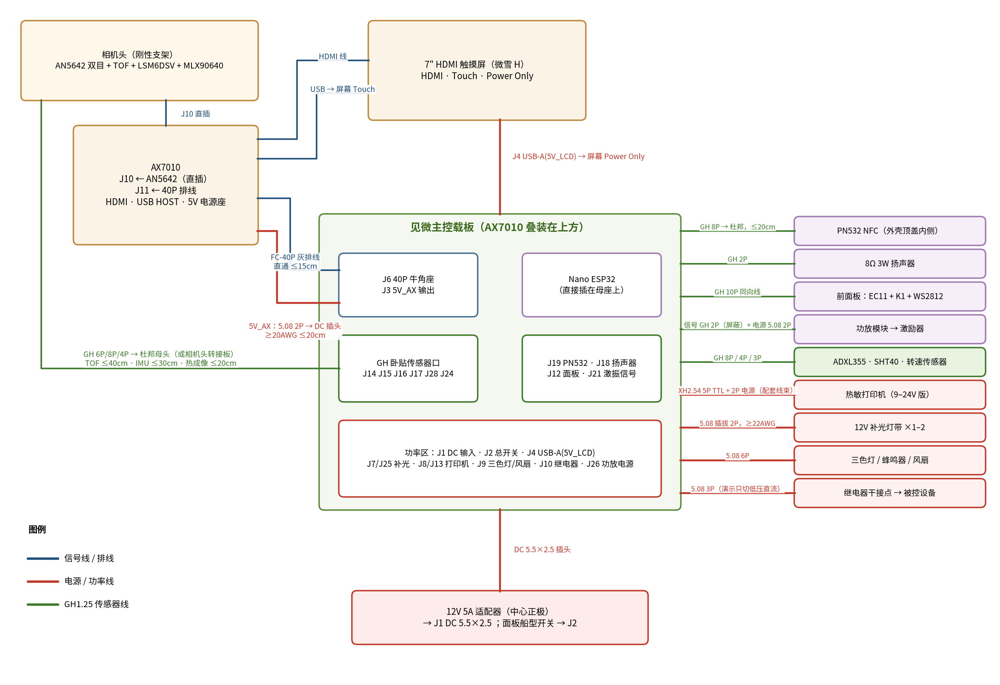

*图 15-1  整机连接图*

### 15.1 线缆清单

| 从 | 到 | 线缆 | 长度 / 要点 |
|---|---|---|---|
| 载板 J6 | AX7010 J11 | FC-40P 灰排线，两端 IDC 母头，直通 | ≤15cm；红边对 1 脚；断电插拔 |
| 载板 J3 | AX7010 电源座 | 5.08 2P 插头 + DC 插头线 | ≥20AWG，≤20cm；插头尺寸按实物 |
| AX7010 J10 | AN5642 | 直插 | — |
| AX7010 HDMI | 屏幕 HDMI | HDMI 线 | — |
| AX7010 USB HOST | 屏幕 Touch | USB 线（按屏幕接口） | AX7010 J5、J6 跳线帽插上 |
| 载板 J4 | 屏幕 Power Only | USB 供电线 | — |
| 载板 J14 / J15 / J28 | TOF / IMU / 热成像 | GH 转杜邦母头 | TOF ≤40cm，IMU ≤30cm，热成像 ≤20cm；可做相机头转接板汇成一束 |
| 载板 J16 / J17 / J24 | ADXL355 / SHT40 / 转速 | GH 转杜邦母头 | ADXL ≤50cm（长线时 SPI 降速、用屏蔽线）；SHT40、转速 ≤1m |
| 载板 J19 | PN532 | GH 8P 转杜邦母头 | ≤20cm |
| 载板 J12 | 前面板小板 | GH 10P 同向双头线 | 按外壳尺寸选 15–30cm |
| 载板 J18 | 扬声器 | GH 2P | — |
| 载板 J21 / J26 | 功放模块 | GH 2P 屏蔽线 / 5.08 2P 电源线 | 功放输出直接接激励器 |
| 载板 J13 / J8 | 热敏打印机 | 打印机配套 XH2.54 线束 | 先核对脚序，TX/RX 交叉 |
| 载板 J7 / J25 | 补光灯带 | ≥22AWG 双色线 | 红正黑负 |
| 载板 J9 / J10 | 三色灯 / 被控设备 | 报警灯自带线 / 低压直流线 | — |
| 适配器 | 载板 J1 | DC 5.5×2.5 插头 | 中心正极 |

### 15.2 机械安装

- AX7010 用 M3×15mm 铜柱叠装在载板上方，孔位按 ALINX dxf 结构图；投影区内只放 ≤8mm 高的贴片器件。也可以两块板并排装在外壳里，排线相应加长但不超过 15cm。
- 相机、TOF、IMU、热成像装在同一个刚性支架上；IMU 与相机刚性连接，热成像镜头紧贴可见光相机、光轴平行。
- PN532 贴在外壳顶盖内侧；屏幕、EC11、K1、状态灯装在前面板；DC 输入、开关、打印机、功率端子在后面板。
- 全部接好再上电；不带电插拔 40P 排线和传感器线。

## 16  相机采集和测振能力的约束

AN5642 能够用于视觉运动显示和低频测振，但**载板外设增加后不会自动提高相机的有效采样频率**。ALINX 提供的示例有 720P、30fps 配置；30fps 采样的奈奎斯特上限是 15Hz，60fps 对应 30Hz，实际测量应留余量。更高帧率必须在所选分辨率、输出格式、驱动和 FPGA 工程中实测。

- 先实现单目或双目稳定采集，再加入运动放大。
- 测量时固定曝光和增益；记录每路相机 VSYNC、实际曝光配置和丢帧情况。
- IMU DRDY、参考加速度计 DRDY 和相机帧使用同一 PL 计数器；对滚动快门及传感器滤波延迟做标定。
- 不把 VSYNC 边沿直接等同于所有像素的曝光时刻；两路相机分别记录时间戳，不假定两颗 OV5640 天然同步曝光。
- 数据量参考：双目 720P、30fps、每像素 2 字节约 110.6MB/s；视频通过 PL、DMA 和 DDR 处理，不经 ESP32 UART 传输。

## 17  关键器件与采购

| 用途 | 推荐型号 / 规格 | 封装或形式 |
|---|---|---|
| 输入防反接、打印与功放高边 | AOS AO4407A ×3 | SOIC-8 |
| 12V 输入 TVS | SMBJ13A | SMB |
| 输入保险丝 | 6.3A 慢断 | 2410 贴片或保险丝座 |
| 栅源钳位 | BZT52C12 | SOD-123 |
| 三路 5V 降压 | TPS5430DDAR ×3 | SOIC-8 PowerPAD |
| 功率电感 | 15µH，Isat ≥6A，Irms ≥3.5A | 屏蔽电感 |
| 降压输出主电容 | 符合 TPS5430 环路条件的 220µF/10V | 按实际器件 |
| 数字 3.3V | 明确厂家的 AMS1117-3.3 | SOT-223 |
| 传感器 3.3V | TPS7A2033PDBVR | SOT-23-5 |
| 电流监测 | INA226AIDGSR + 5mΩ 1% ≥1W | MSOP-10 / 2512 |
| GPIO 扩展 | TCA9555PWR | TSSOP-24 |
| 掉电比较器 | TLV3011AIDBVR | SOT-23-6 |
| 可禁用缓冲 | SN74LVC125APWR ×5 | TSSOP-14 |
| 施密特 / 单路缓冲 | SN74LVC1G17、SN74LVC2G17、SN74LVC1G125 | SOT-23 系列 |
| 状态灯电平提升 | 74AHCT1G125 | SOT-23-5 |
| 外接 I2C 开关 | TMUX1511PWR | TSSOP-14 |
| 补光栅极驱动 / MOSFET | UCC27517DBVR / AOD4184A | SOT-23-5 / DPAK |
| 小负载 / 控制 MOSFET | AO3400A / 2N7002 | SOT-23 |
| 续流二极管 | SS14、SS54、1N4007 | 按电流选择 |
| 激振低通 | MCP6002 + 74LVC1G125 | SOIC-8 / SOT-23-5 |
| RTC | DS3231SN + CR1220 座 | SO-16W |
| 语音功放 / 扬声器 | MAX98357AETE+T / 8Ω 3W | TQFN-16 / 成品 |
| 操作件 | EC11（带按压）+ 轻触按键 ×1 | 面板安装 |
| SD | 带 CD 开关的 Micro SD 卡座 | 贴片 |
| 连接器 | GH1.25 卧贴 2/3/4/6/8/10P、XH2.54 5P、5.08 插拔端子、2×20 牛角座、USB-A、DC 5.5×2.5 | — |
| 成品模块 | Nano ESP32、PN532 V3、TOF、LSM6DSV、MLX90640、ADXL355、SHT40、功放模块、打印机 | — |

| 器件 | 立创商城编号 |
|---|---|
| TPS5430DDAR | C9864 |
| AOS AO4407A | C16072 |
| TPS7A2033PDBVR | C2862740 |
| SN74LVC125APWR | C7813 |
| DS3231SN# | C722469 |
| MAX98357AETE+T | C910544 |

这些编号用于查找器件；商城有条目不等于属于嘉立创基础库，也不保证当前批次可直接贴片。最终 BOM 应核对品牌、后缀、封装及装配库存。不同厂家的同名 MOSFET 或 1117 不能直接视为完全等效。

## 18  PCB 布局要点

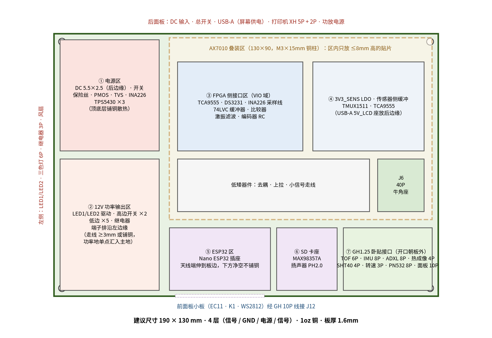

*图 18-1  建议布局（俯视）*

- **四层板**：L1 器件、信号、功率铜；L2 连续完整 GND；L3 电源分区及少量信号；L4 信号、辅助铜。
- 输入、降压器、打印机和 LED 功率输出集中在功率区；AX7010 接口、IMU 接收和 RTC 位于低噪声区域。
- 保持完整地平面，不在数字信号回流路径下切割 GND；大电流回流通过位置和铜宽控制，避免穿过敏感区域。
- TPS5430 输入电容、芯片、续流二极管形成的高频回路最小；PH 铜面积适量；反馈走线远离 PH、电感和 LED 开关节点；PowerPAD 按手册打散热过孔。
- ESP32 天线区域遵守开发板天线净空要求；NFC 天线远离金属和功率电感。
- GH 卧贴座统一放在板边、开口朝外，两侧固定脚焊满；同一束线的座子相邻摆放。
- 40P 排线尽量短；外接 SPI 先用短线验证。输入 5A 路径用宽铜或铺铜，按实际层叠、温升和过孔参数计算。
- 给 12V、三路 5V、各 3.3V、FPGA_READY 及关键中断信号留测试点。

## 19  首板验证顺序

1. 不接模块，验证输入极性、保护及静态电流。
2. 分别验证三路 5V 的空载、负载、启动和纹波（2A 假负载用 2.5Ω、≥20W 电阻；满载散热用测温判断，不用手摸）。
3. 验证各路 3.3V 及缓冲器默认关闭状态；用 JP 跳线逐个强制使能，确认通路。
4. 接 AX7010 与 AN5642，确认启动、视频和 HDMI 显示。
5. 接屏幕独立供电及 USB 触摸，确认 Linux 识别触摸设备。
6. 调通 FPGA_READY、RTC、TCA9555、INA226；确认重载 Overlay 时缓冲器自动禁用。
7. 调通 TOF、IMU、热成像及温湿度；I2C2 从 400kHz 升到 1MHz。
8. 调通 ESP32 UART、SD、NFC、语音；**测试 PN532 与 SD 卡共存**。
9. 单独测打印机上电、走纸、普通文本和大面积黑色打印的电流。
10. 测激振功放的扫频输出和电流。
11. 最后测“相机 + 屏幕 + 补光 + 打印 + 语音”和“相机 + 屏幕 + 补光 + 激振”两种组合负载，观察 12V、5V_AX 是否跌落、是否复位。

## 20  待确认事项

| 事项 | 需要补齐的内容 |
|---|---|
| 打印机 | 峰值电流、5P 口 VCC 含义、CTS 有效电平和脚序、电源座型号 |
| TOF 模块 | 实际芯片型号、VIN 范围及电平转换电路 |
| 热成像模块 | VIN 是否经过 LDO、SCL/SDA 上拉到哪一路电源；BAA 还是 BAB |
| PN532 模块 | SPI 模式下 MISO 是否正常释放；拨码定义 |
| 触摸屏 | PYNQ 内核是否已支持 HID 多点触摸 |
| EC11 | 每圈脉冲数、是否带按压开关、安装尺寸 |
| 测振目标 | 目标频率范围、相机分辨率和实际采集帧率 |
| 机械连接 | AX7010 电源插头、打印机线束、GH 线缆长度和各模块连接器尺寸 |
| 功放模块 | 输入阻抗、增益、供电电流 |

按本方案可分页绘制：输入电源、三路降压与 3.3V、主控接口与电源域、传感器、ESP32 外设、打印机、面板与报警、激振。核心供电与信号架构已经确定，上述未确认项会影响相应接口的最终接线和功率验收。
