# 屏幕、触屏与编码器操作说明

屏幕和触屏由 AX7010 的 PS/Linux 程序 vibmond 控制（`src/ui`），输出到 framebuffer `/dev/fb0`，触摸读 `/dev/input/event*`。EC11 和 K1 由 PL 译码后经事件 FIFO 上报。下列截图均为主机用合成数据渲染（`tests/test_render.cpp`），不是上板截图。

## 布局

1024×600 深色界面：顶部状态栏，左侧六个页面导航，右侧内容区。状态栏从右到左显示时间（未校时为黄色 `--:--:--`）、电压电流（掉电预警变红）、网络、当前测点、激光开启时的红色“激光”和预警/报警（静音后显示静音图标），这几项以着色标签显示；左侧为“见微”和当前页名。界面约 8 帧/秒刷新，手指按下时立即重画按下效果；界面刷新率不是相机采样率。

| 页面 | 内容 |
|---|---|
| 实时 | 相机预览（全分辨率，相机有彩色时为彩色；缩小显示取最近像素保持清晰，放大时双线性；相机区域在整页重绘之间单独刷新；左下角显示画面像素和帧率，测量中另显示每帧处理时间，超过一帧间隔时为黄色）、可拖动和拉伸的测点框/十字准星、采集状态、启用声学麦克风时其旁的麦克风电平（dBFS；启动中显示“麦克风启动”，故障显示“麦克风故障”，点按显示原因）、显示缩放 −/＋/复位（放大后拖动画面平移）；实时位移曲线和峰峰值；大号开始/停止按钮，带采集进度环，旁边显示采集进度，或位移方向与标定状态（多点方式显示停机基线状态）；测量时长 5/10/30/60 s；实时位移、相关度、帧率、工作距离；照明（J301）、十字投影（J304）、报警静音、振动热力叠加，输出打开时按钮着色 |
| 结果 | 主频、峰峰值、有效值、判级四张卡片（判级卡附预警/报警阈值；单框测量的谱峰不够突出时主频显示“无明确”，幅值谱标“最大峰 … 不明确”，打印为“无明确主频”）；时间和测点，有丢帧或未标定时追加提示，多点测量的代表测点波形没通过检查时注明原因（记录里其峰峰值、有效值为空），有声学记录时追加声学包络频率及其与视觉主频的关系（一致为绿色，倍频或不同为琥珀色）；位移波形和幅值谱（标出主频），有声学包络谱时右上角可切换“位移谱/声学包络”（包络谱同时标出声学与视觉频率）；打印报告、再测一次。从记录页进入时显示该条记录，并有“返回记录” |
| 视觉 | 三种显示：运动放大（原始/放大并排）、振动热力（带通幅值伪彩，标出最强振动点）、双目深度（深度伪彩、近远色标、点按查看距离、测点处距离，没有深度处透出暗化的左目画面；可在此开关十字线投影，并按已知距离校正）。可选频带 0.5–2/2–5/5–10/10–20 Hz 或跟随主频（需要上次测量有明确主频），放大 ×5/×10/×20/×50（只用于运动放大，其他显示下为灰色）；右侧显示处理图像的像素、帧率和每帧处理时间（超过一帧间隔时为黄色）；滤波预热和测量期间暂停时在放大画面左上角提示 |
| 记录 | 本机保存的测量记录，新的在前，每页 8 条，显示时间、测点、主频（不明确时为“无明确”）、峰峰值、有效值（未知时为“—”）、判级；点一行打开结果页 |
| 设备 | 16 块状态卡：PL 载板、电源监测、负载控制、时钟、相机、Nano、Wi-Fi、语音 SD、NFC、打印机、IMU、参考加速度计、测距、温湿度、风扇与转速、照明与激光（含 SW301 是否允许）；整机电源条（标出预警和禁止大负载阈值）；声学麦克风（就绪/采集中/启动中/未接入/故障，电平、采样率、L/R 或原因；位流不含接收核或读不到麦克风数据时为“未接入”，实时页此时不显示麦克风标签）；应用/PL/Nano 版本 |
| 设置 | 测量时长、测点框尺寸（32/48/64/96 方形预设，拖成其他尺寸时显示当前宽×高）、位移方向、测量自动照明、照明亮度、测量时关闭激光、峰峰值预警/报警（mm）、蜂鸣器、语音及音量、风扇模式、前面板灯亮度；Wi-Fi 配置（屏幕键盘）；关机（需确认） |

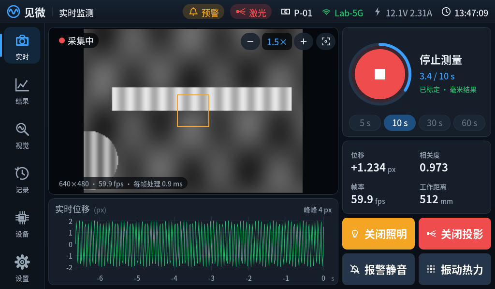
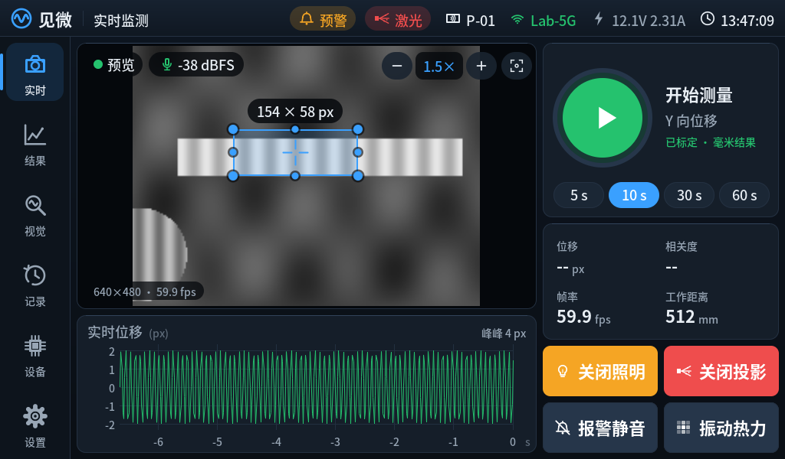
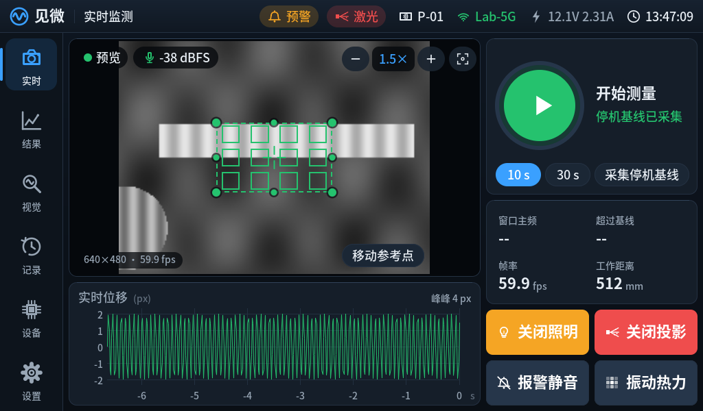
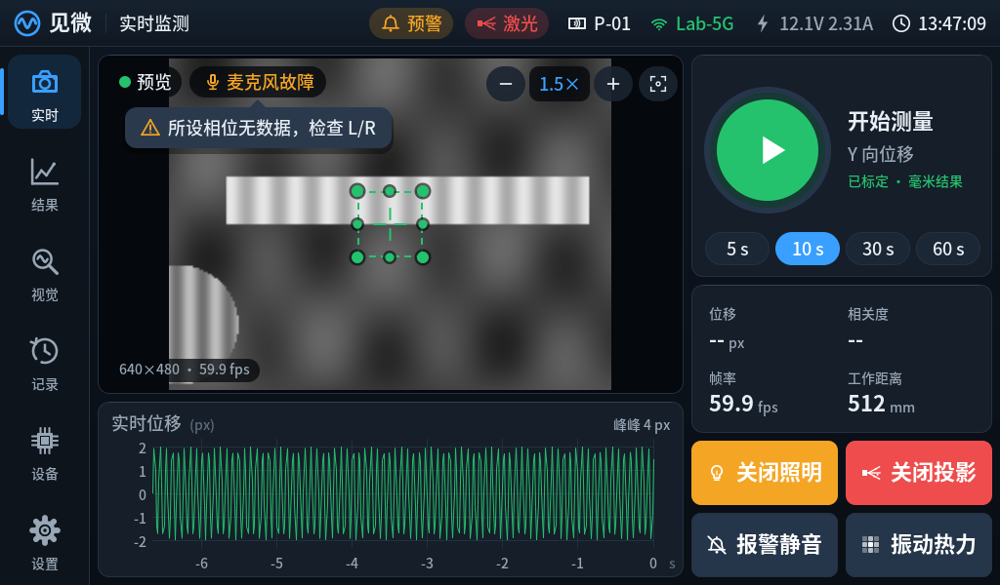
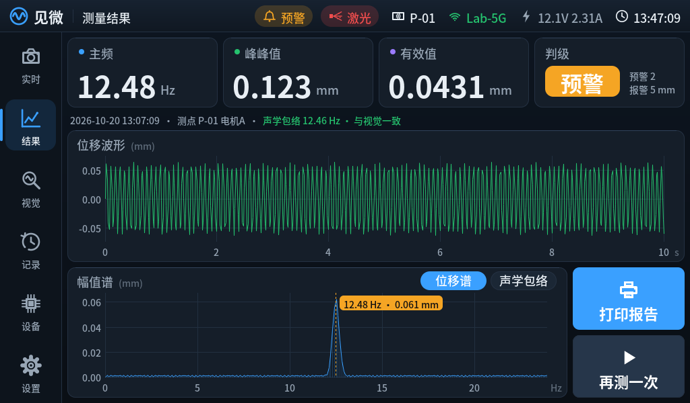
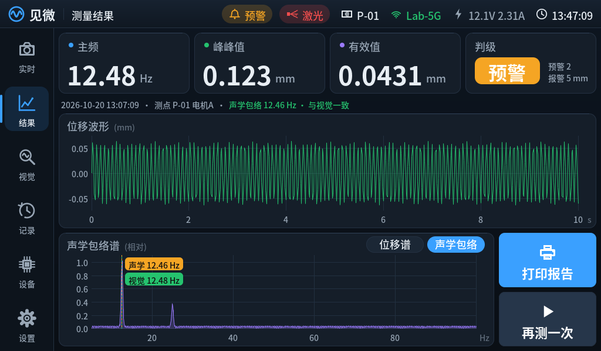
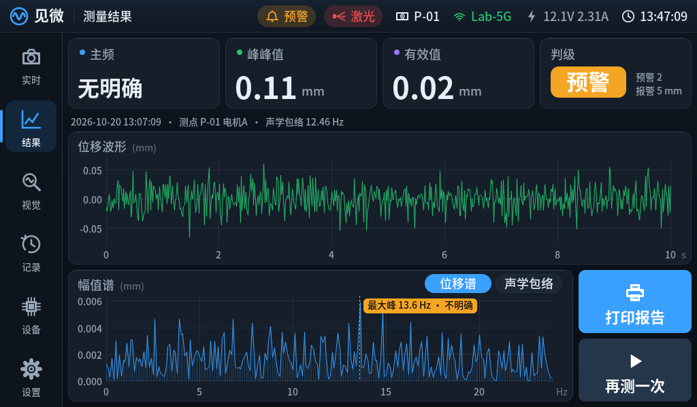
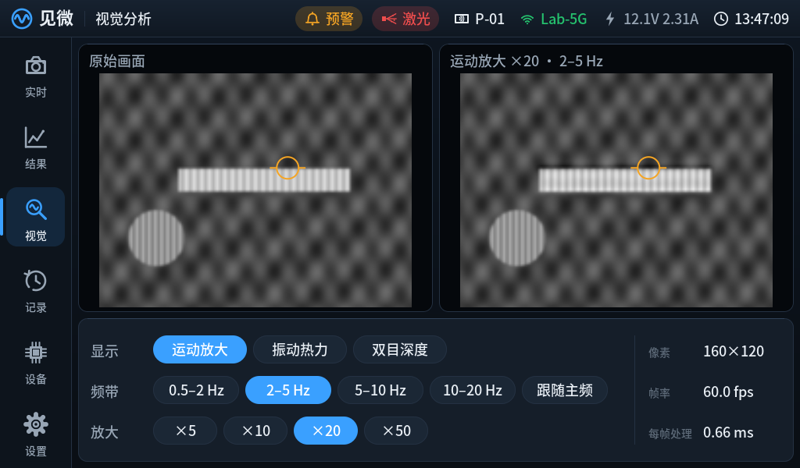
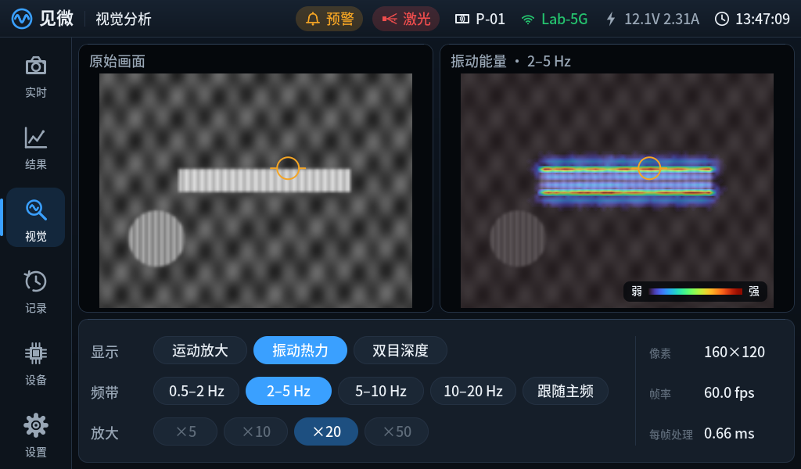
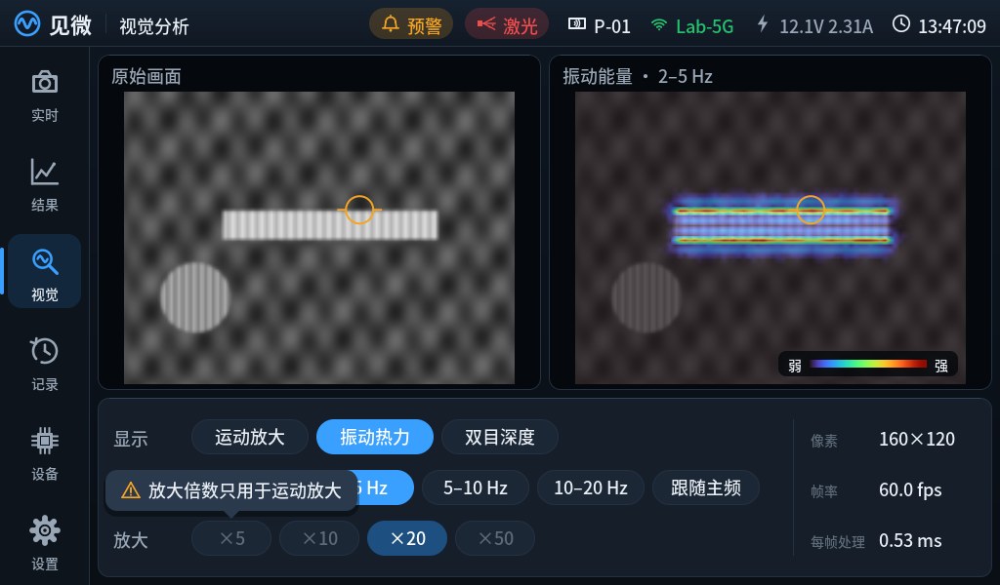
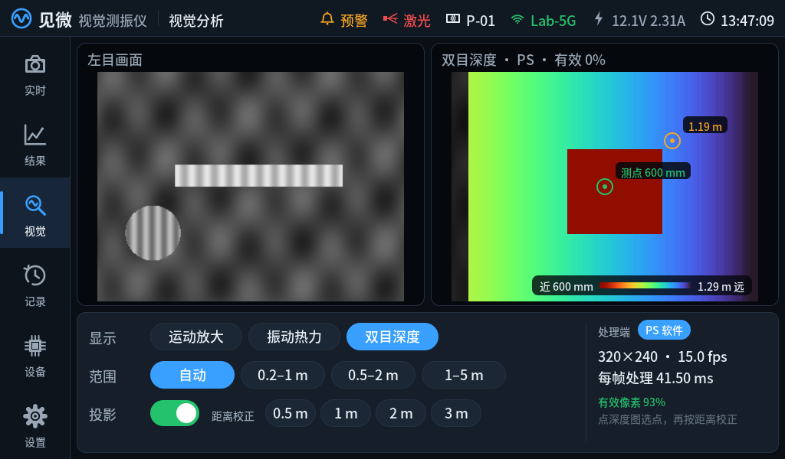
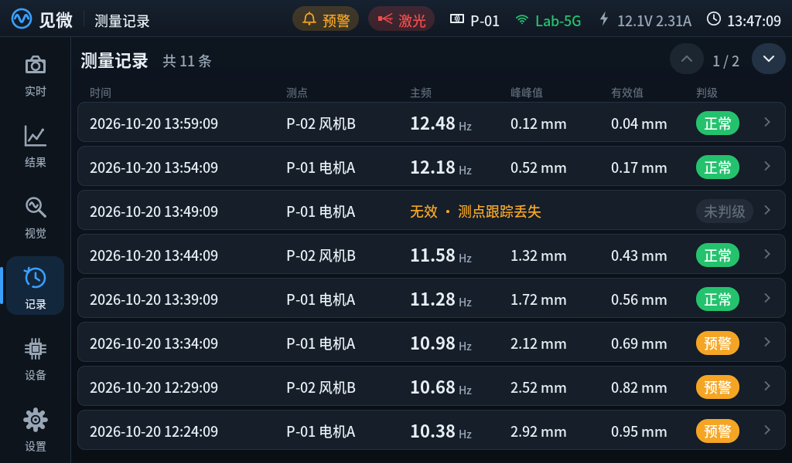
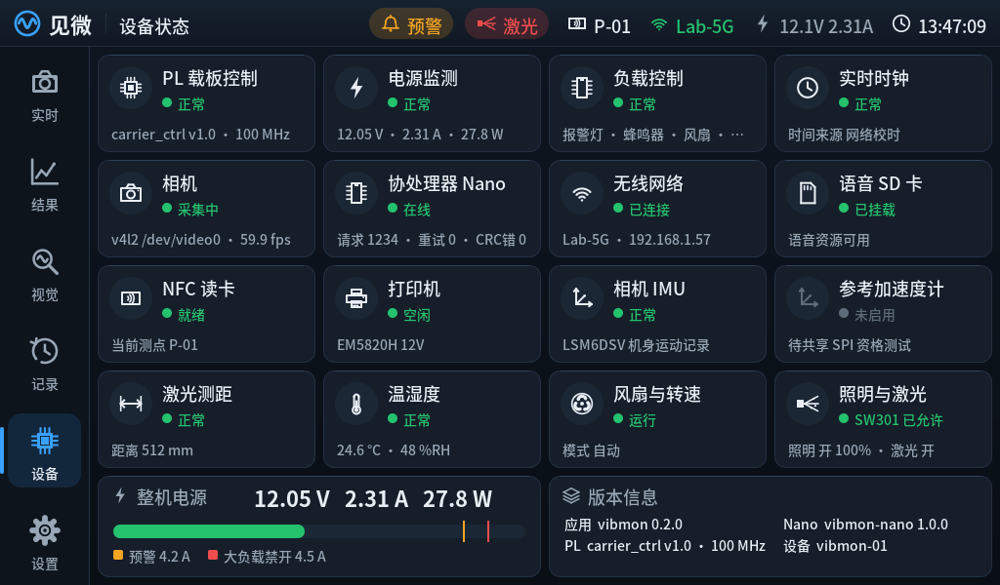
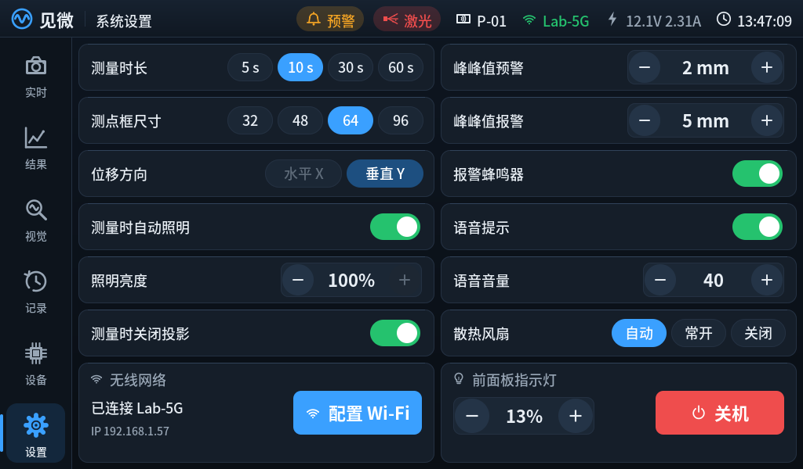
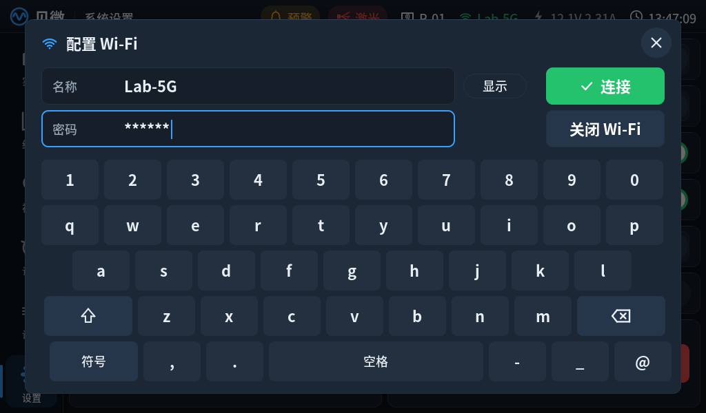
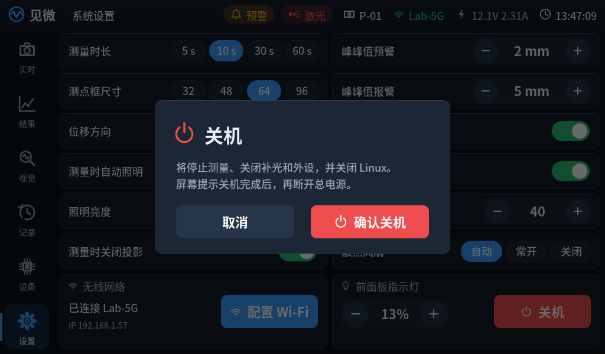

## 触屏

点按在手指抬起时生效，且必须在按下位置附近（24 像素内）抬起；左右滑动超过 140 像素切换上一页/下一页（对话框打开时不切换）。灰色控件不执行动作，点按时在控件旁弹出原因（如“测量中不能修改时长”“放大倍数只用于运动放大”“需先在电机停机时采集基线”），约 2.5 秒或下一次触摸时消失；所有动作走 `Application::command()`，与 vibmonctl 相同，主控仍会再次检查互锁。命令被拒绝时底部提示原因（如“相机未就绪”“打印机工作中”）。

实时页预览中的测点框（绿色虚线，四角和较长边的中点有圆点）可以直接拖：按住框内拖动是移动；按住边或角拖动是调整宽高，对边保持不动，框外约 28 像素内也能抓住边角。宽、高下限 16 像素，上限 256 像素；单框方式用 LK 跟踪器时上限 64 像素（跟踪核最多 64×64 像素），设置页超过上限的尺寸按钮变灰，旧设置里更大的框启动时会被裁到上限。框不会拖出画面。拖动时框变蓝并显示宽×高像素，松手后生效，尺寸写入设置文件；从框上开始的滑动只拖框，不翻页，只点一下框不改动。点按框外的画面，或在视觉页的放大/热力图上点按，会把框中心移到该处，尺寸不变。采集和计算期间不能改。画面缩放后拖动和点按都换算回原图坐标，放大后便于细调；放大后在测点框以外的画面上拖动是平移视野（采集中也可以，只改变显示，视野不出画面），不放大时在画面上左右滑动仍是翻页；显示缩放和运动放大都不参与毫米换算。

多点测振方式（`measurement.method` 为 `multipoint`，AN5642 板卡配置默认）在测点框里按 32 像素间距布 25×25 的网格测点（绿色小方块，默认最多 12 个），另有 2×2 共 4 个背景参考点（琥珀色小方块，默认在画面左下）。参考点必须落在不动的背景上，不能在被测板面、电机或测点框内；点“移动参考点”后，下一次拖动或点按画面改放参考点组，放好即回到编辑测点框（不放时再点一次取消），参考点位置随测点框一起写入设置文件。先在电机停机时点“采集停机基线”（默认 15 秒；没采成时提示原因：丢帧、采样间隔不均匀、参考点跟踪失败或测点跟踪丢失），基线文件按测点与参考点布局保存，开始按钮旁显示“停机基线已采集”；移动或缩放测点框、移动参考点后需要重新采集，没有对应基线时“开始测量”是灰色，点按提示先采集基线。随后开电机测量：实时数据显示最近 128 帧窗口的主频和超过基线的测点数，结果页显示主频、超过基线测点数和这些测点的像素 RMS（图像平面二维量，不换算毫米、不判级）；波形和频谱画的是超过基线最多的代表测点。布局不可用时（参考点出画面、落入测点框等）画面上方红字提示。

照明和激光是两路独立输出：照明可调亮度；激光固定 100% 输出、只开关。两路都需要 SW301 硬件允许，打印、掉电和关机时都会关闭。“测量时关闭投影”默认打开：开始测量时自动关激光、结束后恢复，因为固定投影图案不保证随被测表面平移，留在测点框内会把位移拉向零；只有在开始前做投影相关实验设置时才关掉这个选项；采集和分析期间不能更改，启用关闭策略时不能从实时页、视觉页或命令行重新开启投影。

设置页的修改立即生效，并保存到 `storage.settings_file`（默认 `/home/root/vibmon/settings.json`），下次启动时覆盖 vibmon.json 中的同名项。非法组合（如预警阈值不低于报警阈值）整体拒绝；采集中不能改时长、测点框和方向；已加载标定时位移方向由标定决定。Wi-Fi 名称和密码通过 SET_NET 交给 Nano 保存，主程序不保存密码。

## 编码器与独立按键

| 操作 | 功能 |
|---|---|
| EC11 旋转 | 实时页：显示缩放（每档 ×/÷1.25，1–8 倍）；记录页：翻页；其他页无动作 |
| EC11 短按 | 实时页：缩放复位；其他页：回到实时页 |
| EC11 长按 | 依次切换到下一页 |
| K1 短按 | 静音蜂鸣器并停止当前语音，保留报警等级灯 |
| K1 长按 | 默认 3 秒发起关机 |

没有屏幕（framebuffer 打不开）时，EC11 旋转和短按仍控制显示缩放。每档电气计数、方向可在 `panel.encoder_counts_per_detent`、`panel.encoder_reverse` 配置，顺/逆时针的最终对应需实物确认。

## 视觉页的数据来源

运动放大和振动热力来自视觉处理链（`src/measure/vision.cpp`）：相机灰度经高斯金字塔降采样到不超过 200 像素宽的工作图，对拉普拉斯带逐像素做时间带通。当前在 PS 上以独立线程运行；测量采集和计算期间暂停，不与位移跟踪争 CPU，页面显示“测量期间暂停”。同一算法的 PL 实现见 `ax7010/pl/vision`，接入后 status 的 `vision.backend` 为 `PL`（处理端只在 status 中给出）。放大画面只用于显示，不参与计量。

双目深度由双目模块通过 `Application::publishDepth()` 提供（毫米深度图，0 为无效，可附左目图像）；超过 3 秒没有新数据视为未接入，页面显示“双目深度未接入”。深度值整体偏大或偏小（远近关系正确）时，把有纹理的目标放在用卷尺量好的距离上，点按深度图上的目标（不点则用测点框中心），再按“距离校正”里对应的 0.5/1/2/3 m：程序取该点 9×9 范围实测视差的中位数，算出两镜头的水平偏心量，平移右图后写回双目标定文件，从下一对图像起生效（标定号以 `-dist<毫米>` 结尾，偏差超过 80 像素拒绝），底部提示是按选点处还是测点处校正的。按新标定算出的深度图出来之前再次校正会被拒绝（提示“上次校正尚未生效”），同一偏差不会被减两次。

## 尚未验证

实体屏幕的 framebuffer 格式、触摸设备识别、方向与边缘精度、ARM 上的刷新耗时，以及 PS 视觉线程在 AX7010 上的实际每帧耗时，都需上板确认。
