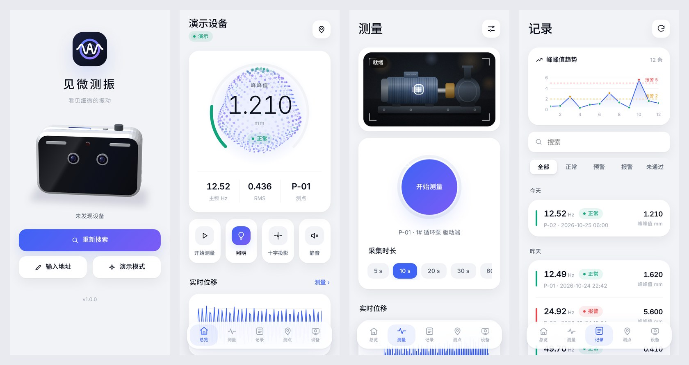
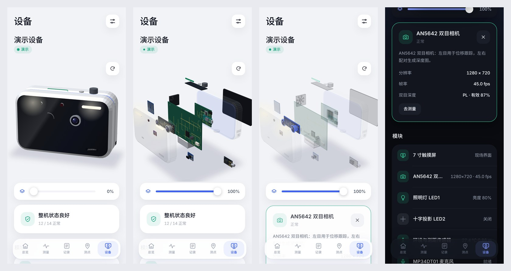

# 见微测振 手机 APP（2026-10-25）

配套见微视觉测振仪的 Android APP，以及为它新增的设备侧接口：AX7010 局域网 API 和 Nano ESP32 Wi-Fi 网关。

- 安装包：[`06_软件与FPGA/mobile_app/dist/JianweiVibro-1.0.0.apk`](../06_软件与FPGA/mobile_app/dist/JianweiVibro-1.0.0.apk)（约 630 KB，Android 7.0 及以上，v2 签名）
- 源码：[`06_软件与FPGA/mobile_app`](../06_软件与FPGA/mobile_app)
- 截图：[截图](截图)，用演示模式在 390×844 手机视口中渲染




## 1. 功能

| 页面 | 内容 |
|---|---|
| 连接 | 3D 产品模型首屏；UDP 广播搜索设备，同时探测网关固定地址 192.168.4.1 和最近用过的设备；可手动输入地址；**演示模式**不需要硬件 |
| 总览 | 动态粒子球与环形表：粒子沿球面传播的波纹随主频变化，颜色随判级变化；中心显示峰峰值、判级、主频、RMS 和测点。还有四个快捷键（测量、照明、十字投影、静音）、实时位移曲线、环境数据（温湿度、测距、功率）、最近记录，报警与预警横幅可一键确认 |
| 测量 | 相机实时画面（局域网直连）带取景框和测量框，点按画面即可移动测量框；开始/结束按钮带进度环；采集时长 5–60 s；照明亮度与十字投影开关；实时位移曲线可触摸读数；多点测振的停机基线采集；上次结果卡片 |
| 记录 | 峰峰值趋势（标出预警/报警线），可搜索，按判级筛选，按日分组。详情页有时域波形、频谱（标注峰值）和 **3D 时频瀑布图**（由波形做短时 FFT，可拖动旋转），还有质量指标、采集条件，以及打印报告、导出 CSV/JSON 到「下载」、分享摘要 |
| 测点 | 当前测点（NFC 或手动切换），按判级统计；测点列表带趋势小图；测点详情含峰峰值趋势、主频变化和历史记录，可一键设为当前测点并开始测量 |
| 设备 | **3D 数字孪生**：可旋转（带惯性）、双指缩放；**滑动条无级调节爆炸程度**，外壳先打开，内部各层依次飞出；点击任一部件高亮并显示实时状态与操作。14 个模块：触摸屏、AX7010、主载板、双目相机、照明、十字投影、ESP32、NFC、传感器、麦克风、前面板、打印机、电源、风扇；指示灯条按判级变色，风扇运行时叶片转动，屏幕显示实时波形。另有模块列表、系统数据、测量与报警设置、网络与 Wi-Fi（网关扫描、热点开关与密码）、用手机时间校准设备时钟、测试提示音、切换设备、安全关机 |
| 设置 | 采集时长、测量方向、报警阈值、蜂鸣器、自动照明与亮度、测量时关闭投影、语音与音量、状态灯亮度、风扇模式；外观**浅色（默认）/ 深色 / 跟随系统**；自动校准设备时间 |
| 关于 | 版本、隐私政策、用户协议 |

交互：底部标签栏指示器随切换滑动；左右滑动切换标签页，页面跟手移动；详情页从左边缘右滑返回；Android 返回键先关闭弹层或详情页。新结果出现时会提示，预警/报警时手机振动、记录标签显示红点；采集期间屏幕保持常亮。

设计：浅色为默认的瓷白中性色，配钴蓝到紫的单一强调色，卡片用柔和阴影而不加描边。字体为内置的 Inter（数字与西文，等宽数字）和 Noto Sans SC 子集（400/500/700，只含 APP 用到的约 540 个汉字，共约 210 KB，其他字符回落到系统字体），两者均为 SIL OFL 1.1 许可。3D 效果全部用 Canvas 2D 自绘，不依赖 WebGL 或第三方库，可离线运行。

## 2. 连接方式

| 方式 | 适用 | 功能 |
|---|---|---|
| 局域网直连 AX7010 | 设备网口与手机接同一路由器 | 全部功能：实时画面、实时波形、完整记录与原始文件、移动测量框、为 Nano 配网 |
| ESP32 Wi-Fi 网关 | 现场无路由器：手机连设备热点 `VIBMON-xxxx`（默认密码 `vibmon2026`，地址 192.168.4.1）；ESP32 也可同时连现场 Wi-Fi | 状态、启停测量、照明/投影/静音、测点、设置、最近 6–8 条记录与最新一次曲线（每条约 48 点）、网关自身的 Wi-Fi 配置；不含相机画面和原始文件 |

按用户要求，设备与 APP 仅供私下使用，不考虑公网攻击者。**默认不配对**，同一网络内直接连接；如需要，可在 vibmond 设置 `app_api.require_pairing=true`，此时 APP 请求配对码，设备屏幕显示 6 位码（120 s 有效，连错 5 次作废），APP 输入后获得令牌，令牌保存在 `app_tokens.json`。

## 3. 接口（API v1）

两种连接使用同一套 JSON 接口，前缀 `/api/v1/`，响应为 `{"ok":true,"data":…}` 或 `{"ok":false,"error":"…"}`，并带 CORS 头。

| 方法 路径 | AX7010（端口 8080） | 网关（端口 80） |
|---|---|---|
| GET info | 设备号、名称、版本、端口、是否需配对 | 同左，另含 `ax_online` |
| GET live | 精简实时状态（与网关同一结构，见下），附最近 300 个位移采样 `wave`（像素，乘 `mmpx` 为毫米） | AX 每 2 s 或状态变化时推送的快照，另含 `gw.age_ms`、`gw.ax_online`（快照超过 8 s 视为离线） |
| GET status / settings / points | 完整 `status`、设置、NFC 测点表 | live 快照、设置、测点 |
| POST command `{"cmd":…}` | 同步执行，白名单：measure_start、baseline_start、measure_stop、light、laser、mute、set_point、print、voice、set、rtc_set、zoom_reset、status、settings、roi、nano_status、set_net、shutdown、stereo_distance | 返回 202 `{"cid"}`，经 APP_COMMAND 事件转给 AX；用 GET command/<cid> 轮询结果（15 s 超时）。白名单同左，但不含 status、settings、roi、nano_status、set_net、stereo_distance |
| GET records、records/<id> | 记录列表；详情为 record.json＋抽稀后的波形（保留包络）与频谱（保留峰值），默认 ≤2000 点 | 最近记录；仅最新一次测量有曲线（`partial:true`） |
| GET records/<id>/files/<name> | 原始 record.json / waveform.csv / spectrum.csv / acoustic.wav | — |
| GET preview.bmp?w= | 相机预览（24 位 BMP，≤640 宽） | — |
| GET/POST net、GET net/scan | — | 站点与热点状态；连 Wi-Fi `{ssid,password}`、热点 `{ap_enabled,ap_password}`；异步扫描 |
| POST pair/request、pair、unpair | 仅 `require_pairing` 时使用 | — |

设备发现：向 UDP 48300 端口发送 `VIBMON_DISCOVER`，AX 与网关各自单播回复 info 的 JSON。网关另有 mDNS `vibmon-xxxx.local`（服务 `_vibmon._tcp`）。

live 字段：`dev ver ms el dur cam method bl roi[cx,cy,w,h] cal unit lv mute light{on,pct,ok} laser pt{id,name,uid} pwr{v,a,w,warn,pf} tc rh dist tach fan prn msg tv utc nano{on,wifi,ip,sd,nfc} st{on,be,vf} ac set{dur,warn,alarm,axis} last{id,ok,why,u,hz,clr,amp,pp,rms,lv,saved,ac_hz} fps fw fh mp{win,hz}`；不含 wave 时不超过 900 字节，可装入一帧协议。

### 协议 V1.1 扩展（PS↔Nano，`shared/vibproto`）

| 方向 | 操作码 / 事件 | 载荷 |
|---|---|---|
| AX→Nano 请求 | `PUBLISH 0x60` | `{"topic":"status"|"settings"|"points"|"records"|"curves","data":{…}}`，每个主题一帧（≤900 字节）；Nano 只缓存最新一份 |
| AX→Nano 请求 | `COMMAND_RESULT 0x62` | `{"cid","ok","error"?,"data"?}`（data ≤600 字节） |
| Nano→AX 事件 | `APP_COMMAND` | `{"cid","cmd","args":{…}}`，args ≤240 字节（事件上限 384 字节） |
| Nano→AX 事件 | `APP_CLIENT` | `{"client":"192.168.4.2"}`：新手机接入时，设备屏幕提示「手机APP已连接」 |

Nano 在 HELLO 的 capabilities 中声明 `app_gateway`；AX 只向声明了它的固件发布。旧固件不受影响，AX 不发布即可。新会话或 Nano 重启后，AX 重新发布全部主题。新操作码同样经过序号重放缓存，重试不会重复执行。

## 4. 代码改动

- **AX7010 vibmond**（新增，不改测振与双目算法）：
  - `src/app/http_server.*`：事件循环上的极简 HTTP/1.1 服务器，非阻塞写、超时清理。
  - `src/app/app_api.*`：路由、可选配对、UDP 发现、记录抽稀、BMP 预览。
  - `src/app/app_remote.cpp`：liveJson、向网关发布、处理 APP_* 事件。
  - 配置新增 `app_api` 和 `app_gateway` 两段（见 `config/vibmon.json`）。
  - 修复：新的 API 层按状态枚举输出判级代码（最初的映射值错误，已用测试覆盖）。
- **Nano ESP32**：
  - `app_gateway.*`：可移植核心，含主题缓存、命令转发与超时、HTTP 路由，主机可测。
  - `http_gateway.*`：WebServer、UDP 发现与 mDNS。
  - `net_service`：同时开热点和站点（AP+STA），热点固定 192.168.4.1，支持异步扫描。
  - `settings`：保存热点开关与密码。
  - `router`：处理 0x60/0x62，HELLO 声明 app_gateway。
  - USB 控制台：`ap on|off`、`ap pass <密码>`。
  - 固件版本升为 0.2.0。
- **APP**（`mobile_app`）：
  - `web/`：界面，无构建步骤，桌面浏览器直接打开 `web/index.html` 即可预览演示模式。
  - `android/`：Java 外壳与资源。
  - `tools/`：图标、字体与 APK 构建脚本。

## 5. 构建 APK

```bash
cd 06_软件与FPGA/mobile_app
tools/build_apk.sh          # -> dist/JianweiVibro-<版本>.apk
```

构建不需要 Android SDK，全部用 Maven Central 上的构件：apktool-lib 3.0.3 中的 aapt2 与 framework 资源、dalvik-dx 16.0.1、apksig 2.3.0，以及 Robolectric android-all 14（API 34 类库，仅用于编译）。另需 JDK 17 或更高版本、python3、curl、unzip。

签名密钥 `android/keystore/release.p12` 在首次构建时生成，不提交到仓库。之后的构建必须使用同一把密钥，才能覆盖安装；本次的 APK 由云端生成的密钥签名，以后在本机重新构建会生成新密钥，需要先卸载旧版再安装。应用商店上架需要换成正式密钥和 AAB 格式。

图标和字体的源脚本是 `tools/make_icons.py` 与 `tools/make_fonts.py`（需要 Pillow 与 fonttools）；界面新增中文后，需重新运行 make_fonts。

## 6. 验证

| 项目 | 结果 |
|---|---|
| vibmond 主机单测 | 12 组全部通过 |
| 应用集成检查（`tests/test_app_host.py`） | 103 项通过（原 65 项，新增 38 项）。覆盖 UDP 发现、可选配对与令牌、CORS、live 字段与 900 字节上限、命令白名单、经 APP 测量、记录列表与详情、抽稀后频谱保留 9 Hz 峰、CSV 下载、路径穿越拒绝、BMP 预览、取消配对、默认免配对。另用 pty 模拟 Nano 网关验证：HELLO 声明 app_gateway、各主题发布、APP_COMMAND 执行与回复、不在白名单的命令被拒、APP_CLIENT 提示、经网关测量后曲线保留 7 Hz 峰，且每帧 ≤1024 字节 |
| 冒烟测试、协议 4＋300 向量 | 通过 |
| ARM 交叉编译 vibmond（静态，Cortex-A9） | 无警告 |
| 网关核心主机测试（`nano_esp32/test/test_app_gateway.cpp`） | 通过：离线 503、快照与 age、陈旧判离线、新客户端只提示一次、命令转发/完成/超时、坏 JSON 与过大参数、记录与 lan_only、网络钩子、新会话清空 |
| Nano 改动的 Arduino 源 | 只用主机桩头文件做语法检查（net_service、http_gateway、settings、router、app_gateway）。云端无法下载 Xtensa 工具链，**未做真实板包编译** |
| APK | aapt2 读取包信息：com.jianwei.vibro 1.0.0，minSdk 24，targetSdk 34；apksig 校验 v2 签名通过 |
| 界面 | 在 Chromium 手机视口中走查各页面（演示模式，浅色/深色），无脚本错误 |

## 7. 未验证与限制

- **未在 Android 真机或模拟器上运行**；WebView 内 UDP 广播、保存到「下载」、状态栏配色和返回键需在手机上确认。
- **未与 AX7010 板子或 Nano 实物联调**；局域网 API 只在 x86 主机上用合成相机测试。
- Nano 固件需在本机用 `build_nano.ps1` 完整编译和烧录；`bin/` 中仍是旧固件，不含网关。
- 热点与站点同时开启时，站点重连的扫描会让热点短暂掉线；现场无路由器时，可不配置站点 Wi-Fi。
- 网关只传压缩的快照与最新一次曲线；完整历史、实时画面和原始文件需局域网直连。
- 演示模式数据是合成的，只用于展示界面，不代表任何测量结果。

## 8. 云端进度（2026-10-25 本次开始时）

`main` 为 a01fed8，冻结标记 `freeze-20261025-capture-near-stereo`，当前事实见 [冻结说明](../04_评审与核对/2026-10-25_冻结_彩色与近景双目/冻结说明与当前事实.md)：
- 板上运行程序 SHA256 e3e94a0d…；
- 4 测点 4 参考 45 fps 采集，同帧彩色；
- 双目 256×144，PL 两段视差搜索，约 1.7 fps，该场景真实有效约 37%；
- 12 组单测和 65 项集成检查通过；
- 20 cm 近景尚未验收，尚未做真实棋盘格标定；
- MP34DT01 声学模块的代码已实现，麦克风未接。

远端另有只含 Python 原型的 `feature/acoustic-10-100hz-20261022`，未合并。冻结说明要求冻结后不再改代码；本次按用户新要求只新增 APP 与通信接口，测振、双目与声学算法未改动，PL 位流未变。
